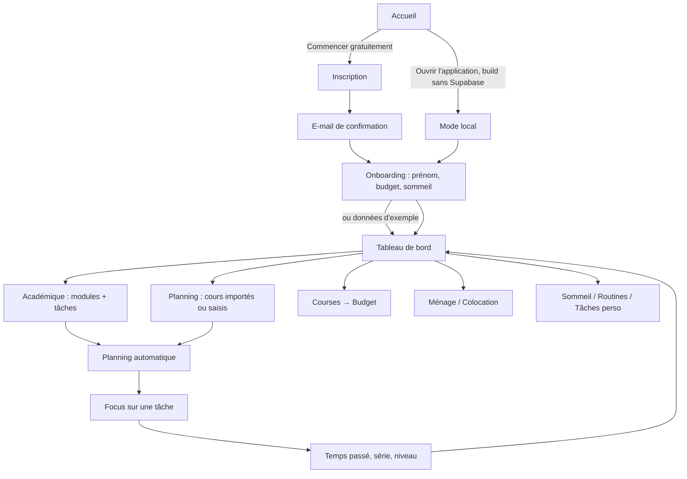
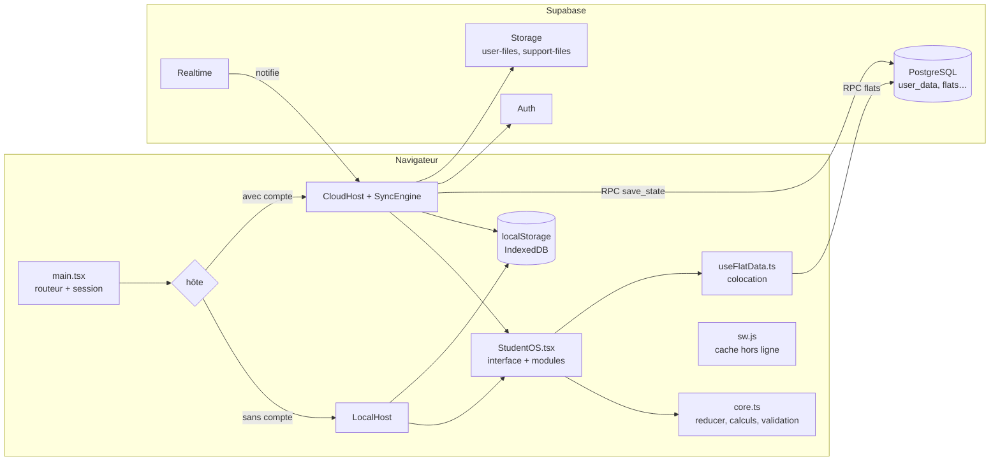
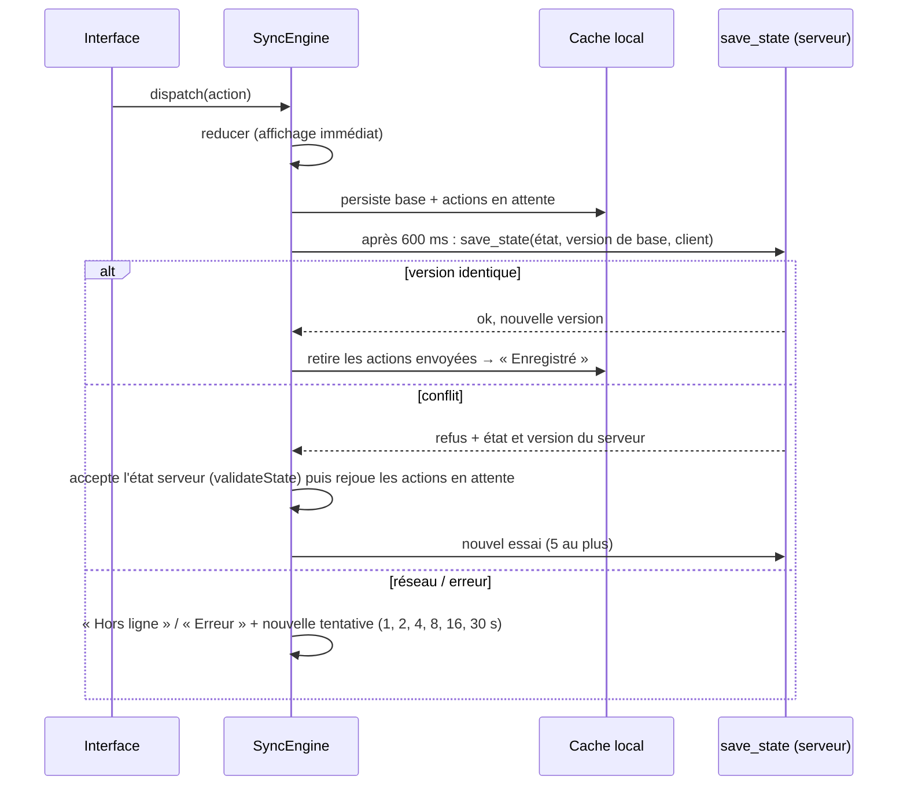
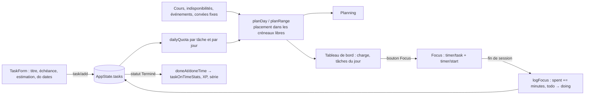
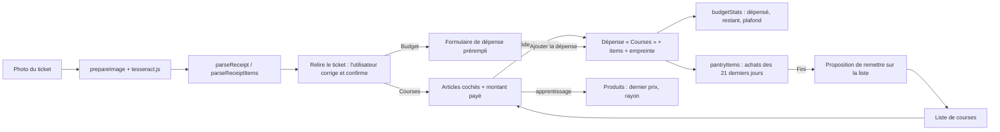
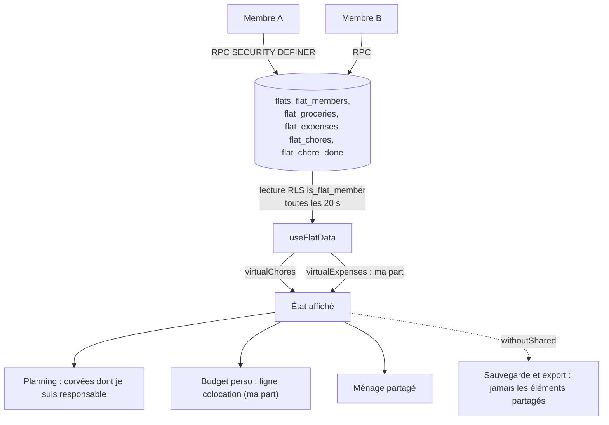

# Étudiant.OS — Documentation complète

| | |
|---|---|
| **Produit** | Étudiant.OS (PWA d'organisation étudiante) |
| **Dépôt** | `https://github.com/Fedizzz/etudiant-os` |
| **Site** | `https://fedizzz.github.io/etudiant-os/` |
| **Branche documentée** | `fix/receipt-scanner` (arbre de travail propre) |
| **Date** | 23 octobre 2026 |
| **Version du `package.json`** | 2.0.0 (version affichée dans les infos techniques de support : 2.1.0) |
| **Méthode** | lecture du code source de `src/`, de `supabase/`, de `scripts/`, de `public/`, de `tests/` et des documents existants ; exécution ciblée de tests (voir [§26](#26-tests)) |

## Comment lire ce document

- **Source de vérité : le code.** Aucune fonctionnalité n'est décrite comme disponible sans avoir été trouvée dans le code ; ce qui n'existe pas est dit explicitement (❌) et ce qui est du code sans interface est marqué 🔧.
- **« à vérifier »** signale ce que la lecture du code ne permet pas de conclure (comportement en navigateur, configuration de production, appareils réels).
- Les chemins de fichiers sont relatifs à la racine du dépôt ; `≈ l. N` indique une ligne approximative.
- Aucun secret, mot de passe, jeton ni adresse d'administrateur n'est reproduit ici.
- Ce document **n'a modifié ni le code ni la configuration** de l'application.

## Table des matières

- **[PARTIE I — Présentation générale](#partie-i--présentation-générale)**
  - [1. Concept, public, valeur](#1-concept-public-valeur)
  - [2. Vue d'ensemble des modules et de leur état](#2-vue-densemble-des-modules-et-de-leur-état)
  - [3. Parcours utilisateur type](#3-parcours-utilisateur-type)
- **[PARTIE II — Design system, responsive et accessibilité](#partie-ii--design-system-responsive-et-accessibilité)**
  - [II.1 Direction artistique](#ii1-direction-artistique)
  - [II.2 Couleurs](#ii2-couleurs)
  - [II.3 Typographie](#ii3-typographie)
  - [II.4 Formes, bordures, ombres, espacements](#ii4-formes-bordures-ombres-espacements)
  - [II.5 Composants (primitives de `src/StudentOS.tsx`)](#ii5-composants-primitives-de-srcstudentostsx)
  - [II.6 Animations](#ii6-animations)
  - [II.7 Responsive](#ii7-responsive)
  - [II.8 Accessibilité](#ii8-accessibilité)
- **[PARTIE III — Pages, écrans et modales](#partie-iii--pages-écrans-et-modales)**
  - [III.1 Coque de l'application (navigation, en-tête, menu mobile, toasts)](#iii1-coque-de-lapplication-navigation-en-tête-menu-mobile-toasts)
  - [III.2 Tableau de bord (`view = "dashboard"`)](#iii2-tableau-de-bord-view--dashboard)
  - [III.3 Palette de commandes et raccourcis clavier](#iii3-palette-de-commandes-et-raccourcis-clavier)
  - [III.4 Premier lancement (`Onboarding`)](#iii4-premier-lancement-onboarding)
  - [III.5 Modales de tâche (« Nouvelle tâche » / « Modifier la tâche ») et aide](#iii5-modales-de-tâche--nouvelle-tâche----modifier-la-tâche--et-aide)
  - [III.6 Page « Planning » (`view = "planning"`)](#iii6-page--planning--view--planning)
  - [III.7 Page « Académique » (vue `academic`)](#iii7-page--académique--vue-academic)
  - [III.8 Page « Focus » (minuteur Pomodoro)](#iii8-page--focus--minuteur-pomodoro)
  - [III.9 Page « Sommeil »](#iii9-page--sommeil-)
  - [III.10 Page « Courses » (liste, « À la maison », scanner de ticket)](#iii10-page--courses--liste--à-la-maison--scanner-de-ticket)
  - [III.11 Page « Budget » (dépenses, revenus, épargne)](#iii11-page--budget--dépenses-revenus-épargne)
  - [III.12 Page « Ménage » (corvées)](#iii12-page--ménage--corvées)
  - [III.13 Page « Tâches perso » (vue `todos`)](#iii13-page--tâches-perso--vue-todos)
  - [III.14 Page « Routines » (vue `routines`)](#iii14-page--routines--vue-routines)
  - [III.15 Page « Colocation » et vues partagées](#iii15-page--colocation--et-vues-partagées)
  - [III.16 Page « Réglages »](#iii16-page--réglages-)
  - [III.17 « Mon compte », synchronisation et import des données locales](#iii17--mon-compte--synchronisation-et-import-des-données-locales)
  - [III.18 Page d'accueil (landing) et pages légales](#iii18-page-daccueil-landing-et-pages-légales)
  - [III.19 Pages d'authentification](#iii19-pages-dauthentification)
  - [III.20 Pages « Support » (utilisateur)](#iii20-pages--support--utilisateur)
  - [III.21 Espace administrateur (`/admin`)](#iii21-espace-administrateur-admin)
- **[PARTIE IV — Modules métier : règles et formules](#partie-iv--modules-métier--règles-et-formules)**
  - [6. Module académique (notes, moyennes, tâches)](#6-module-académique-notes-moyennes-tâches)
  - [7. Module planning — règles et formules](#7-module-planning--règles-et-formules)
  - [8. Module Focus (Pomodoro)](#8-module-focus-pomodoro)
  - [9. Module budget](#9-module-budget)
  - [10. Module ménage (corvées)](#10-module-ménage-corvées)
  - [11. Module sommeil](#11-module-sommeil)
  - [12. Tableau de bord, calculs et gamification](#12-tableau-de-bord-calculs-et-gamification)
  - [13. Recherche et commandes (palette)](#13-recherche-et-commandes-palette)
  - [14. Réglages et personnalisation](#14-réglages-et-personnalisation)
- **[PARTIE V — Documentation technique](#partie-v--documentation-technique)**
  - [15. Architecture](#15-architecture)
  - [16. Arborescence](#16-arborescence)
  - [17. Technologies et dépendances](#17-technologies-et-dépendances)
  - [18. Gestion de l'état](#18-gestion-de-létat)
  - [19. Stockage](#19-stockage)
  - [20. Backend (Supabase), authentification et données](#20-backend-supabase-authentification-et-données)
  - [21. Sécurité](#21-sécurité)
  - [22. PWA et service worker](#22-pwa-et-service-worker)
- **[PARTIE VI — Flux, relations et cas d'usage](#partie-vi--flux-relations-et-cas-dusage)**
  - [23. Diagrammes de flux de données](#23-diagrammes-de-flux-de-données)
  - [24. Relations entre modules](#24-relations-entre-modules)
  - [25. Cas d'usage](#25-cas-dusage)
- **[PARTIE VII — Tests, exploitation et limites](#partie-vii--tests-exploitation-et-limites)**
  - [26. Tests](#26-tests)
  - [27. Installation et lancement](#27-installation-et-lancement)
  - [28. Build et déploiement](#28-build-et-déploiement)
  - [29. Bugs connus, limites et hypothèses](#29-bugs-connus-limites-et-hypothèses)
  - [30. Glossaire](#30-glossaire)
  - [31. Index des fichiers](#31-index-des-fichiers)
- **[PARTIE VIII — État global du produit](#partie-viii--état-global-du-produit)**

---

# PARTIE I — Présentation générale

## 1. Concept, public, valeur

**Étudiant.OS** (nom de l'interface : « Étudiant OS ») est une application web (PWA) qui rassemble en un seul espace l'organisation de la vie étudiante : emploi du temps, devoirs et examens, sessions de travail (focus), budget, courses, ménage, sommeil, routines et tâches personnelles, avec un partage en **colocation**.

- **Public visé** : étudiant·es, seul·es ou en colocation (formulation de la landing : « Pour les étudiants, par des étudiants »).
- **Idée centrale** : des modules qui **partagent les mêmes données**. Une tâche créée apparaît dans le planning (placée automatiquement dans les créneaux libres), dans le tableau de bord et dans le Focus ; des courses validées créent une dépense du budget ; le ticket de caisse photographié préremplit les deux.
- **Valeur** : moins d'outils dispersés, charge du jour visible, suivi du « à l'heure », fonctionnement hors ligne, données isolées par compte, gratuit (la landing indique qu'aucun moyen de paiement n'est demandé).
- **Modes** : local (aucun compte, données dans le navigateur) ou compte (synchronisation entre appareils via Supabase).
- **Adresses** : dépôt `https://github.com/Fedizzz/etudiant-os` ; site `https://fedizzz.github.io/etudiant-os/`.
- **Monétisation** : **non implémentée** dans le code (aucun paiement, abonnement ni publicité). Des pistes ont été discutées pendant le développement ; elles ne font pas partie du produit.

## 2. Vue d'ensemble des modules et de leur état

Légende : ✅ opérationnel (code lu, comportement vérifié par lecture et/ou exécution de la logique) · ⚠️ partiel · 🔧 logique sans interface · ❌ non implémenté.

| Module | Route | Mode | État | Remarque |
|---|---|---|---|---|
| Accueil, pages légales, 404 | `/`, `/confidentialite`, `/conditions` | tous | ✅ | textes légaux à compléter (placeholders) |
| Connexion / inscription / mot de passe | `/login`, `/signup`, `/forgot-password`, `/reset-password` | compte | ✅ | nécessite un projet Supabase |
| Tableau de bord | `/app` | tous | ✅ | 15 cartes personnalisables |
| Planning | `/app/planning` | tous | ✅ | import PDF et calendriers .ics, export PDF |
| Académique (tâches, modules, bloc-notes) | `/app/academique` | tous | ⚠️ | notes/moyennes : 🔧 |
| Notes, moyennes, objectif, simulateur | — | — | 🔧 | calculs dans `core.ts` + tests, aucune interface |
| Focus (Pomodoro) | `/app/focus` | tous | ✅ | pas de notification système |
| Courses + « À la maison » | `/app/courses` | tous | ✅ | |
| Scanner de tickets | dans Courses et Budget | tous | ⚠️ | testé sur tickets synthétiques seulement |
| Budget, revenus, épargne | `/app/budget` | tous | ✅ | |
| Ménage | `/app/menage` | tous | ✅ | |
| Colocation | `/app/colocation` | compte | ✅ si migrations appliquées | |
| Tâches perso | `/app/perso` | tous | ✅ | pas de rappel |
| Routines | `/app/routines` | tous | ✅ | |
| Sommeil | `/app/sommeil` | tous | ✅ | |
| Réglages, Mon compte, import/export | `/app/settings` | tous / compte | ✅ | export « Mon compte » incompatible avec l'import (§29) |
| Support (signalement, aide, demandes) | `/app/report-problem`, `/app/help`, `/app/requests` | compte | ✅ | |
| Administration | `/admin…` | compte (admin) | ✅ | |
| Traductions EN / ES / AR | sélecteur de langue | tous | ⚠️ | dictionnaires ≈ 2 180 entrées ; texte absent = français |
| PWA installable, hors ligne | — | HTTPS | ⚠️ | pas d'invite d'installation, icône non *maskable* |
| Notifications système / push | — | — | ❌ | |
| Widgets iPhone (WidgetKit) | — | — | ❌ | impossible pour une PWA |
| Paiement / abonnement | — | — | ❌ | |

## 3. Parcours utilisateur type


L'Onboarding propose aussi « Explorer avec des données d'exemple ». Dans un compte, la première connexion peut proposer d'importer les données du mode local ([III.17](#iii17--mon-compte--synchronisation-et-import-des-données-locales)).

---

# PARTIE II — Design system, responsive et accessibilité

## II.1 Direction artistique

D'après le commentaire de `src/styles.css` : « carnet d'étudiant imprimé en risographie » — papier à grain, encre bleue et rose fluo, ombres d'encre décalées, surligneur jaune. Le mode sombre est nommé « carnet de nuit » (ardoise bleu nuit, écriture à la craie crème, ombres roses). Aucun fichier de maquette (Figma, etc.) n'est présent dans le dépôt : le code CSS/Tailwind est la seule source du design.

## II.2 Couleurs

Les couleurs sont des **variables CSS en triplets RGB** (`--bg: 238 236 244`) dans `:root`, consommées par Tailwind via `rgb(var(--x) / <alpha-value>)` (`tailwind.config.cjs`). Les valeurs hexadécimales ci-dessous sont calculées à partir des triplets.

| Jeton | Rôle | Clair | Sombre |
|---|---|---|---|
| `bg` | fond de page, en-têtes | `#EEECF4` | `#131821` |
| `panel` | cartes, modales, champs | `#FCFBFF` | `#1B212E` |
| `sunken` | zones enfoncées, onglets | `#E4E2EE` | `#232A39` |
| `line` | traits fins, bordures de champ | `#CECBDE` | `#404A60` |
| `fg` | texte et bordure « encre » | `#18162E` | `#F3ECDC` |
| `ink` | ombre décalée | `#18162E` | `#FF5696` (rose) |
| `muted` | texte secondaire | `#666282` | `#A0A4B6` |
| `accent` | accent (6 choix, voir ci-dessous) | `#3448F0` | `#8496FF` (`#788AFF` une fois `accentCss` appliqué) |
| `onaccent` | texte sur accent | `#FFFFFF` | `#0C0E1E` |
| `pink` | rose fluo (logo, erreurs) | `#FF488C` | `#FF66A0` |
| `hi` | surligneur jaune (actif, toasts) | `#FFE240` | `#FFD666` |
| `ok` / `warn` / `bad` | succès / alerte / erreur | `#009669` / `#CD7800` / `#E22850` | `#5CD6A0` / `#FFBE5A` / `#FF7088` |

**Thème.** `data-theme="dark|light"` est posé avant le premier rendu par un script inline de `src/index.html` à partir de `localStorage["etudiant-os/theme"]` ; la valeur « système » n'ajoute aucun attribut et `data-night` suit `prefers-color-scheme`. La balise `theme-color` est resynchronisée sur `--bg`. Texte fixe `#18162E` sur les fonds jaunes dans les deux thèmes.

**Accents** (clair → sombre) : Cobalt `#3448F0 → #788AFF` (défaut), Menthe `#008769 → #3CD2A0`, Corail `#DE4034 → #FF7864`, Prune `#803AC8 → #B684FF`, Ocre `#B06E00 → #F5B43C`, Fuchsia `#D41E78 → #FF6EAA`. Incohérence mineure : le sombre par défaut de `styles.css` (`#8496FF`) diffère de celui de la liste (`#788AFF`).

**Contrastes (calcul WCAG indépendant, à confirmer avec un outil et à l'œil)** : `fg`/`bg` 15,0 ; `muted`/`panel` 5,6 ; en **thème clair**, `ok` sur `panel` ≈ 3,66, `warn` ≈ 3,24, `bad` ≈ 4,38, blanc sur `pink` ≈ 3,20 — sous le seuil AA de 4,5 pour du petit texte ; blanc sur l'accent Corail 4,30 et Ocre 4,14. Les bordures de champ (`line` sur `panel`) ≈ 1,5. Ce sont des **constats de calcul**, pas le résultat d'un audit outillé.

## II.3 Typographie

Polices chargées depuis **Google Fonts** (`<link>` avec `preconnect`, `display=swap`) — non auto-hébergées (impact vie privée et hors-ligne, mis en cache par le service worker après la première visite) :

| Famille | Usage |
|---|---|
| Instrument Sans (400-700) | texte courant (`font-sans`) |
| Bricolage Grotesque (400, 600, 800) | titres h1-h3 et grands chiffres (`font-display`) |
| JetBrains Mono (400, 500, 700) | horaires, pourcentages, touches (`font-mono`) |

Pas d'échelle typographique centralisée : tailles écrites en dur par composant (micro-étiquettes `text-[11px]` en capitales, corps 13 px, titre de carte 15 px, titre de page 18/20/26 px). Sur téléphone, `input, select, textarea` passent à 16 px pour éviter le zoom iOS.

## II.4 Formes, bordures, ombres, espacements

- `.inked` : bordure pleine 2 px `fg` + ombre décalée `4px 4px 0` couleur `ink` (levée de 2 px au survol) ; `.btn-ink` : ombre 3 px ; `.press:active` : effet « tampon enfoncé » (translation de 3 px, ombre supprimée). En sombre : bordure craie et ombre rose (jaune au survol).
- Rayons en dur : 20 px (cartes), 22 px (modales), `rounded-xl` 12 px (boutons, champs), `rounded-full` (pastilles).
- Espacement : grille Tailwind de 4 px ; boutons 36 px (`md`) ou 28 px (`sm`) de haut ; contenu limité à `max-w-6xl` (1152 px), 1560 px en `2xl`, 1880 px à partir de 2200 px.
- Texture papier : points et bruit SVG `feTurbulence` en pseudo-éléments fixes (`pointer-events: none`) ; petite lune décorative en bas à droite (sombre, ≥ 1024 px).
- Impression : `@media print` masque barres, boutons et ombres.

## II.5 Composants (primitives de `src/StudentOS.tsx`)

| Composant | Rôle / variantes | Accessibilité constatée |
|---|---|---|
| `Card` | section encadrée avec titre `h3` et action | sémantique `section`/`h3` (niveau fixe) |
| `Btn` | `primary` / `soft` / `ghost` / `danger` × `sm` / `md` | contour de focus visible 2 px ; pas de `type="button"` par défaut |
| `Input`, `Select`, `Field` | champs 36 px ; focus = bordure accent + anneau 20 % | libellés liés (`htmlFor`) ; anneau de focus discret (à tester) |
| `Pill` | `ok`, `warn`, `bad`, `info`, `muted` | information portée par texte + couleur |
| `Stat`, `LoadMeter`, `BarChart` | tuiles chiffrées, jauge de charge, histogramme SVG | `BarChart` : `role="img"` + `<title>` par barre, **sans `aria-label` global** ; jauge **sans** `role="progressbar"` |
| `Empty`, `Kbd`, `StepsCheck`, `StepsEditor`, `TimeMode` | états vides, touches, checklists, mode de temps | `aria-pressed`, `radiogroup` |
| `Modal` | portail `body`, feuille basse sur mobile, centrée ≥ sm | `role="dialog" aria-modal`, Échap, clic sur le voile ; **pas de piège de focus ni de restauration du focus** |
| `ToastStack` | 4 toasts max, 3,2 s (6,5 s avec action) | `role="status"` |
| `MobileMenu` | menu ⋮ sous `md` | `role="menu"`, `aria-current`, focus géré, Échap |
| `CommandPalette` | Ctrl/⌘ K | `role="listbox"` sans rôle `option` repéré |
| `PullToRefresh` | tirer pour actualiser (tactile) | `aria-live`, texte `sr-only` |
| Icônes « sketch » | SVG maison (`sketch(name, strokes)`), filtre « crayon » `feTurbulence` | `aria-hidden` par défaut, `role="img"` si `aria-label` |

Aucune bibliothèque d'icônes ni de composants tierce.

## II.6 Animations

Variables d'easing `--spring` et `--ease`. Animations : arrivée échelonnée des blocs (`settle`), modales (`pop`), toasts (`slide`), coche (`tick`), valeurs de tuiles (`bump`), surligneur (`draw`), transitions de vue (View Transitions API), flammes et confettis de la série. **`prefers-reduced-motion: reduce`** désactive toutes les animations et transitions (`styles.css`). Aucune règle `forced-colors`.

## II.7 Responsive

Mobile d'abord (Tailwind : sm 640, md 768, lg 1024, xl 1280, 2xl 1536 + points arbitraires 360, 400, 1100, 2200 px).
- **≥ md** : barre latérale collante de 76 px (icônes) puis 240 px dès `lg` (256 px en `2xl`) ; en-tête collant.
- **< md** : pas de barre latérale ni de barre du bas ; un menu ⋮ ouvre `MobileMenu` ; en-tête non collant (`relative`).
- Modales en feuille basse sous 640 px. Grilles `grid-cols-2 sm:grid-cols-4`, `lg:grid-cols-3`, etc. propres à chaque module.
- **iPhone** : `viewport-fit=cover`, `--safe-top` et bande opaque `.status-cover`, marges `env(safe-area-inset-*)`, `overscroll-behavior: none`, contournements des champs date/heure, `apple-mobile-web-app-status-bar-style: black-translucent`.
- **Tactile** (`pointer: coarse`) : cibles portées à 36-40 px minimum ; effets de survol neutralisés (`hover: none`).

## II.8 Accessibilité

**Constaté dans le code** : `<html lang="fr">` (et `dir="rtl"` pour l'arabe) ; zone de chargement `role="status"` et `<noscript>` ; environ 190 attributs `aria-*` dans `StudentOS.tsx` ; boutons-icônes avec `aria-label` ; rôles `dialog`, `menu`, `listbox`, `tablist`, `radiogroup`, `alert`, `status` ; raccourcis clavier globaux ; `alt` sur les captures de la landing ; lien d'évitement « Aller au contenu » sur la **landing** ; mouvement réduit respecté ; polices 16 px sur mobile.
**Absent ou à tester** : pas de lien d'évitement dans l'application ; piège de focus dans les modales ; navigation aux flèches du menu et de la palette ; barre latérale sans `aria-current` (à vérifier) ; contrastes ci-dessus ; zoom 200-400 % ; annonce de la traduction dynamique par un lecteur d'écran ; `forced-colors`. **Aucun audit automatisé (axe, Lighthouse) n'a été exécuté.**

---

# PARTIE III — Pages, écrans et modales

Chaque page est documentée selon la même trame : **A** objectif · **B** accès (route, navigation, raccourci) · **C** organisation · **D** éléments interactifs · **E** fonctionnement interne · **F** interactions avec les autres modules · **G** états et cas limites · **H** fichiers sources · **I** état d'implémentation. Les libellés entre guillemets sont ceux de l'interface (français). Les numéros de ligne (`≈ l. N`) sont indicatifs.

Pages de l'application (barre latérale) : III.2 Tableau de bord · III.6 Planning · III.7 Académique · III.8 Focus · III.9 Sommeil · III.10 Courses · III.11 Budget · III.12 Ménage · III.13 Tâches perso · III.14 Routines · III.15 Colocation · III.16 Réglages. Autres écrans : III.1 coque, III.3 palette, III.4 Onboarding, III.5 modales, III.17 compte, III.18 accueil et pages légales, III.19 authentification, III.20 support, III.21 administration.


## III.1 Coque de l'application (navigation, en-tête, menu mobile, toasts)

> Composant : `StudentOS` (export par défaut de `src/StudentOS.tsx`, section « Application racine », ≈ l. 3798 → fin). Il est rendu par `LocalHost` (mode local) ou `CloudHost` (compte) de `src/hosts.tsx`, eux-mêmes montés par `src/main.tsx`.

**A. Objectif.** Fournir le cadre commun de toutes les pages : barre latérale, en-tête, menu mobile, notifications (toasts), raccourcis clavier, minuteur global, thème, modales « Nouvelle/Modifier la tâche », aide, tirer-pour-actualiser. Il héberge aussi la fusion « à l'affichage » des données de colocation (voir III.15 et §23.3).

**B. Accès.** Toute route `/app` ou `/app/<slug>` pour un utilisateur autorisé (mode local : toujours ; mode compte : session valide). Slugs (`VIEW_SLUGS`, `src/router.ts`) : tableau de bord `""`, planning `planning`, académique `academique`, focus `focus`, courses `courses`, budget `budget`, ménage `menage`, colocation `colocation`, tâches perso `perso`, routines `routines`, sommeil `sommeil`, réglages `settings`. Une route inconnue sous `/app` donne la page « introuvable ».

**C. Organisation.**
- *Barre latérale (≥ `md`, `aside` sticky)* : 76 px (icônes seules) ; ≥ `lg` 240 px (libellés visibles) ; ≥ `2xl` 256 px. Logo (pastille rose + icône liste cochée) et mot-symbole « Étudiant.OS ». Un bouton par entrée de navigation ; un surlignage animé suit la page active. En bas : carte « Charge du jour » (`LoadMeter`), bouton « Rechercher » (ouvre la palette), contenu `menuExtra` fourni par l'hôte (≥ `lg`).
- *En-tête (toutes tailles, toujours visible)* : salutation + date, titre de page, `headerExtra` (statut de synchronisation en mode compte), pastille « Journée … », bouton clavier, pastille de série 🔥, sélecteur de langue, bouton thème, bouton « Tâche », bouton « Menu » (< `md`).
- *Menu mobile* (`MobileMenu`) : panneau `role="menu"` ancré sous l'en-tête. Il remplace une barre de navigation inférieure (il n'y en a pas).
- *Zone de page* : `<main key=…>` remonté à chaque changement de page (animation `page stagger`) ; une page de support peut s'y substituer via la prop `override`.
- *Toasts* : pile en bas à droite.

**D. Éléments interactifs.**

| Élément (libellé / aria-label) | Position | Comportement | Données / action |
|---|---|---|---|
| Entrées de navigation (12) | Barre latérale / menu mobile | Ouvre la page. Transition animée (`document.startViewTransition` + `flushSync`) sauf si `prefers-reduced-motion` ; remonte en haut de page | `onView(clé)` → l'URL change (`/app/<slug>`) |
| « Rechercher » (`aria-label="Rechercher"`, `Ctrl K`) | Barre latérale, menu mobile | Ouvre la palette de commandes (III.3) | état local `palette` |
| « Raccourcis » | En-tête (≥ `lg`) | Ouvre l'aide « Raccourcis clavier » | état `help` |
| Pastille 🔥 (`aria-label="Série : n jours"`, title « Voir ma série ») | En-tête | Ouvre la modale « Ma série » (carte `StreakHero`, III.2) | lecture seule |
| Sélecteur de langue (globe + code) | En-tête | Change la langue de l'interface puis recharge la page | `localStorage["etudiant-os/lang"]`, voir §19 |
| « Changer de thème » | En-tête (≥ `sm`), menu mobile (« Thème sombre/clair ») | Bascule clair ↔ sombre (jamais vers « Système ») | `dispatch({type:"settings", patch:{theme}})` |
| « Nouvelle tâche » (« Tâche ») | En-tête | Ouvre la modale `TaskForm` (III.7.1) | — |
| « Menu » (`aria-haspopup="menu"`, `aria-expanded`) | En-tête (< `md`) | Ouvre/ferme le menu mobile ; se ferme avec Échap, clic extérieur ou défilement > 8 px ; rend le focus | — |
| Toast avec action (ex. « Annuler ») | Bas droite | Exécute l'action puis retire le toast | `undoable` → `dispatch({type:"replace", state: précédent})` |

**E. Fonctionnement interne.**
- *Données* : `StoreCtx` fournit `{ state, dispatch, toast, undoable, go, openTask, now, env }` ; `FlatCtx` fournit les données de colocation.
- *Toasts* : `toast(texte, ton, action?)` ; ton `ok` / `info` / `bad` ; 4 toasts maximum ; disparition après 3,2 s (6,5 s s'il y a une action). `undoable(action, texte)` enregistre l'état courant, exécute l'action et propose « Annuler » (restaure l'état d'avant par `replace`).
- *Minuteur global* : `now` est rafraîchi toutes les 500 ms tant que le minuteur tourne ; à `timerLeft ≤ 0` : bip (oscillateur 880 Hz, 0,8 s), `timer/finish`, toast de fin (§8). Le titre de l'onglet affiche `MM:SS · Focus|Pause courte|Pause longue` pendant que le minuteur tourne.
- *Thème* : `settings.theme` `"system"` retire `data-theme` de `<html>` ; `"light"`/`"dark"` le positionne ; copie dans `localStorage["etudiant-os/theme"]` (lu au démarrage par `index.html` pour éviter un flash).
- *Récurrentes* : `recurring/sync` au montage, à chaque changement de la liste des récurrentes, puis toutes les heures.
- *Épinglage des corvées* : pour chaque bloc « corvée » du plan du jour sans heure ni créneau figé, `chore/pin` fige l'heure du bloc (la corvée ne « bouge » plus dans la journée).
- *Dispatch enveloppé* : une action `chore/*` visant un id `flat:…` (ou `chore/add` avec `shared`) est exécutée côté base ; `expense/remove|update` sur un id `flat:…` est refusée avec un toast. Tout le reste va au reducer.
- *Tirer pour actualiser* (`PullToRefresh`) : écrans tactiles uniquement (`pointer: coarse`), page en haut, seuil 72 px ; relit les données du compte, resynchronise les calendriers abonnés, relance `recurring/sync`, puis toast « À jour » ou « Hors ligne : affichage des données de l'appareil ».

**F. Interactions.** La coque est partagée par tous les modules ; la palette et les raccourcis (III.3) la pilotent.

**G. États et cas particuliers.** Si `settings.onboarded` est faux (et pas d'`override`), l'application affiche l'écran de premier lancement (III.4) à la place de la coque. Le menu mobile n'indique aucune page active quand une page de support est affichée.

**H. Fichiers.** `src/StudentOS.tsx` (composant `StudentOS`, `MobileMenu`, `PullToRefresh`, `ToastStack`, `NAV`), `src/main.tsx`, `src/hosts.tsx`, `src/router.ts`.

**I. Implémentation.** Opérationnel (couvert par les tests e2e de parcours ; voir §26).

**Navigation (`NAV`)** — ordre, libellés, icônes, raccourcis :

| Clé | Libellé | Icône | Touche |
|---|---|---|---|
| `dashboard` | Tableau de bord | LayoutDashboard | `1` |
| `planning` | Planning | CalendarClock | `2` |
| `academic` | Académique | GraduationCap | `3` |
| `focus` | Focus | Timer | `4` |
| `groceries` | Courses | ShoppingCart | `5` |
| `budget` | Budget | Wallet | `6` |
| `chores` | Ménage | Home | `7` |
| `flat` | Colocation | Users | — |
| `todos` | Tâches perso | ListChecks | — |
| `routines` | Routines | Sparkles | `0` |
| `sleep` | Sommeil | Moon | `8` |
| `settings` | Réglages | Settings | `9` |

Les pages peuvent être masquées de la barre latérale/du menu mobile (`settings.hiddenViews`, réglable dans Réglages) ; la palette de commandes et les raccourcis chiffrés parcourent néanmoins toute la liste `NAV` (déduit du code, non testé en navigateur).

---

## III.2 Tableau de bord (`view = "dashboard"`)

**A. Objectif.** Donner en un écran l'état de la journée et de la semaine : ce qu'il faut faire, ce qui est en retard, la charge à venir, le focus, le sommeil, le budget, le ménage, les routines et la progression (série, niveau).

**B. Accès.** Page d'accueil de `/app` (touche `1`, « Tableau de bord » dans la navigation) ; atteint aussi depuis la fin de l'écran de premier lancement.

**C. Organisation.** Grille `grid-cols-1 gap-4 md:grid-cols-2 xl:grid-cols-3` (`data-testid="dash-grid"`). Un bandeau « Risque de surcharge » précède la grille quand le plan du jour dépasse 100 % de charge. 15 cartes, dans cet ordre par défaut :

| # | Id | Libellé | Largeur | Affichée si |
|---|---|---|---|---|
| 1 | `todos` | Mes tâches perso | pleine | toujours |
| 2 | `start` | Pour bien démarrer | pleine | au moins une des 6 étapes non faite |
| 3 | `stats` | Chiffres clés | pleine | toujours |
| 4 | `today` | Aujourd'hui | 2 col. (md) | toujours |
| 5 | `progress` | Avancement des tâches | 1 | toujours |
| 6 | `focus` | Temps de focus | 1 | toujours |
| 7 | `sleep` | Sommeil | 1 | toujours |
| 8 | `sleepOnTime` | À l'heure ? (coucher & réveil) | 1 | toujours |
| 9 | `routines` | Routines du jour | 1 | au moins une routine prévue aujourd'hui |
| 10 | `taskOnTime` | Tâches à l'heure ? | 1 | toujours |
| 11 | `classes` | Cours d'aujourd'hui | 1 | toujours |
| 12 | `events` | Événements d'aujourd'hui | 1 | toujours |
| 13 | `load` | Charge des 7 prochains jours | 1 | toujours |
| 14 | `deadlines` | Prochaines échéances | 2 col. (md) | toujours |
| 15 | `chores` | Ménage du jour | 2 col. (md) puis 1 (xl) | toujours |

La carte « Série » (`StreakHero`) n'est pas dans la grille : elle s'ouvre dans une modale depuis la pastille 🔥 de l'en-tête.

**D. Éléments interactifs (par carte).**

*Bandeau de surcharge.* Titre « Risque de surcharge aujourd'hui (x %) » ; texte « {durée} de travail ne tient pas dans la journée. » (si du travail déborde) puis « Repoussez une échéance ou découpez une tâche. » ; bouton « Voir le planning » → page Planning.

*Personnalisation de la grille.* Bouton « Personnaliser » (`aria-pressed`) ↔ « Terminé ». En édition : texte d'aide « Utilisez ↑ ↓ pour déplacer une carte et l'œil pour la masquer. », bouton « Réinitialiser » (efface `settings.dashLayout`, toast « Disposition par défaut rétablie »), et sur chaque carte un bandeau avec « ↑ » (`Monter …`), « ↓ » (`Descendre …`) et un œil (`Masquer …` / `Afficher …`). Les cartes masquées sont à 40 % d'opacité en édition et non rendues hors édition. Pas de glisser-déposer. L'ordre et les cartes masquées sont enregistrés dans `settings.dashLayout = { order: string[], hidden: string[] }` (persisté, synchronisé).

*« Mes tâches perso »* — action « Tout voir » → page Tâches perso. Groupes « En retard », « Aujourd'hui », « Demain » (tâches perso non faites avec échéance ≤ demain) ; lignes `TodoRow`. Vide : « Tout est fait pour aujourd'hui 🎉 » ou « Rien de prévu aujourd'hui ni demain. » + lien « Ajouter une tâche perso ».

*« Pour bien démarrer · n/6 »* — 6 boutons (désactivés et barrés une fois faits) : « Ajouter vos modules » (Académique) ; « Saisir votre emploi du temps fixe » (Planning) ; « Créer vos devoirs, examens et projets » (ouvre la modale Nouvelle tâche) ; « Noter une première dépense » (Budget) ; « Enregistrer votre dernière nuit » (Sommeil) ; « Faire une première session de focus » (Focus). Une étape est « faite » quand : au moins un module existe ; au moins un cours/créneau existe ; au moins une tâche existe ; au moins une dépense ou récurrente existe ; au moins une nuit existe ; au moins une session de focus existe. La carte disparaît quand les 6 sont faites.

*« Chiffres clés »* — 5 indicateurs, chacun un bouton vers la page concernée :
1. « Focus · 7 jours » (→ Focus) : minutes de focus des 7 derniers jours, comparées aux 7 jours précédents (`+x % vs semaine précédente`).
2. « Terminées · 7 j » (→ Académique) : tâches terminées dans les 7 derniers jours ; sous-texte « n ouvertes · n en retard » (ton rouge s'il y a du retard).
3. « Sommeil · 7 jours » (→ Sommeil) : moyenne des nuits saisies ; « dette » = Σ(objectif − durée) sur les nuits saisies ; ton rouge si dette > 240 min, orange si > 60 min, vert sinon.
4. « Ménage aujourd'hui » (→ Ménage) : `faites ou reportées / prévues`.
5. « Budget restant » (→ Budget) : `budgetStats.remaining`, « x dépensés ce mois », nombre de plafonds dépassés ; ton rouge si reste < 0 ou plafond dépassé, orange si reste < 15 % du budget mensuel, vert sinon.

*« Aujourd'hui »* — action « Planning ». Bloc rouge « En retard · n » (4 premières tâches) : titre cliquable (ouvre « Modifier la tâche »), pastille « n j », boutons « +1 j » (échéance demain) et « +7 j » (échéance dans une semaine), coche « Marquer terminé » ; note « Le planning répartit le reste sur 3 jours ; reportez l'échéance pour replanifier. » Puis les tâches planifiées aujourd'hui (pastille de couleur du module, titre, « ☑ x/y » si étapes, durée « prévus », bouton « Focus » `Lancer le focus sur …` qui assigne la tâche au minuteur, le démarre et ouvre Focus, coche « Marquer terminé »). Vide : « Rien de planifié aujourd'hui » / « Aucune tâche ouverte » (+ bouton « Nouvelle tâche »).

*« Avancement des tâches »* — 4 barres (À faire / En cours / En révision / Terminé) ; pied « Temps passé : … sur … estimés (tâches ouvertes). » Vide : « Aucune tâche ».

*« Temps de focus »* — histogramme des 7 jours (en heures) avec trait pointillé à l'objectif quotidien (`settings.focusGoal`, 180 min par défaut). Vide : « Aucune session cette semaine » + bouton « Lancer le minuteur ».

*« Sommeil »* — action « Détails ». Histogramme des 7 dernières nuits ; couleur : vert si durée ≥ objectif − 15 min, orange si ≥ objectif − 75 min, rouge sinon ; tiret = nuit non saisie. Vide : « Aucune nuit cette semaine » + « Enregistrer une nuit ».

*« À l'heure ? » (sommeil)* — action « Cocher » → Sommeil. Deux compteurs « Coucher · {cible} » et « Réveil · {cible} » : ✓ nombre à l'heure, ✗ nombre en retard, barre, pourcentage, détail « 30 derniers jours » ; pied : série de nuits consécutives à l'heure, sinon invitation à cocher.

*« Routines du jour · faites/prévues »* — action « Tout voir » ; liste triée par heure ; case « Marquer … comme fait » / « Annuler … » (`habit/toggle`), toast `🔥 … : série de n jours !` ou `… : fait ✓`, pastilles « En retard » / « Fait en retard », étapes cochables.

*« Tâches à l'heure ? »* — action « Tâches ». Compteurs : « Tâches · avant l'échéance » ; « Ménage · à l'heure prévue » ou « le jour prévu » (selon le mode, si des corvées existent) ; « Tâches perso » (si une a une échéance) ; « Routines · le jour prévu » (si des routines existent). Légende : « ✓ terminée au plus tard le jour de l'échéance · ✗ terminée après, ou encore ouverte et en retard… ».

*« Cours d'aujourd'hui » / « Événements d'aujourd'hui »* — action « Planning ». Blocs du jour dont la fin est après l'heure actuelle, triés par début ; pastille « En cours » si on est dedans. Vide : « Plus de cours aujourd'hui. » / « Plus d'événement aujourd'hui. »

*« Charge des 7 prochains jours »* — 7 jauges (calme/équilibré → vert, chargé → orange, surcharge → rouge) ; légende « Cours, indisponibilités, tâches et corvées ; le travail planifié un jour n'est pas recompté les jours suivants. »

*« Prochaines échéances »* — 5 tâches ; pastille « Aujourd'hui » ou `J-n` (orange si ≤ 2 j) ; titre cliquable. Vide : « Rien à rendre » / « Rien d'autre à venir ».

*« Ménage du jour »* — action « Tout voir ». Corvées du jour (non faites d'abord, puis celles qui vous reviennent) : case « Marquer … comme faite » / « Annuler … », heure, pastille du responsable (sauf si vous êtes seul), « ↷ » `Reporter …` (masqué pour les corvées de colocation), checklist ; pied « n corvée(s) non faite(s) ces 3 derniers jours. » Vide : « Aucune corvée » + bouton « Créer une corvée ».

*Modale « Ma série » (`StreakHero`)* — série actuelle et record, message d'encouragement, 7 pastilles lundi→dimanche, niveau (nom, « x / y pts »), barre de progression ; légende « +10 pts par chose faite, +5 si c'est à l'heure ». Un changement de niveau déclenche des confettis (1,8 s) et le toast « 🎉 Niveau n : nom ! » ; le dernier niveau vu est mémorisé sur l'appareil (`localStorage["etudiant-os/level"]`).

**E. Fonctionnement interne.** Voir les règles et formules au §12 (indicateurs) et §6/§8/§9/§10/§11 (calculs détaillés). Les calculs sont faits à chaque rendu avec `useMemo` partiel ; aucune écriture n'a lieu à l'affichage hors effets racine (`recurring/sync`, `chore/pin`, `timer/finish`).

**F. Interactions.** Chaque carte renvoie vers son module (« go ») ou modifie l'état : « +1 j / +7 j » (`task/update`), « Terminé » (`task/update` statut `done`), « Focus » (`timer/task` + `timer/start`), cases routines/corvées (`habit/toggle`, `chore/toggle`, `chore/step`, `chore/skip`).

**G. États vides** : décrits carte par carte ci-dessus. Aucun chargement spécifique. Le bandeau de surcharge n'apparaît que si `plan.level = "surcharge"`.

**H. Fichiers.** `src/StudentOS.tsx` (section « Module : Tableau de bord » ≈ l. 783-1155 ; `Dashboard`, `DashGrid`, `dashOrder`, `StreakHero`, `StreakChip`, `CounterRow`, `OnTimeCounter`, `UpcomingCard`, `LoadMeter`) ; `src/core.ts` (`planRange`/`planDay`, `budgetStats`, `focusStats`, `sleepStats`, `onTimeStats`, `taskOnTimeStats`, `choreOnTimeStats`, `todoOnTimeStats`, `habitStats`, `activeDays`, `xpOf`, `levelOf`, `globalStreak`).

**I. Implémentation.** Opérationnel. Tests : formules de `core.ts` couvertes par `tests/core.test.ts` ; l'ordre/masquage (`dashOrder`) est une fonction exportée (couverture à vérifier).

---

## III.3 Palette de commandes et raccourcis clavier

**A. Objectif.** Naviguer et agir au clavier sans passer par les menus.

**B. Accès.** `Ctrl+K` / `⌘+K` (fonctionne même dans un champ de saisie), bouton « Rechercher » de la barre latérale et du menu mobile. Fermeture : Échap, clic hors du panneau, sélection d'un résultat ; le focus retourne à l'élément précédent.

**C. Organisation.** Champ de recherche (`#cmdk`, placeholder « Page, action ou tâche… »), liste `role="listbox"` (« Résultats ») ; titres de groupes « Actions », « Pages », « Tâches ».

**D. Éléments interactifs.**
- *Recherche* : tous les mots saisis doivent apparaître (sous-chaîne, sans accents ni majuscules) dans « libellé + mots-clés » ; 40 résultats maximum ; ordre de déclaration (pas de score) ; « Aucun résultat » sinon. Le groupe « Tâches » n'apparaît que si la requête contient au moins un mot.
- *Clavier* : ↑/↓ (bornés, sans bouclage), Entrée exécute, survol souris change la sélection.
- *Actions (8)* : « Nouvelle tâche » (`N`) ; « Démarrer le minuteur de focus » / « Mettre le minuteur en pause » (`Espace`, puis ouvre Focus) ; « Ajouter une dépense » (va sur Budget puis focus sur `#bd-amount` après 350 ms) ; « Ajouter un article de courses » (focus `#gr-name`) ; « Enregistrer une nuit » (focus `#sl-bed`) ; « Exporter mes données (JSON) » (ouvre seulement Réglages ; l'export n'est pas lancé) ; « Basculer clair / sombre » (`T`) ; « Raccourcis clavier » (`?`).
- *Pages* : les 12 entrées de `NAV`.
- *Tâches* : toutes les tâches académiques (`state.tasks`) ; ouvre « Modifier la tâche ». Les tâches perso, corvées, routines, courses et dépenses ne sont pas indexées.

**Raccourcis globaux** (hors champ de saisie et hors modales ouvertes, sans Ctrl/Alt/⌘) : chiffres `1`–`9`, `0` = pages (voir tableau III.1) ; `n` nouvelle tâche ; `t` thème ; `?` aide ; `Espace` démarrer/pause du minuteur **uniquement sur la page Focus** ; Échap ferme modales, palette et menu. Les touches sont sensibles à la casse (`n` et `t` minuscules). L'aide liste : Ctrl/⌘ K, 1–9, N, T, Espace, ?, Échap (le `0` n'y figure pas).

**E–G.** Logique : `norm()` de `core.ts`. Limites : pas de recherche plein texte du contenu, pas de bouclage haut/bas.

**H. Fichiers.** `src/StudentOS.tsx` (« Palette de commandes & raccourcis » ≈ l. 3690-3798 et gestion des touches dans `StudentOS`). **I.** Opérationnel.

---

## III.4 Premier lancement (`Onboarding`)

**A. Objectif.** Créer l'espace avec trois réglages avant d'afficher l'application.
**B. Accès.** Affiché automatiquement tant que `settings.onboarded` est faux (premier lancement local, ou compte sans données).
**D. Éléments.** Champs « Votre prénom » (`#ob-name`, prérempli depuis le compte), « Budget mensuel (€) » (`#ob-budget`, défaut 600), « Sommeil visé (h) » (`#ob-sleep`, 5–11, pas 0,5, défaut 8), « Réveil habituel » (`#ob-wake`, 07:30), « Coucher habituel » (`#ob-bed`, 23:30). Bouton « Créer mon espace » : `replace` avec `blank({ name, roommates: [], wakeDefault, bedDefault, sleepGoal }, budget)` (nom vide → « Moi », budget invalide → 600), ouvre le tableau de bord, toast « Bienvenue … ! Commencez par ajouter vos cours dans Académique et Planning. » Lien « Explorer avec des données d'exemple » : charge `seed()` (données fictives de « Camille »).
**H.** `src/StudentOS.tsx` (« Premier lancement » ≈ l. 3664). **I.** Opérationnel. Remarque : le champ « Colocataires » a été retiré de cet écran (remplacé par l'onglet Colocation).

---

## III.5 Modales de tâche (« Nouvelle tâche » / « Modifier la tâche ») et aide

Documentées avec le module académique (III.7.1, formulaire `TaskForm`). La modale « Raccourcis clavier » est décrite au III.3 ; la modale générique `Modal` (portail dans `document.body`, z-90, Échap et clic extérieur ferment, `role="dialog" aria-modal`, bouton « Fermer ») est décrite au II.5.

## III.6 Page « Planning » (`view = "planning"`)

**A. Objectif.** Construire automatiquement le plan de chaque journée (« time-blocking ») à partir de l'emploi du temps fixe (cours, calendriers abonnés), des indisponibilités, des événements personnels, des corvées et des tâches à faire avant leur échéance ; signaler la saturation et les chevauchements.

**B. Accès.** Navigation « Planning » (touche `2`) ; boutons « Planning » / « Voir le planning » du tableau de bord ; étape « Saisir votre emploi du temps fixe » de « Pour bien démarrer ».

**C. Organisation.** Carte principale (jour ou semaine) avec onglets « Jour » / « Semaine » ; à côté (ou en dessous sur mobile) des cartes : « Ne tient pas aujourd'hui / ce jour-là » (si du travail déborde), « Semaine » (mini-histogrammes de charge + bouton PDF), « Calendriers synchronisés », « Événements », « Indisponibilités », « Emploi du temps PDF » (import), « Emploi du temps fixe ». Modale de détail d'un créneau (`BlockDetail`).

**D. Éléments interactifs.**

*Barre de la carte principale*
- Onglets `role="tablist"` « Affichage » : **Jour** / **Semaine** (le choix est mémorisé dans `localStorage["etudiant-os/planning-view"]`).
- « Jour précédent/suivant » ou « Semaine précédente/suivante » (pas de ±1 j ou ±7 j), « Aujourd'hui » (retour à l'offset 0). Pas de saisie directe de date, pas de limite de navigation.
- Titre : « Lundi 19 octobre » (jour) ou « Semaine du 19 octobre » (semaine).

*Mode jour* — indicateurs « Saturation » (pastille calme / équilibré / chargé / surcharge), « Cours » (devient « Cours + indispo. » s'il y a des indisponibilités), « Travail planifié », « Éveil » (`HH:MM → HH:MM`), jauge de charge (`LoadMeter`). Si des conflits existent : bandeau « Chevauchement(s) détecté(s) » listant `HH:MM–HH:MM · A / B` et « Un cours tombe sur une indisponibilité ou un événement personnel. Rien n'est déplacé automatiquement. » Échéances du jour (`DueBadges` : pastille « ! » par tâche, title « Examen : … » / « À rendre : … »), bandeau de routines du jour (`RoutineStrip`, coche d'une routine → `habit/toggle`, désactivée pour une date future). Grille horaire : 84 px par heure, de l'heure de réveil à l'heure de coucher, repère rouge « maintenant » sur le jour courant. Chaque bloc est un bouton (clic, Entrée ou Espace → ouvre `BlockDetail`) ; les événements personnels portent un « ✕ » (`Retirer … ce jour-là`). Glisser-déposer vertical : voir ci-dessous.

*Mode semaine* (`WeekGrid`, `data-testid="week-grid"`) — 7 colonnes (défilement horizontal sur mobile), 44 px par heure ; tous les blocs sauf sommeil et repas ; clic sur un bloc → `BlockDetail` ; clic sur l'en-tête d'un jour → bascule en mode jour sur ce jour. Pas de glisser-déposer, pas d'indicateurs ni de bandeau de conflits.

*Glisser-déposer (mode jour)* — seuls les blocs « corvée », « tâche » et « événement personnel » stocké sont déplaçables (pas les cours, repas, indisponibilités, to-dos horodatés ni événements de calendrier). Souris : après 6 px ; tactile : appui long de 350 ms (vibration 15 ms) ; un déplacement de plus de 10 px avant 350 ms annule (permet de défiler). Pas de 5 minutes ; au dépôt la position est bornée à la journée ; corvées et tâches sont décalées vers le premier créneau libre (toast « Créneau occupé : placé juste à côté. »), les événements peuvent chevaucher. Effets : corvée → `chore/pin` (heure figée) ; tâche → `task/update` `{ slot:{date,start,end}, doDates: undefined, noPlan: undefined }` (la tâche devient « créneau précis » unique) ; événement non récurrent → `event/update` ; récurrent → `event/skip` + `event/add` d'une occurrence unique. Le glisser ne change jamais le jour.

*Carte « Ne tient pas … »* — liste tâche + durée non placée ; bouton « +1 j » (`task/update` échéance +1 jour, toast « Échéance repoussée d'un jour »).
*Carte « Semaine »* — 7 mini-histogrammes (rouge si surcharge, orange si chargé) ; clic sur un jour = aller à ce jour ; bouton « PDF » (`data-testid="export-pdf"`) : exporte la semaine affichée (voir E).

*Carte « Événements » (événements personnels)* — liste des événements à venir (corbeille `Supprimer l'événement …` → `undoable event/remove`) ; formulaire : « Événement » (`#ev-title`), « Date » (`#ev-date`), « Début » (18:00), « Fin » (19:00), « Répétition » (`#ev-rec` : Une seule fois, Tous les jours, Chaque semaine, Toutes les 2 semaines, Chaque mois), « Jusqu'au (facultatif) » (`#ev-until`), bouton « Ajouter l'événement ». Validations (toasts rouges) : « Donne un nom à l'événement. », « Choisis une date. », « L'heure de fin doit suivre l'heure de début. », « La fin de la répétition doit suivre la première date. ». Aucune validation de date passée. Action : `event/add`.

*Carte « Indisponibilités »* (job, sport, trajets) — formulaire « Libellé » (`#un-label`), « Jour », « Début » (18:00), « Fin » (21:00), « Ajouter » ; hebdomadaire uniquement ; fin ≤ début → « L'heure de fin doit suivre l'heure de début. » ; stockage `settings.unavailable` ; corbeille « Supprimer l'indisponibilité » (annulable).

*Carte « Emploi du temps fixe »* — liste triée jour + début avec pastille de module, corbeille « Supprimer le créneau » (annulable) ; formulaire « Module », « Jour », « Salle », « Début » (10:00), « Fin » (12:00), « Ajouter le créneau » (désactivé sans module ; fin ≤ début → toast rouge ; chevauchement avec un autre créneau → toast info « Cours ajouté, mais il chevauche un autre créneau (… ). »).

*Carte « Emploi du temps PDF » (`TimetableImport`)* — voir « Import PDF » ci-dessous. *Carte « Calendriers synchronisés » (`CalendarFeeds`)* — voir « Calendriers abonnés ».

**Import PDF.** Bouton « Importer un PDF » (« Lecture… » pendant l'analyse) → sélection d'un `.pdf`. Le fichier est d'abord enregistré (nom fixe `timetable.pdf`, écrasé à chaque import) puis analysé avec pdf.js 3.11.174 (chargé à la demande depuis cdnjs ; hors ligne l'import échoue avec « Lecture du PDF impossible ici. Elle fonctionne sur le site en ligne. »). Deux lectures : *grille* (`src/timetable.ts` : jours en colonnes, heures en lignes, plusieurs formats d'emplois du temps écoles ; reconnaît des périodes de dates type « 07.sep-05.oct »), sinon *par lignes* (horaires `9h00-10h30`, mots-jours FR/ES/CA/EN). Résultat : liste de revue (case « Importer ce créneau », champs « Intitulé », « Jour », « Début », « Fin », « Salle », note « semaines : … » ou « terminé · … » ; les cours terminés sont décochés par défaut). Case `replace-old` « Remplacer mon emploi du temps actuel … Annulable juste après » (cochée par défaut s'il existe déjà des créneaux). Boutons « Annuler » et « Remplacer par / Ajouter N cours ». Import : les modules sont rapprochés par nom, sinon créés (code = initiales, couleur cyclique) ; en remplacement, les modules de l'ancien emploi du temps sont retirés **sauf ceux qui ont des tâches ou des notes** ; remplacement annulable (`undoable replace`), ajout par `class/addMany`. Aucune validation des champs édités (heures vides, fin ≤ début) dans l'import. Le PDF reste consultable : « Voir mon PDF » (modale « Mon emploi du temps », rendu canvas de chaque page) et « Retirer le PDF ».

**Calendriers abonnés (.ics).** Formulaire « Nom » (`#fd-name`) + « Lien du calendrier (.ics / webcal) » (`#fd-url`) + « S'abonner » ; l'URL est normalisée (`webcal://` → `https://`) et doit être un lien complet (sinon « Collez un lien de calendrier complet (https://… ou webcal://…). ») ; doublon → « Ce calendrier est déjà abonné. » ; puis synchronisation immédiate (« {nom} : n événement(s) synchronisé(s) »). Liste (`feeds-list`) : actualiser (`Actualiser …`), retirer (`Retirer …`, annulable), statut « n événement(s) · actualisé il y a … » ou « Échec : … ». Aide « Où trouver le lien ? » (Celcat, iPhone/iCloud, Google Agenda). Synchronisation automatique : 2,5 s après l'ouverture, puis toutes les 10 min, au retour sur l'onglet, uniquement si l'onglet est visible et en ligne, et seulement si le dernier rafraîchissement date de plus de 3 h ; fenêtre J−14 → J+150, 3000 événements maximum par flux. En mode compte, le téléchargement passe par la fonction SQL `fetch_calendar` (garde-fous au §20) ; en mode local, c'est un `fetch` direct (souvent bloqué par CORS → message « Ce calendrier ne peut pas être lu directement par le navigateur. Connectez-vous à un compte… »). Les événements des calendriers apparaissent dans le planning comme des blocs de type « cours ».

**Modale `BlockDetail`** (titre = type du bloc : Cours, Travail planifié, Ménage, Repas, Sommeil, Indisponibilité, Événement) : quand, type, salle, matière, semaines, source du calendrier, répétition, échéance, récurrence ; sélecteur de couleur (9 couleurs ; pour un cours : toutes les séances du module via `course/update` ; pour un événement de calendrier : `settings.feedColors[titre normalisé]` ; pour un événement perso : `event/update`) ; boutons : « Modifier la tâche » (tâche), « Supprimer » ou « Retirer ce jour-là » (événement), « Fermer » ; panneaux de déplacement : `ChoreMove` (« Déplacer cette corvée » : heure précise ou juste le jour ; récurrente → `chore/skip` + `chore/add` d'une corvée « once »), `TaskMove` (« Déplacer ce travail » : refuse un jour après l'échéance), `EventMove` (« Modifier le jour et l'horaire » : fin ou durée).

**Export PDF** (`exportWeekPdf` + `MiniPdf`, sans dépendance) : semaine affichée, A4 paysage, grille horaire, blocs colorés (repas inclus, sommeil exclu), un seul page ; nom `planning-semaine-{n° ISO}.pdf` ; sur iPhone/iPad : feuille de partage, sinon téléchargement ; toast « PDF du planning téléchargé ». Le message d'erreur (« … vérifiez votre connexion internet (le générateur PDF se charge à la première utilisation) ») est un héritage probablement obsolète (à vérifier).

**E. Fonctionnement interne.** Voir §7 (moteur : `planDay`, `planRange`, `planFor`, `dailyQuota`, `layoutLanes`, `freeStart`).

**F. Interactions.** Lit : cours/créneaux, tâches (échéance, estimation, temps passé, créneau, jours choisis), corvées (heure, rotation « Moi »), tâches perso horodatées, routines, événements, indisponibilités, calendriers abonnés, réglages de réveil/coucher/préparation/taille de bloc. Alimente : le tableau de bord (charge, « Aujourd'hui », cours, événements), le Focus (blocs → tâches), l'export PDF.

**G. États et cas particuliers.** Journées passées : pas de travail ni de corvée générés, seuls les blocs fixes restent (cours, événements, indisponibilités, tâches à créneau, repas) ; le texte « Journée passée : seuls les cours et indisponibilités sont affichés » est plus restrictif que le comportement réel. Lecture PDF sans résultat : « Aucun horaire reconnu. Le PDF est gardé pour consultation ; ajoutez les cours à la main. » (« n créneaux » sans accord pour n = 1).

**H. Fichiers.** `src/StudentOS.tsx` (sections « Planning / Time-blocking », « Import d'emploi du temps PDF », « Calendriers abonnés », « Détail d'un créneau + couleurs + vue semaine », ≈ l. 1155-1886 ; composants `Planning`, `WeekGrid`, `BlockDetail`, `ChoreMove`, `TaskMove`, `EventMove`, `DueBadges`, `RoutineStrip`, `TimetableImport`, `extractTimetable`, `CalendarFeeds`, `syncFeed`, `useFeedAutoSync`, `exportWeekPdf`, `useDrag`) ; `src/core.ts` (moteur) ; `src/timetable.ts` ; `src/ical.ts` ; `src/pdf.ts` ; `supabase/migrations/20261018000001_calendar_feeds.sql`.

**I. Implémentation.** Opérationnel. Tests : `tests/core.test.ts` (moteur), `tests/timetable.test.ts` (extraction grille), `tests/ical.test.ts` (parseur), `tests/calendar.test.ts` (fonction SQL, nécessite Supabase local).

## III.7 Page « Académique » (vue `academic`)

### A. Objectif
Gérer les **devoirs, examens et projets** (type `Task`), les **modules** (cours) et un **bloc-notes** libre. Les tâches alimentent le planning (voir [§7](#7-module-planning--règles-et-formules)), le tableau de bord et le Focus.

### B. Accès
- Navigation : « Académique » (icône GraduationCap), raccourci clavier `3` ; raccourci `n` (hors champ de saisie et hors modale) = « Nouvelle tâche » (`src/StudentOS.tsx` ≈ l. 3736-3739 et 3905).
- Rendu : `{view === "academic" && <Academic …/>}` (≈ l. 3992). Composant `Academic` (≈ l. 1886-2067).

### C. Organisation (de haut en bas)
1. Carte **Bloc-notes** (`AcademicNotes` + `InkPad`).
2. Barre de filtres : « Période », « Filtrer par module », aide, bouton « Nouvelle tâche ».
3. **Tableau Kanban** à 4 colonnes : À faire / En cours / En révision / Terminé.
4. État vide global (si aucune tâche).
5. Carte **Modules** (liste, suppression, ajout).

### D. Éléments interactifs
| Élément | Libellé / attribut | Action |
|---|---|---|
| Période | groupe `aria-label="Période"` : Tout, Aujourd'hui, Demain, Cette semaine (`aria-pressed`) | filtre local, non persisté |
| Module | `<select id="ac-filter">` « Tous les modules » + un module par option | filtre `courseId` (une tâche « Libre » disparaît dès qu'un module est choisi) |
| Nouvelle tâche | bouton (+ pastille `N`) | ouvre la modale « Nouvelle tâche » (`TaskForm`) |
| Carte : crayon | `aria-label="Modifier la tâche"` | modale « Modifier la tâche » |
| Carte : poubelle | `aria-label="Supprimer la tâche"` | `task/remove` annulable (toast « Annuler », 6,5 s) |
| Carte : flèches | `Statut précédent` / `Statut suivant` | `task/update {status}`; toast `« titre » terminé` en arrivant à « Terminé » |
| Carte : glisser-déposer | HTML5 DnD sur `<article draggable>` | dépôt sur une autre colonne = changement de statut + toast `Déplacé vers « … »` |
| Checklist de carte | `StepsCheck` (`aria-label` « Checklist de {titre} ») | `task/step` (bascule d'une étape) |
| Bloc-notes | « ⌨️ Clavier » / « ✍️ Apple Pencil » ; stylo, surligneur, gomme, 4 couleurs, « ↶ Annuler », « Effacer » | voir ci-dessous |
| Modules | champs « Nom du module », « Code », bouton « Module » ; poubelle `Supprimer {nom}` | `course/add`, `course/remove` |

### E. Fonctionnement interne
**Filtre de période** (`Academic`, ≈ l. 1975-1984). Pour chaque tâche, l'ensemble des jours « touchés » = échéance ∪ `doDates` ∪ `slot.date` ∪ jours des 7 prochains jours où `planRange` place un bloc `task` de cette tâche. Une tâche s'affiche si le filtre module passe **et** (pas de période, ou un jour de la période est touché, ou la tâche est non terminée et en retard — sauf pour « Demain »).

**Tri** dans une colonne : échéance croissante (`deadline.localeCompare`) ; « sans échéance » (`9999-12-31`) en dernier.

**Carte** : code module coloré (« Libre » sans module), pastille du type, flamme `Priorité haute` si priorité 3, titre (barré si « Terminé »), « ⏰ Terminé en retard » (`taskDoneLate`), « 🚫 Pas de do date · hors planning » (`noPlan`), « 📖 Révision : … » (examen) ou « 🛠 Travail : … » (`doDates`), checklist, barre `min(100, spent/estimate×100) %`, ligne `spent / estimate` (`fmtDur`) et échéance (rouge si dépassée, orange si dans 0-2 jours).

**Bloc-notes** :
- mode initial `ink` si un dessin existe et que le texte est vide, sinon `text` (non persisté) ;
- texte : sauvegarde auto 500 ms après la dernière frappe (`notes/set {text}`) ;
- dessin : canvas 1200×900 ; stylo `1,6 + pression×4` px (3,6 px souris/doigt), surligneur jaune alpha 0,3 de 22 px, gomme 28 px ; rejet de la paume dès qu'un stylet est détecté ; historique de 15 instantanés ; sauvegarde 400 ms après la fin du trait (`toDataURL("image/png")`).

**Modules** : ajout `course/add` avec coef **toujours 1**, couleur `palette[courses.length % 7]` (#2f6fed, #0f9d76, #d9822b, #c2417a, #7a5af5, #1d9bb5, #b5651d), code en majuscules (repli : 4 premières lettres du nom). Suppression : le module et ses créneaux de cours sont retirés, ses tâches passent à `courseId: null` (conservées).

### F. Interactions avec le reste
- Passage à « Terminé » : `doneAt` = aujourd'hui, `doneTime` = HH:MM (reducer `task/update`) → statistiques « à l'heure », XP ([§12](#12-tableau-de-bord-calculs-et-gamification)).
- Une session [Focus](#iii8-page--focus--minuteur-pomodoro) ajoute `spent` et fait passer `todo → doing`.
- Les tâches non terminées alimentent le [Planning](#iii6-page--planning--view--planning) ([§7](#7-module-planning--règles-et-formules)) et le [Tableau de bord](#iii2-tableau-de-bord-view--dashboard).

### G. États / cas limites
- Aucune tâche : carte « Aucune tâche pour l'instant » avec bouton « Première tâche » (affichée **en plus** des 4 colonnes vides « Aucune tâche »).
- Aucun module : « Ajoutez vos modules pour les relier à vos tâches et à votre emploi du temps. »
- Suppression d'un module : **sans confirmation**, annulable par le toast.
- Nom de module vide : toast « Nommez le module. » ; pas de contrôle de doublon.
- La dernière frappe du bloc-notes peut être perdue si l'on quitte la vue avant 500 ms (déduit du code, non testé en navigateur).
- Un dessin dont la data URL dépasse 900 000 caractères est écarté **au rechargement** (`validateState`) sans avertissement visible à l'enregistrement (à vérifier).

### H. Fichiers source
`src/StudentOS.tsx` (`Academic`, `AcademicNotes`, `InkPad`, `TaskForm`, `StepsCheck`, `StepsEditor`, `TimeMode`) ; `src/core.ts` (types `Task`/`Course`, reducer `task/*` `course/*` `notes/set`, `dailyQuota`, `taskDoneLate`, `validateState`) ; tests : `tests/core.test.ts`.

### I. État d'implémentation
| Fonction | État |
|---|---|
| Kanban, DnD, filtres, checklist, modules (ajout/suppression), bloc-notes texte + dessin | **Opérationnel** (code lu ; DnD non testé en navigateur réel) |
| Saisie des **notes**, moyennes de module/générale, coefficients modifiables, objectif de moyenne, simulateur « note nécessaire » | **Logique seulement** dans `core.ts` + tests, **aucune interface** (voir [§6](#6-module-académique-notes-moyennes-tâches)) |
| Édition d'un module (nom, code, coef, couleur) | **Absente** de la page (la couleur se change depuis une modale du Planning) |

---

### III.7.1 Formulaire de tâche (`TaskForm`) — modales « Nouvelle tâche » / « Modifier la tâche »

**Champs** (ids) : « Titre » (`tf-title`, obligatoire) ; « Module » (`tf-course`, « Sans module » possible ; le 1er module est présélectionné à la création) ; « Type » (`tf-kind` : Devoir, Examen, Projet, Devoir perso (sans échéance)) ; « Priorité » (`tf-prio` : Basse 1, Normale 2, Haute 3) ; échéance (`tf-dl`, « Échéance (à rendre) » ou « Date de l'examen », défaut aujourd'hui + 3 j) ; **mode de temps** (`TimeMode` : « Durée » / « Horaire précis »).
- Mode « Durée » : « Durée estimée (min) » (`tf-est`, min 15, pas 15, défaut 120) et **do dates** : « ⚡ Automatique », « 📅 Choisir mes jours (de révision) », « 🚫 Pas de do date » (`data-testid="do-dates"`).
- Mode « Horaire précis » : « Jour » (`tf-sday`), « Début » (`tf-sstart`, 14:00), « Fin » (`tf-send`, 16:00) ; `estimate = fin − début`.
- Type « perso » : pas d'échéance (`NO_DEADLINE`), choix « Pas de do date » / « Choisir mes jours » (`tf-pest`).
- Checklist (`tf-steps`, 40 étapes max, 120 caractères) ; en édition seulement : « Temps déjà passé (min) » (`tf-spent`) — **seul endroit** du formulaire qui modifie `spent`.

**Validations** (toast « bad », dans l'ordre) : titre vide → « Donnez un titre à la tâche. » ; échéance invalide → « Choisissez une date d'échéance valide. » ; créneau : jour invalide → « Choisissez le jour du créneau. », fin ≤ début → « L'heure de fin doit suivre l'heure de début. » ; estimation < 5 → « L'estimation doit être d'au moins 5 minutes. » ; temps passé négatif → « Le temps passé ne peut pas être négatif. » ; do date après l'échéance → « Les jours de révision doivent être avant l'examen. » / « Les jours de travail doivent être avant l'échéance. ». Création avec échéance passée : toast info non bloquant « Échéance déjà passée : la tâche apparaîtra en retard. ».

**Enregistrement** : `task/add` (`status: "todo"`, `createdAt` = aujourd'hui) ou `task/update`. Toasts : « Tâche ajoutée et planifiée », « Tâche ajoutée : {date}, {début}–{fin} », « Tâche mise à jour », « Devoir perso ajouté (sans échéance) ». Passer d'un créneau à une durée efface `slot`. Pas de plafond sur l'estimation. Il n'y a **pas de champ « statut »** : le statut se change via le Kanban.

---

## III.8 Page « Focus » (minuteur Pomodoro)

### A. Objectif
Minuteur de travail/pauses (Pomodoro) lié éventuellement à une tâche ou un module ; chaque session est enregistrée (minutes) et alimente les statistiques et le temps passé des tâches.

### B. Accès
Navigation « Focus » ; touche **Espace** (démarrer/pause, uniquement sur la vue Focus, hors champ de saisie/modale) ; commande de palette « Démarrer le minuteur de focus » ; bouton « Focus » d'une tâche du tableau de bord (`startFocus` : `timer/task` puis `timer/start`, aller à Focus, toast `Focus lancé sur « {titre} »`). Composant dans `src/StudentOS.tsx` ≈ l. 2105-2226 ; mode plein écran ≈ l. 2151-2167.

### C. Organisation
Grille 2 colonnes (≥ lg : `1fr` + 320 px). Gauche : carte minuteur. Droite : « Focus aujourd'hui », « Cette semaine », « Par matière · 7 jours », « Temps par tâche · 7 jours », « Réglages des sessions ».

### D. Éléments interactifs
| Élément | Libellé / attribut | Comportement |
|---|---|---|
| Onglets de phase | « Focus », « Pause courte », « Pause longue » | `switchTo` : si on quitte une phase « work » avec ≥ 60 s écoulées, la session partielle est d'abord enregistrée |
| Anneau SVG | cercle r = 92 | progression = `1 − remaining/total` |
| Réinitialiser | `aria-label="Réinitialiser"` | `stopAndLog` : en work avec ≥ 60 s, enregistre `⌊done/60⌋` min (toast « …min de focus enregistrées (session interrompue) ») |
| Démarrer / Pause | `data-pomo-toggle` | `timer/start` / `timer/pause` |
| Phase suivante | `aria-label="Passer à la phase suivante"` | `skip` (voir E) |
| « Mode focus plein écran » | bouton | plein écran + verrou d'écran + ambiances sonores |
| « Tâche en cours » | `pomo-task` | options « Sans tâche » + tâches non terminées (`titre · code module`) |
| « Matière (focus libre) » | `pomo-course` | visible sans tâche liée et avec ≥ 1 module |
| Réglages | `pc-w` Focus, `pc-s` Pause courte, `pc-l` Pause longue, `pc-e` Longue tous les | plancher 5/1/5/2 à la saisie, **pas de plafond** malgré les `max` HTML |

Mode plein écran (`role="dialog"`, « Mode focus ») : temps géant, barre de progression, tâche liée ou « Focus libre », Démarrer/Pause, `Phase suivante`, ambiances « Silence », « Bruit brun », « Pluie douce », « Vagues » (Web Audio, générées, aucun fichier audio), « Quitter le mode focus » / Échap. `navigator.wakeLock` et `requestFullscreen` sont demandés (échecs ignorés).

### E. Fonctionnement interne
Valeurs par défaut : 50 min / 10 / 25 / longue tous les 3 cycles ; objectif `focusGoal` = 180 min. Formules et machine à états : voir [§8](#8-module-focus-pomodoro).

### F. Interactions
- `logFocus` ajoute les minutes à `Task.spent` et passe `todo → doing`.
- Tableau de bord : carte « Temps de focus » (7 jours + objectif), `startFocus`.
- Titre du document : `MM:SS · {Focus|Pause courte|Pause longue}` pendant que le minuteur tourne (toutes pages) ; sinon « Étudiant OS ».
- Le minuteur est dans l'état global : il continue en changeant de page ou en rechargeant (`endAt` absolu).

### G. États / cas limites
- Aucune session cette semaine → « Aucune session cette semaine » (indication de lancer le minuteur).
- Pas de lien avec une tâche : « Pas encore de session liée ».
- Tâche supprimée liée à une entrée : « Tâche supprimée ».
- Fermeture puis réouverture **après** `endAt` : la session complète est enregistrée à la date du moment de la réouverture (pas de plafonnement du temps écoulé).
- Le bip (880 Hz) peut être bloqué par la politique d'autoplay du navigateur (à vérifier) ; aucun réglage pour le couper ; **aucune notification système** (pas d'API `Notification`).
- Dans « Temps par tâche », la division par `estimate` n'est pas protégée contre 0 (à vérifier).

### H. Fichiers
`src/StudentOS.tsx` (Focus, `useAmbient`, `beep`, effet global de fin ≈ l. 3856-3875) ; `src/core.ts` (`TimerState`, `timerLeft/Start/Pause/Finish`, `logFocus`, `focusStats`, reducer `timer/*`) ; tests : `tests/core.test.ts`.

### I. État
Opérationnel (code lu et exemples exécutés avec Node). Comportement navigateur (autoplay, throttling en arrière-plan, Espace sur bouton focalisé) **non testé**.

---

## III.9 Page « Sommeil »

### A. Objectif
Saisir ses nuits, obtenir des heures de coucher conseillées (cycles de 90 min), suivre moyenne, dette, régularité et ponctualité coucher/réveil.

### B. Accès
Navigation « Sommeil » ; carte « Sommeil » et « À l'heure ? » du tableau de bord ; étape d'onboarding « Enregistrer votre dernière nuit ». Composant ≈ `src/StudentOS.tsx` l. 3317-3418.

### C. Organisation
Grille 2 colonnes : « Heure idéale d'endormissement », « Régularité & dette », « À l'heure ? » (pleine largeur), « Enregistrer une nuit » (pleine largeur) + tableau des 10 dernières nuits.

### D. Éléments interactifs
| Élément | Détail |
|---|---|
| « Forcer un réveil » (`sl-wake`) / « Automatique » | remplace l'heure de réveil calculée (état local) |
| « Objectif (h/nuit) » (`sl-goal`, 5-11, pas 0,5) | `settings.sleepGoal`, sans validation à la saisie |
| « Coucher visé » (`sl-tbed`), « Réveil visé » (`sl-twake`) | `settings.bedDefault` / `wakeDefault` (valeur vide ignorée) |
| Formulaire « Enregistrer une nuit » | « Nuit se terminant le » (`sl-date`, max aujourd'hui), « Coucher » (`sl-bed`), « Réveil » (`sl-wk`), « Qualité » (`sl-q`, 1-5 ★), bascules « Couché·e à l'heure » / « Levé·e à l'heure », bouton « Enregistrer » ou « Remplacer » |
| Boutons ✓/✗ du tableau | `Coucher à l'heure du {date}` / `Réveil à l'heure du {date}` : cycle non renseigné (« ? ») → en retard → à l'heure → … |
| Poubelle | `Supprimer la nuit` — annulable |

**Validations** (toast « bad ») : « Choisissez une date passée ou aujourd'hui. » ; « Indiquez l'heure de coucher et de réveil. » ; `Durée de {…} peu plausible : vérifiez les heures (le passage de minuit est géré automatiquement).` (durée < 60 min ou > 16 h). Succès : `Nuit enregistrée : {durée}` ou `Nuit mise à jour : {durée}` (avec « Annuler » en cas de remplacement).

### E. Fonctionnement interne
Formules (durée avec minuit, 3 propositions 6/5/4 cycles, dette, régularité, ponctualité à 15 min, série) : [§11](#11-module-sommeil). Heure de réveil utilisée : premier cours de demain − préparation, sinon réveil par défaut + 60 min (voir §11 pour la remarque).

### F. Interactions
Le planificateur ([§7](#7-module-planning--règles-et-formules)) utilise coucher/réveil. Tableau de bord : tuile « Sommeil · 7 jours », carte « À l'heure ? » (`OnTimeCounter`). **Le sommeil ne donne aucun XP** et ne compte pas dans la série globale.

### G. États / cas limites
Aucune nuit → « — » partout et texte d'aide ; une seule nuit → régularité « 2 nuits min. » ; tableau vide sans message dédié ; 07:00→07:00 = 24 h (refusé). Les nuits non saisies ne comptent jamais comme 0 h. La page ne regarde que `state.classes` par jour de semaine (pas les calendriers abonnés).

### H. Fichiers
`src/StudentOS.tsx` ; `src/core.ts` (`SleepLog`, `sleepMinutes`, `bedtimeOptions`, `sleepStats`, `onTimeGuess`, `onTimeStats`, reducer `sleep/*`).

### I. État
Opérationnel (code lu et formules exécutées). Indications « générales, pas un avis médical » affichées dans l'interface.

---

## III.10 Page « Courses » (liste, « À la maison », scanner de ticket)

### A. Objectif
Préparer la liste de courses (rayons devinés, prix estimés), valider les achats en une dépense « Courses » du budget, suivre ce qu'on a à la maison et lire un ticket de caisse par photo.

### B. Accès
Onglet « Courses » (composant `PersonalGroceries`, `src/StudentOS.tsx` ≈ l. 2228-2476), enveloppé par `ScopedTab` (≈ l. 3724-3733) : **hors appartement**, seule la version personnelle existe ; **membre d'une colocation** : un sélecteur `ScopeSwitch` Perso / Colocation apparaît et la version partagée est rendue par `FlatGroceriesPanel` (`src/flatView.tsx`, voir [III.15](#iii15-page--colocation--et-vues-partagées)).

### C. Organisation
Colonne gauche : carte « Liste de courses » (rayons, pied de liste avec scanner et validation). Colonne droite : « Budget courses du mois », « À la maison », « Articles fréquents », « Ajouter un article », « Listes prêtes », « Base de produits », « Saisie en vrac ». Dialogue « Remettre sur la liste ».

### D. Éléments interactifs
| Élément | Libellé / attribut | Action |
|---|---|---|
| Mode rapide | bouton bascule | lignes plus hautes, pas de champ prix ni de suppression |
| Masquer / Afficher cochés | bouton | filtre d'affichage |
| Case | `Cocher` / `Décocher` | `grocery/toggle` |
| Prix de ligne | `Prix {nom}` (au blur) | `grocery/update {price}` (non multiplié par la quantité) |
| Supprimer | `Supprimer` | `grocery/remove` annulable |
| Scanner | « Scanner le ticket de caisse » | voir [III.10.1](#iii101-scanner-de-ticket-de-caisse) |
| Montant payé | `gr-paid` (visible si ≥ 1 article coché) | montant de la dépense |
| Valider les achats | bouton | `grocery/checkout` |
| Retirer sans dépense | bouton | `grocery/clearChecked`, annulable |
| « Fini » (À la maison) | par ligne | `pantry/use` ; propose de remettre sur la liste |
| Remettre sur la liste / Non merci | dialogue `rebuy-dialog` | `grocery/add` + toast `{nom} remis sur la liste` |
| Articles fréquents | boutons (10 max) | ajout rapide |
| Ajouter un article | « Article » (datalist), « Quantité », « Prix estimé », « Rayon » (auto + 7 rayons) | `grocery/add` |
| Listes prêtes | 6 listes intégrées + listes perso ; « Nom de la liste » + `Enregistrer la liste` ; ✕ `Supprimer {liste}` | `grocery/addMany`, `template/save|remove` |
| Base de produits | recherche `Chercher un produit`, prix `Prix {nom}`, ✕ `Oublier ce produit` | `product/upsert|remove` |
| Saisie en vrac | `Articles en vrac` + « Trier et ajouter » | un `grocery/add` par ligne |

### E. Fonctionnement interne
- **Rayons** (`AISLES`) : Fruits & légumes, Frais, Épicerie, Boissons, Surgelés, Hygiène, Entretien. `guessAisle` teste des regex dans l'ordre (première qui correspond, défaut « Épicerie »), **sans bornes de mot** (ex. « eau » correspond à « gâteau » → Boissons) et sensibles aux accents.
- **Catalogue** : 66 produits indicatifs (`CATALOG`) ; produits appris (`state.products`) prioritaires. À la saisie d'un nom connu : prix et quantité remplis si vides, **rayon forcé** sur celui du produit.
- `grocery/checkout` : crée UNE dépense `{category: "Courses", label: "Courses (n article(s))", source: "courses", items, ticket?}` pour le montant saisi (ou la somme des prix des articles cochés), retire les cochés et **apprend** chaque article (`count + 1`, dernier prix). Refusé si montant ≤ 0 (« Indiquez le montant payé (ou des prix sur les articles cochés). ») ou ticket déjà enregistré (« Ce ticket est déjà enregistré dans le budget. »).
- **À la maison** (`pantryItems`, `src/core.ts`) : articles des dépenses `courses`/`ticket` des **21 derniers jours**, hors ceux marqués « Fini » (`pantryUsed`, 2000 max) ; regroupés « Frigo et congélateur » / « Salle de bain et entretien » / « Placards » d'après le rayon. Aucune action ne permet d'annuler « Fini » (l'action `pantry/restore` existe mais n'est jamais déclenchée).
- **Budget courses du mois** : si un plafond « Courses » existe, barre `dépensé / plafond` et phrase « Attention : cette liste (X) dépasserait le budget de Y » ou « Après cette liste, il resterait Z » ; sinon « Pas de plafond « Courses » défini… ».
- **Saisie en vrac** : découpe sur retour ligne, virgule ou point-virgule ; la quantité commence au premier mot de forme `x?chiffres` (« riz 500 g » → qty « 500 g »).
- **Listes prêtes** : 6 intégrées (Essentiels de la semaine 10 articles, Petit-déjeuner 7, Produits ménagers 6, Salle de bain 5, Soirée pâtes 5, Petit budget (< 20 €) 8) ; les articles déjà présents (comparaison `norm`) sont ignorés.
- `norm` : minuscules sans accents ; la ligature « œ » n'est pas décomposée (« œufs » ≠ « oeufs »).

### F. Interactions
Budget (la dépense créée alimente « Dépensé », catégorie Courses, plafond), colocation (version partagée), historique du budget (« Remettre ces articles dans la liste »), scanner.

### G. États / cas limites
Liste vide → « Liste vide » et ni pied de liste ni scanner (le scanner de Courses n'apparaît que si la liste contient au moins un article). « Valider les achats » invisible tant que rien n'est coché. Ajout manuel sans détection de doublon. Articles dont le rayon sort de `AISLES` (import corrompu) non affichés (à vérifier). Échap non géré dans le dialogue « Remettre sur la liste ».

### H. Fichiers
`src/StudentOS.tsx`, `src/core.ts` (`grocery/*`, `learnProduct`, `pantryItems`, `applyReceiptToGroceries`), `src/receipt.ts`, `src/ocr.ts`, `src/imageprep.ts`, `src/flatView.tsx`.

### I. État
Opérationnel (code lu ; logique testée dans `tests/core.test.ts` et `tests/receipt.test.ts`).

---

### III.10.1 Scanner de ticket de caisse

**Objectif.** Pré-remplir total, date, magasin et articles d'un ticket à partir d'une photo, **sans rien enregistrer avant confirmation**.

**Accès.** Bouton « Scanner le ticket de caisse » (Courses, pied de liste) et « Scanner un ticket » (Budget, carte « Nouvelle dépense ») ; composant `ReceiptScanner` (`src/StudentOS.tsx` ≈ l. 743) avec `<input type="file" accept="image/*" capture="environment" data-testid="receipt-file">` (sur mobile : appareil photo ; sur ordinateur : sélecteur de fichiers).

**Pipeline** (détail technique en [§9.5](#95-scanner-de-tickets-de-caisse)) : photo → préparation (`src/imageprep.ts`) → OCR tesseract.js 5.1.0 hébergé (`public/ocr/`, repli CDN) → `parseReceipt` + `parseReceiptItems` (`src/receipt.ts`) → fenêtre « Relire le ticket » → callback du module.

**Éléments de la fenêtre « Relire le ticket »** (`role="dialog"`, `data-testid="receipt-review"`, Échap = annuler) : « Total du ticket » (`rv-amount`, valide si 0 < montant < 100 000) ; « Date » (`rv-date`, Budget uniquement) ; « Magasin » (`rv-store`) ; boutons de choix en cas de totaux multiples ; case de doublon ; « Articles lus (n) » avec « Ajouter une ligne » et, par ligne, « Nom de l'article », « Quantité », « Prix de la ligne », « Supprimer la ligne » (bordure rouge/orange selon la confiance) ; « Somme des lignes » vs « Total du ticket » avec avertissement d'écart ; `<details>` « Texte reconnu par le scanner » ; « Annuler » ; « Utiliser ces données » (ou « Valider malgré l'écart »).

**États et erreurs.** Phases : « Préparation de l'image… », « Chargement du moteur de lecture… », « Chargement du français… », « Lecture du ticket… {pct} % » ; bouton « Annuler » pendant la lecture. Erreurs (`role="alert"`) : HEIC illisible, image illisible, moteur ou langue non chargé (message hors ligne dédié), lecture échouée. Annuler ne produit aucun message.

**Intégration.** Courses : coche les articles correspondants (`sameProduct`), ajoute les autres cochés, reprend le montant payé ; la dépense n'est créée qu'au clic sur « Valider les achats » ; date = aujourd'hui. Budget : pré-remplit le formulaire (catégorie « Courses », source `ticket`, libellé = magasin ou « Ticket de caisse ») ; la dépense n'est créée qu'au clic sur « Ajouter la dépense ».

**Limites.** Voir [§29](#29-bugs-connus-limites-et-hypothèses) : aucune photo réelle testée, tickets sur deux colonnes, HEIC, mémoire des très grandes photos.

---

## III.11 Page « Budget » (dépenses, revenus, épargne)

### A. Objectif
Suivre un budget mensuel : dépenses, plafonds par catégorie, dépenses récurrentes, argent reçu, épargne, projection de fin de mois.

### B. Accès
Onglet « Budget » (composant `PersonalBudget`, `src/StudentOS.tsx` ≈ l. 2478-2654 ; `MoneyIn` ≈ l. 2655-2732), via `ScopedTab` (sélecteur Perso / Colocation pour les membres d'un appartement). Cartes « Budget » du tableau de bord ; raccourcis de dépenses rapides configurables dans les Réglages.

### C. Organisation
En-tête de mois (« Mois précédent », « Ce mois », « Mois suivant ») ; bandeaux d'alerte ; 4 tuiles (Dépensé, Restant, Projection/Total, Dépenses) ; « Dépenses par jour » ; « Historique » ; colonne droite : « Nouvelle dépense » (+ scanner + ajout rapide), « Par catégorie » (plafonds), « Dépenses récurrentes », « Argent reçu » / « Épargne ».

### D. Éléments interactifs
| Élément | Détail |
|---|---|
| « Budget mensuel » (`bd-monthly`) | au blur, `budget/set {monthly}` si > 0 ; toast « Budget mensuel mis à jour » ; **un seul budget valable pour tous les mois** |
| Navigation mois | `Mois précédent` / `Mois suivant` (sans borne) / « Ce mois » |
| Nouvelle dépense | « Libellé », « Montant », « Catégorie » (`CatSelect`, option « + Nouvelle catégorie… » → `window.prompt`), « Date », « Ajouter la dépense » |
| Ajout rapide | un bouton `{libellé} · {montant}` par raccourci (défauts : Resto U 3,30 ; Café 1,50 ; Ticket transport 2,10 ; Boulangerie 2,40) avec toast « Annuler » |
| « Mes catégories » | `Retirer la catégorie {c}` (les dépenses existantes la gardent) |
| Historique | `Remettre ces articles dans la liste de courses`, `Modifier la dépense`, `Supprimer la dépense` (annulable) ; lignes « colocation (ma part) » non modifiables |
| « Plafonds par mois » ⇄ « Terminé » | champs `Plafond {catégorie}` (vide = aucun) |
| Récurrentes | `Activer {libellé}`, `Supprimer {libellé}`, champs « Libellé », « Montant », « Catégorie », « Jour du mois » (1-31), « Ajouter » |
| Argent reçu | « Montant », « Provenance » (Job / paye, Bourse, Aides (CAF, APL…), Famille, Ami(e), Vente, Remboursement, Autre), « Détail », « Date », « Ajouter l'entrée d'argent » ; `Supprimer l'entrée` |
| Épargne | « Mettre de côté » / « Retirer », « Montant », « Note », « Épargner » ; raccourcis 10 / 20 / 30 % du dernier revenu ; objectif (« Nom de l'objectif », « Montant visé ») ; `Supprimer le mouvement` |

**Validations.** Dépense : « Saisissez un montant positif, par exemple 12,50. » (≤ 0 ou > 100 000) ; « Choisissez une date valide. » ; anti double envoi (même date/montant/catégorie/libellé en moins de 3 s ignoré silencieusement). Récurrente : « Libellé et montant requis. », « Jour du mois entre 1 et 31. ». Revenu : « Saisissez un montant positif, par exemple 450. » (≤ 1 000 000). Épargne : « Saisissez un montant positif. », « Votre épargne n'est que de {total}. ». Objectif : « Montant d'objectif invalide. ».

### E. Fonctionnement interne
Formules complètes : [§9](#9-module-budget). Points d'interface : couleur de ton (`bad` si restant < 0 ou plafond dépassé ; `warn` si projection > budget ; sinon `ok`) ; bandeaux « Budget dépassé de X ce mois-ci », « Plafond dépassé : … », « Au rythme actuel, le budget serait dépassé d'environ X en fin de mois. » ; la ligne « Restant » n'affiche le « par jour » que s'il n'y a ni revenu ni épargne dans le mois.

### F. Interactions
- Courses : `grocery/checkout` et ticket créent des dépenses « Courses ».
- Colocation : « ma part » des dépenses communes est fusionnée à l'affichage ([III.15](#iii15-page--colocation--et-vues-partagées)).
- Réglages : devise, dépenses rapides, catégories perso.
- Tableau de bord : cartes de budget (`budgetStats`).

### G. États / cas limites
Aucune dépense → « Aucune dépense ce mois-ci » ; mois futur → projection « — » (« mois à venir ») ; mois passé → projection = dépensé. Le dernier jour du mois courant affiche « Total du mois » mais le sous-texte « mois terminé » (à vérifier visuellement). Récurrentes : seul le mois courant est traité (aucun rattrapage rétroactif). Dates futures ou hors mois affiché acceptées. Les montants sont des flottants (`expense/add` du formulaire n'arrondit pas ; `grocery/checkout` arrondit au centime).

### H. Fichiers
`src/StudentOS.tsx`, `src/core.ts` (`budgetStats`, `applyRecurring`, reducers `expense/*` `income/*` `saving/*` `recurring/*` `budget/set`), `src/flat.ts` (`virtualExpenses`).

### I. État
Opérationnel (code lu ; calculs exécutés avec Node ; tests `tests/core.test.ts`).

---

## III.12 Page « Ménage » (corvées)

### A. Objectif
Planifier et suivre les corvées (récurrentes ou ponctuelles) avec rotation entre personnes, durée ou créneau précis, checklist, report sans pénalité, historique et ponctualité. Le **même composant** `ChoresBoard({flat})` sert au ménage personnel et au ménage de la colocation.

### B. Accès
Onglet « Ménage » (composant `ChoresBoard`, `src/StudentOS.tsx` ≈ l. 2836-2977), via `ScopedTab` (sélecteur Perso / nom de l'appartement si l'utilisateur est membre d'une colocation). Carte « Ménage du jour » du tableau de bord ; blocs « chore » dans le Planning.

### C. Organisation
Carte « Semaine N · {date} » (matrice corvées × 7 jours) ; « Répartition de la semaine » (si plusieurs personnes) ; « À l'heure ? » (`data-testid="chore-ontime"`) ; « Historique · 4 semaines » ; « Nouvelle corvée » (suggestions + formulaire).

### D. Éléments interactifs
| Élément | Libellé / attribut | Action |
|---|---|---|
| Navigation semaine | `Semaine précédente`, « Cette semaine », `Semaine suivante` | décalage en semaines (sans borne) |
| Case d'un jour | bouton (title « À faire par {qui} · cliquer quand c'est fait ») | `chore/toggle` ; toast `{nom} : faite` / `{nom} : fait par {qui}` |
| Poignée | `Déplacer {nom} vers un autre jour` (⠿) | glisser-déposer immédiat |
| Reporter | `Reporter {nom}` (↷) | `chore/skip` (visible si non faite, non reportée et jour ≥ aujourd'hui − 7) ; toast `{nom} reportée` |
| « reportée » | bouton | annule le report (toast « Report annulé ») |
| Checklist | `Checklist de {nom}` (« ☑ Checklist · N étape(s) » / « + Checklist ») | modale « Checklist · {nom} » |
| Supprimer | `Supprimer la corvée` | perso : annulable (toast) ; colocation : `window.confirm("Supprimer la corvée « … » pour tout l'appartement ?")` |
| Suggestions | 24 pastilles (`data-testid="chore-presets"`) | pré-remplissent le formulaire |
| Formulaire | « Corvée » (`ch-name`), « Fréquence » (« 🔁 Récurrente » / « 📅 Une seule fois »), « Date choisie » (`ch-date`), « Récurrence » (`ch-rec` : Quotidienne, Hebdomadaire, Bimensuelle), « Jour » (`ch-day`), `TimeMode` « Durée » (`ch-min`) / « Horaire précis » (`ch-time`, `ch-end`), checklist (`ch-steps`), « Rotation (séparée par des virgules) » (`ch-who`, seulement si des colocataires sont déclarés) ou « Rotation entre » (cases des membres, `data-testid="chore-rotation"`), « Ajouter » |

**Glisser-déposer** (`useDrag`) : souris après 6 px ; tactile après appui long de 350 ms (vibration 15 ms), annulé si on bouge de plus de 10 px avant ; le dépôt n'est possible que sur une cellule de **la même ligne**. Jour passé refusé : « Choisissez aujourd'hui ou un jour à venir. ». Une occurrence unique change de date ; une récurrente est **reportée puis recréée en corvée « une seule fois »** à la nouvelle date (responsable = premier de la liste, pas forcément celui du jour).

**Validations du formulaire** (toast « bad ») : « Nom et au moins une personne requis. » ; « L'heure de fin doit suivre l'heure de début. » ; « Choisissez la date de la corvée. ». Succès : « Corvée ajoutée à la rotation » (si colocataires/colocation) ou « Corvée ajoutée ». La durée (`minutes`) n'est pas validée côté interface en mode perso ; en colocation elle est bornée à 1-600 par `choreToRpc`.

### E. Fonctionnement interne
Règles de récurrence, rotation, retard, historique : [§10](#10-module-ménage-corvées). Résumé : couleur de la case = vert (faite à l'heure), orange « en retard » (faite après l'heure/le jour prévu), rouge (jour passé non fait, ou aujourd'hui après l'heure de fin du créneau), accent (c'est « Moi »), neutre. Une corvée avec checklist est cochée automatiquement quand toutes les étapes le sont (et décochée si une étape est décochée alors qu'elle était complète).

### F. Interactions
Planning ([§7](#7-module-planning--règles-et-formules)) : seules les corvées dont le responsable du jour est « Moi » y sont placées. Tableau de bord : « Ménage du jour », statistique « Ménage aujourd'hui », alerte des corvées non faites (3 jours). XP : corvées personnelles seulement (les corvées `shared` sont exclues). Colocation : voir [III.15](#iii15-page--colocation--et-vues-partagées).

### G. États / cas limites
Aucune corvée : « Aucune corvée définie ». Historique vide : « L'historique apparaîtra avec vos premières corvées. ». Une corvée « quotidienne » ignore le champ jour. Textes d'aide incohérents en colocation : « Les données restent sur cet appareil (pas de partage entre colocataires). » et « Ajoutez des colocataires dans Réglages pour activer la rotation. » sont aussi affichés dans la vue partagée (**défaut constaté**).

### H. Fichiers
`src/StudentOS.tsx` (`ChoresBoard`, `useDrag`, `ChoreDragCell`, `moveChoreTo`, `ChoreStepsEdit`, `useChoreStep`, `CHORE_PRESETS`) ; `src/core.ts` ; `src/flat.ts`, `src/useFlatData.ts` (mode colocation).

### I. État
Opérationnel en mode personnel et en colocation (tests : `tests/core.test.ts`, `tests/flat.test.ts`, e2e colocation sur un faux serveur Supabase).

---

## III.13 Page « Tâches perso » (vue `todos`)

### A. Objectif
Liste de tâches personnelles non scolaires (démarches, rendez-vous, appels, achats…), distincte des devoirs de cours (type `Task`) : ne pas confondre « Tâches perso » (`Todo`) et « Devoir perso » (`Task` de type `perso`).

### B. Accès
Navigation « Tâches perso » (icône ListChecks, pas de raccourci). Composant `Perso` (`src/StudentOS.tsx` ≈ l. 3182-3239). Carte « Mes tâches perso » en tête du tableau de bord (`TodoDashCard`, ≈ l. 3241-3260).

### C. Organisation
Carte principale « À faire · n » (2 colonnes sur grand écran) + carte « Bilan ».

### D. Éléments interactifs
| Élément | Détail |
|---|---|
| « Tâche détaillée » | ouvre la modale `TodoForm` |
| Ajout rapide | champ `aria-label="Ajout rapide"` (Entrée) + bouton `Ajouter` ; puces « Aujourd'hui », « Demain », « Sans date » ; champ `Autre jour` |
| Filtre de type | « Tout » + un bouton par type ayant une tâche ouverte |
| Case ronde | `Marquer {texte} comme fait` / `Rouvrir {texte}` |
| Texte de la ligne | ouvre la modale d'édition (inactif sur le tableau de bord) |
| Poubelle | `Supprimer {texte}` — annulable |
| Section « Faites · n » | dépliable ; « Tout effacer » (`todo/clearDone`, annulable) ; 40 plus récentes |

**Formulaire `TodoForm`** : Titre (`td-text`), Type (7 : Administratif 📄, Rendez-vous 📅, Appel / message 📞, Achat / course 🛍️, Santé 🩺, Perso ⭐, Autre 📌), Priorité (Haute/Normale/Basse), Jour (`td-due`, défaut aujourd'hui), Début/Fin facultatifs (`td-start`, `td-end`), Note (`td-note`), checklist (`td-steps`), lien « Retirer la date ». Validations : « Donnez un titre à la tâche. » ; « Indiquez aussi l'heure de début. » ; « L'heure de fin doit suivre l'heure de début. ».

### E. Fonctionnement interne
- Groupes (si non vides) : En retard, Aujourd'hui, Demain, Cette semaine (≤ +7 j), Plus tard, Sans date ; tri `todoSort` = échéance, puis heure de début, puis priorité décroissante.
- Ajout rapide : `priority 2`, `kind "perso"`, texte tronqué à 200 caractères, aucun toast.
- Cocher : `done:true`, `doneAt` = aujourd'hui, `doneTime` = HH:MM ; rouvrir retire `doneAt`.
- **Lien avec le planning** : une tâche non faite avec `due === date`, `start` **et** `end` (fin > début) devient un bloc fixe « ✓ texte » (couleur #7a5af5) dans `planDay`. Sans horaire, elle n'est pas placée. Voir [§7](#7-module-planning--règles-et-formules).
- Statistique « à l'heure » : `todoOnTimeStats` ([§12](#12-tableau-de-bord-calculs-et-gamification)).

### F. Interactions
Tableau de bord (carte « Mes tâches perso » : tâches dues ≤ demain), carte « Tâches à l'heure ? », XP (10 par tâche faite, +5 si à l'heure), planning.

### G. États / cas limites
Aucune tâche → « Aucune tâche perso » ; tout fait → « Tout est fait 🎉 ». Pas de contrôle de date passée à la création (la tâche apparaît « En retard »). Un filtre de type reste actif après avoir terminé la dernière tâche du type. **Aucun rappel/notification propre aux tâches perso** n'a été trouvé dans le code (voir [§22](#22-pwa-et-service-worker)).

### H. Fichiers
`src/StudentOS.tsx` (`Perso`, `TodoForm`, `TodoRow`, `TodoDashCard`) ; `src/core.ts` (`todo/*`, `todoSort`, `todoDoneLate`, `todoOnTimeStats`, `TODO_KINDS`).

### I. État
Opérationnel (code lu). Tests : logique dans `tests/core.test.ts`.

---

## III.14 Page « Routines » (vue `routines`)

### A. Objectif
Suivre des habitudes récurrentes (soins, médicaments, sport, bien-être, maison) avec séries, étapes et statistiques « à l'heure ». L'application **ne remplace pas un avis médical** (mention affichée dans la page).

### B. Accès
Navigation « Routines » (icône Sparkles), raccourci `0`. Composant `Routines` (`src/StudentOS.tsx` ≈ l. 3262-3317). Carte « Routines du jour » sur le tableau de bord ; bandeau `RoutineStrip` sur le Planning.

### C. Organisation
1. Carte « Aujourd'hui · x/n » + bouton « Routine ».
2. Carte « Bilan » (`data-testid="habit-stats"`).
3. Carte « Semaine {n° ISO} » (tableau 7 jours).
4. Carte « Suggestions » (18 modèles).
5. Modale `HabitForm`.

### D. Éléments interactifs
| Élément | Action |
|---|---|
| Case `Marquer {nom} comme fait` / `Annuler {nom}` | `habit/toggle` ; toast `🔥 {nom} : série de N jours !` si série ≥ 1, sinon `{emoji} {nom} : fait ✓` |
| Étapes (`aria-label="Étapes de {nom}"`) | `habit/step` ; toutes cochées ⇒ coche la routine ; décocher une étape ⇒ décoche la routine |
| Semaine précédente / Cette semaine / Semaine suivante | navigation |
| Cellule du tableau `{nom} le {date} : fait/non fait` | bascule (désactivée pour un jour futur) ; cocher un jour passé = « fait en retard » |
| Crayon / poubelle | modifier / supprimer (annulable) |
| Suggestion « {emoji} {nom} » | ouvre la modale préremplie |

**Formulaire `HabitForm`** : Nom (`hb-name`), Icône (20 emojis), Catégorie (`hb-cat` : Soins, Santé & médicaments, Sport, Bien-être, Maison, Autre), Heure facultative (`hb-time`), Récurrence (« Jours de la semaine » / « Tous les N jours » `hb-every` 2-60 / « Chaque mois » `hb-month` 1-31), Note (`hb-note`), étapes (`hb-steps`). Validations : « Donnez un nom à la routine. », « Choisissez au moins un jour. ».

### E. Fonctionnement interne
Formules (`habitOn`, `habitDeadline`, `habitDoneLate`, `habitStats`, `habitStreak`) : voir [§12](#12-tableau-de-bord-calculs-et-gamification). Résumé : priorité de récurrence `every` > `monthDay` > `days` ; heure limite = heure + 30 min (mode « L'heure du créneau », par défaut) ou aucune (mode « Le jour prévu seulement ») ; une routine non cochée un jour prévu passé = oubliée. **Les routines ne sont pas placées dans les créneaux du planning** (`planDay` ne lit pas `habits`).

### F. Interactions
Tableau de bord (carte « Routines du jour », « Tâches à l'heure ? »), XP (10 par routine cochée, pas de +5), Réglages (mode « à l'heure »).

### G. États / cas limites
Aucune routine → « Aucune routine » ; routines mais aucune aujourd'hui → « Rien de prévu aujourd'hui ». `since` n'est jamais modifié à l'édition. Une routine à 23:30 ou plus ne peut pas être « En retard » le jour même (déduit du code, à vérifier). Au chargement : 400 dernières entrées `doneOn`/`doneTime`, 120 `stepsDone`.

### H. Fichiers
`src/StudentOS.tsx` (`Routines`, `HabitForm`, `HabitToday`, `RoutineStrip`, `HABIT_PRESETS`) ; `src/core.ts`.

### I. État
Opérationnel (code lu et formules exécutées avec `node --experimental-strip-types`).

---

## III.15 Page « Colocation » et vues partagées

### A. Objectif
Créer ou rejoindre un appartement (jusqu'à 8 membres) et partager : liste de courses, dépenses avec calcul « qui doit combien à qui », ménage avec rotation. Les parts s'intègrent à l'affichage du budget et du planning personnels.

### B. Accès
Navigation « Colocation » (icône Users, pas de raccourci). Nécessite un **compte connecté** (mode cloud Supabase). Dès que l'utilisateur est dans un appartement, les onglets Courses, Budget et Ménage affichent un sélecteur **Perso | {nom de l'appartement}** (`ScopeSwitch`, `data-testid="scope-<onglet>"`), mémorisé dans `localStorage["etudiant-os/scope/<groceries|budget|chores>"]`.

### C. Organisation
Onglet Colocation (`FlatView`, `src/flatView.tsx`) : sans appartement → deux cartes (Créer / Rejoindre) ; dans un appartement → carte du nom, membres, code d'invitation, « Quitter l'appartement ». Les panneaux partagés s'affichent dans les autres onglets.

### D. Éléments interactifs
| Zone | Éléments | Action |
|---|---|---|
| Créer | « Nom de l'appartement » (`fl-name`, 60), « Votre prénom (visible des colocataires) » (`fl-me`, 80), « Créer l'appartement » | RPC `create_flat` ; toast « Appartement créé » |
| Rejoindre | « Code d'invitation » (`fl-code`, 10 caractères), prénom (`fl-me2`), « Rejoindre » | RPC `join_flat` ; code inconnu → « Code d'invitation invalide. » ; sinon « Vous avez rejoint l'appartement » |
| Membres | liste (« (moi) », pastille « propriétaire »), « Retirer » (propriétaire, `window.confirm`) | RPC `remove_flat_member` |
| Code | `data-testid="flat-code"`, « Copier le code », « Nouveau code » (propriétaire, confirmation) | `navigator.clipboard`, RPC `regenerate_invite_code` |
| Quitter | « Quitter l'appartement » (`flat-leave`) → dialogue « Quitter l'appartement ? » : « Rester » / « Quitter » | RPC `leave_flat` |
| Courses communes | « Article », « Quantité », « Prix estimé », « Ajouter » ; case Cocher/Décocher ; Supprimer ; « Valider les achats » (`flat-checkout`) | RPC `add_flat_grocery`, `set_flat_grocery`, `remove_flat_grocery`, `flat_checkout` |
| Dépenses communes | « Ajouter une dépense » (`flat-add-expense`), dialogue (Libellé, Montant payé, Date, Payé par, Partagé entre, aperçu `fe-preview`, `fe-submit`) ; « Marquer remboursé » ; Supprimer la dépense | RPC `add_flat_expense`, `remove_flat_expense` |
| Ménage commun | `ChoresBoard flat` ([III.12](#iii12-page--ménage--corvées)) | RPC `save_flat_chore`, `set_flat_chore_day`, `remove_flat_chore` |

### E. Fonctionnement interne
- **Synchronisation** : pas de temps réel ; `useFlatData` relit tout au montage, toutes les **20 s** (page visible) et au retour de visibilité. La relecture ne met à jour l'état que si le contenu a changé (comparaison `JSON.stringify`). 500 dépenses et 2000 coches de corvées lues au maximum.
- **Fusion à l'affichage** : les corvées communes (id `flat:<uuid>`, `shared: true`) et « ma part » des dépenses (`Expense.shared`) sont ajoutées à l'état **affiché** ; `withoutShared` les retire avant toute sauvegarde ou export. Elles ne sont donc jamais écrites dans `user_data`.
- **Calculs** : voir [§10](#10-module-ménage-corvées) pour les corvées et ci-dessous pour les dépenses.
  - `splitEqual(cents, ids)` : `base = ⌊cents/n⌋`, le reste est réparti **un centime** aux premiers de la liste. Exemples exécutés : (701, [a, b]) → 351 / 350 ; (1000, [a, b, c]) → 334 / 333 / 333 ; (2, [a, b, c]) → 1 / 1 / 0.
  - `balances` : pour chaque ligne (dépense ou remboursement) `solde[payeur] += montant`, `solde[part] −= part` ; > 0 = on lui doit.
  - `settleUp` : glouton débiteurs/créanciers triés par montant décroissant. Exemple : A paie 1000 partagés a, b, c (334/333/333) + B paie 600 partagés a, b (300/300) → soldes a +366, b −33, c −333 → transferts c→a 333, b→a 33.
  - Remboursement = ligne de type `payment` (payeur = débiteur, part = créancier).
  - Ma part → catégorie du budget (`flatExpenseCategory`) : articles → « Courses » ; loyer/internet/eau/gaz/charges/assurance… → « Logement » ; courses/supermarché/enseignes → « Courses » ; sinon « Autre ».
- **Saisie** : `centsFromInput` accepte `^\s*(\d{1,6})(?:[.,](\d{1,2}))?\s*$` (max 999 999,99) ; valeurs invalides : **aucun message** dans le formulaire de courses.
- **Erreurs** (`flatError`) : migration absente → « La colocation n'est pas encore activée sur ce serveur (mise à jour de la base à appliquer). » ; messages SQL français tels quels ; 23514 → « Valeur refusée : vérifiez les champs saisis. ».
- Si les migrations 20261020/21 manquent : `choresOk = false`, seul le ménage partagé affiche « Le ménage partagé n'est pas encore activé sur ce serveur… » (`flat-chores-off`).

### F. Interactions
Budget (ligne « · colocation (ma part) » non modifiable ; toast « Dépense partagée : modifiez-la dans Budget, en mode Colocation. »), planning (seule « Moi » est planifiée), tableau de bord (« Ménage du jour »), statistiques (corvées `shared` exclues des XP et du compteur « à l'heure »).

### G. États / cas limites
Hors connexion ou mode local : carte « Colocation : compte nécessaire ». Soldes calculés sur les **500** dernières dépenses seulement. La case d'une corvée commune est toujours enregistrée « fait par » celui qui clique (le paramètre `who` est ignoré). Décocher la coche d'un autre : refusé silencieusement par la base (sauf propriétaire). Un membre parti est retiré de la rotation affichée (l'historique « prévu » change rétroactivement). Aide « onglet Membres » inexistante (texte de l'interface à corriger).

### H. Fichiers
`src/flat.ts`, `src/flatApi.ts`, `src/useFlatData.ts`, `src/flatView.tsx`, `src/StudentOS.tsx` (`ScopedTab`, fusion ≈ l. 3811-3826), `supabase/migrations/20261019000001_flats.sql`, `20261020000001_flat_chores.sql`, `20261021000001_flat_chores_full.sql`, `tests/flats.sql`, `tests/flat.test.ts`, `tests/flat-ui/`, `docs/colocation.md`.

### I. État
Opérationnel **si les trois migrations sont appliquées sur le serveur**. Dans cette session, elles ont été appliquées à des bases PostgreSQL temporaires locales (tests 51/51 de l'interface sur un faux serveur compatible) mais **pas** à une base Supabase distante par l'assistant (voir [§20](#20-backend-supabase-authentification-et-données)).

---

## III.16 Page « Réglages »

### A. Objectif
Régler profil, rythme, thème, personnalisation, sauvegardes, compte et support.

### B. Accès
Navigation « Réglages » (route `/app/settings`). Composant `SettingsView` (`src/StudentOS.tsx` ≈ l. 3567-3662), `Personalize` (≈ l. 3433-3474), `AccountCard` (≈ l. 3479-3550), `SupportCard` (≈ l. 3552-3565).

### C. Organisation
Grille 1 colonne (2 en `lg`). Ordre : « Mon compte » et « Aide & support » (**mode compte seulement**), « Profil & rythme », « Personnalisation », « Sauvegarde ».

### D. Éléments interactifs
**« Profil & rythme »** — chaque champ envoie immédiatement `settings` (aucun bouton « Enregistrer », aucun toast) : « Prénom » (`st-name`) ; « Thème » (`st-theme` : Système, Clair, Sombre) ; « Réveil par défaut » (`st-wake`) ; « Coucher par défaut » (`st-bed`) ; « Préparation matin (min) » (`st-prep`, 10-180) ; « Endormissement (min) » (`st-fall`, 0-60) ; texte sur les colocataires (+ « La retirer » si l'**ancienne** liste `settings.roommates` n'est pas vide) ; « Devise » (`st-cur` : €, $, £, CHF, DT, MAD, FCFA) ; « « À l'heure » compté selon » (`st-ontime` : « L'heure du créneau (en retard dès que l'heure est passée) » / « Le jour prévu seulement (en retard le lendemain) ») ; « Objectif de focus / jour (min) » (`st-focus`, 0-720, pas 15) ; « Bloc de travail max (min) » (`st-block`, 25-180, pas 5).

**« Personnalisation »** : « Couleur d'accent » (6 pastilles : Cobalt, Menthe, Corail, Prune, Ocre, Fuchsia) ; « Modules affichés » (masque un module de la barre latérale et du menu mobile ; il reste atteignable par Ctrl K et par URL) ; « Dépenses rapides » (retrait `Retirer {nom}` ; formulaire Nom / Montant / Catégorie / + ; erreur « Nom et montant requis. », succès « Raccourci ajouté »).

**« Sauvegarde »** : « Exporter en JSON » (copie dans le presse-papiers), « Télécharger le fichier » (`etudiant-os-AAAA-MM-JJ.json`), « Importer un fichier » (`st-file`), zone `st-json` + « Vérifier et importer », panneau « Remplacer vos données actuelles par ce fichier ? » (résumé + « Remplacer » / « Annuler »), « Copie de sécurité disponible » + « Restaurer », bloc « données illisibles » (« Afficher », « Télécharger »), « Tout effacer » (confirmation en ligne « Effacer toutes vos données ? (copie de sécurité conservée) »).

### E. Fonctionnement interne
- `dispatch({type: "settings", patch})` fusionne dans `settings` ; si `patch.pomodoro` et que le minuteur est à l'arrêt, `timer.remaining` suit la phase courante.
- Thème : « Système » retire l'attribut `data-theme` de `<html>` ; sinon `data-theme` = valeur. Écrit aussi `localStorage["etudiant-os/theme"]` pour que `index.html` l'applique **avant** le rendu. Le bouton de l'en-tête et la touche `T` basculent clair ↔ sombre (jamais « système »).
- Import : `JSON.parse` puis `validateState` ; refus « Import impossible : le texte n'est pas du JSON valide. » / « Import impossible : Ce fichier n'est pas une sauvegarde Étudiant OS (version 1). ». « Remplacer » écrit d'abord une copie (`<ns>:backup`) ; si elle échoue (« Impossible de créer la copie de sécurité (stockage plein). Exportez d'abord vos données. ») rien n'est remplacé ; sinon `replace`. « Restaurer » échange l'état et la copie.
- « Tout effacer » : copie de sécurité (**son résultat n'est pas vérifié**), puis remplacement par un état vierge qui ne conserve que le thème et relance l'Onboarding.
- L'export exclut les corvées et dépenses de colocation (`withoutShared`).

### F. Interactions
Le mode « à l'heure » modifie tous les compteurs et les XP ([§12](#12-tableau-de-bord-calculs-et-gamification)). Les réglages font partie du document synchronisé : thème, accent et devise sont donc **communs à tous les appareils du compte** (déduit du code).

### G. États / cas limites
`gradeTarget` existe dans l'état mais n'a aucun contrôle. Pas de clamp sur la préparation, l'endormissement ou l'objectif de sommeil à la saisie. Les modules masqués restent accessibles par URL (aucune garde dans le routeur). Texte de bas de carte : en mode compte « Vos données sont enregistrées dans votre compte… » ; en mode local « Mode local : les données restent dans ce navigateur… ».

### H. Fichiers
`src/StudentOS.tsx`, `src/core.ts` (`SettingsState`, `DEFAULT_SETTINGS`, `validateState`, `loadState`).

### I. État
Opérationnel. Détail de chaque réglage : [§14](#14-réglages-et-personnalisation).

---

## III.17 « Mon compte », synchronisation et import des données locales

### A. Objectif
Gérer l'identité, la sécurité, la synchronisation entre appareils, l'export, la déconnexion et la suppression du compte. **N'existe qu'en mode compte** (build avec Supabase).

### B. Accès
Carte « Mon compte » en tête de Réglages ; pastille de synchronisation de l'en-tête ; menu utilisateur (« Besoin d'aide ? », « Signaler un problème », « Mes demandes », « Administration », « Se déconnecter »).

### C. Organisation
En-tête avec pastille de synchro, puis trois colonnes : identité (nom, e-mail), mot de passe, synchronisation + export + déconnexion + suppression.

### D. Éléments interactifs
| Élément | Détail |
|---|---|
| « Nom d'affichage » (`ac-name`, 80) + « Enregistrer » | `auth.updateUser({data:{display_name}})` puis mise à jour de `profiles.display_name` ; erreur « Nom entre 1 et 80 caractères. » ; ne modifie pas le « Prénom » des réglages |
| « Nouvelle adresse e-mail » (`ac-email`) + « Changer » | `auth.updateUser({email})` ; « Lien de confirmation envoyé : validez le changement depuis vos boîtes mail. » (double confirmation) ; « Changement vers {e-mail} en attente de confirmation… » |
| Mot de passe (`ac-pw`, `ac-pw2`) + « Changer le mot de passe » | 8 caractères minimum avec lettre et chiffre ; l'ancien mot de passe n'est **pas** demandé |
| « Réessayer maintenant » | `engine.reconnect` (statuts erreur, hors ligne, en attente) |
| « Exporter mes données » | fichier `etudiant-os-mes-donnees-<date>.json` = `{exportedAt, account:{id,email,displayName}, data}` |
| « Se déconnecter » | voir ci-dessous |
| « Supprimer mon compte » | taper `SUPPRIMER` (`ac-del`, casse respectée) puis « Supprimer définitivement » |

**Libellés de synchronisation** (`SYNC_LABEL`) : « Chargement… », « Enregistrement… », « Enregistré », « Modifications en attente », « Hors ligne », « Erreur de synchronisation » (+ « · N » si N modifications en attente).

### E. Fonctionnement interne
- Moteur `SyncEngine` : voir [§20](#20-backend-supabase-authentification-et-données) et [§18](#18-gestion-de-létat).
- **Déconnexion** : si des modifications ne sont pas envoyées, modale « Modifications non envoyées » (« Rester connecté » / « Se déconnecter quand même »). Sinon : destruction du moteur, suppression des clés `etudiant-os/u/<uid>*`, `auth.signOut({scope:"local"})`, retour à l'accueil. Les données du mode local (`etudiant-os/v1`) ne sont pas touchées.
- **Suppression** : liste et supprime les fichiers du bucket `user-files`, RPC `delete_my_account` (erreur « fichiers restants » traduite en « Suppression interrompue : des fichiers n'ont pas pu être supprimés. Réessayez. »), déconnexion locale, toast « Compte supprimé ».
- **Import des données locales** (`CloudHost`) : à la première arrivée sur un compte, si des données du mode local existent et ne sont pas vides, la modale « Importer les données de cet appareil ? » propose « Importer dans mon compte », « Plus tard » ou « Ne plus proposer ». Jamais automatique ; copie de sécurité `etudiant-os/u/<uid>:backup-before-import` ; fusion sans doublon (`mergeStates` : par `id`, `date` pour le sommeil, nom normalisé pour les produits ; les réglages du compte priment). Décision mémorisée dans `etudiant-os/import-decision/<uid>`.

### F–G. Interactions / cas limites
- Le fichier d'« Exporter mes données » a une **enveloppe** `{data: …}` alors que l'import de Réglages attend un état à la racine : l'import refuse donc ce fichier sans extraction manuelle de `data` (**incohérence confirmée par lecture du code, non testée en navigateur**). Cet export contient aussi les éléments de colocation fusionnés à l'affichage.
- Compte suspendu : écran « Compte suspendu » (« L'accès à ce compte a été suspendu par l'administration. Tes données ne sont pas supprimées. »).
- `beforeunload` demande confirmation tant que des modifications ne sont pas envoyées.

### H. Fichiers
`src/hosts.tsx` (`CloudHost`, `LocalHost`), `src/sync.ts`, `src/supabase.ts`, `src/StudentOS.tsx` (`AccountCard`).

### I. État
Opérationnel avec un projet Supabase configuré ; **non testé contre un vrai Supabase** dans cette session.

---

## III.18 Page d'accueil (landing) et pages légales

### A–B. Objectif et accès
Présenter le produit et diriger vers l'inscription. Routes publiques : `/` (landing), `/confidentialite`, `/conditions`, toute autre route inconnue → page 404. `src/landing.tsx`.

### C. Organisation
Lien d'évitement « Aller au contenu » ; en-tête fixe (ancres Fonctionnalités, Comment ça marche, Nouveautés, Avantages, FAQ ; `LangSwitch` ; `ThemeToggle` ; « Se connecter » ; « Commencer gratuitement ») ; héros « Tes études. Ton organisation. Un seul espace. » ; 7 cartes de modules (Tableau de bord, Planning, Académique, Focus, Budget & courses, Ménage, Sommeil) + « Et aussi » ; « Quoi de neuf ? » (6 cartes) ; « Comment ça marche » (3 étapes) ; « Moins d'outils, plus de clarté » ; aperçu à onglets (4 captures) ; FAQ (11 questions) ; appel final ; pied de page.

### D. Éléments interactifs
Boutons d'inscription/ouverture (`start` : `/app` si connecté **ou** build sans Supabase, sinon `/signup`), `ThemeToggle` (`aria-label` « Passer en mode clair/sombre »), burger « Menu », onglets d'aperçu, `<details>` de la FAQ, « Signaler un problème » (lien externe vers les tickets du dépôt GitHub).

### E–G. Particularités
- Les captures (`public/screens/*.jpg`) sont de **vraies captures avec données d'exemple**.
- La FAQ affirme que la lecture de ticket nécessite internet, alors que la politique de confidentialité indique qu'elle est faite dans le navigateur : à harmoniser (le moteur est hébergé mais chargé à la première lecture).
- La FAQ promet que, si deux appareils modifient en même temps, « les deux changements sont conservés » : le moteur rejoue les actions mais ne fusionne pas champ par champ (voir [§20](#20-backend-supabase-authentification-et-données)).
- Pages légales : « Dernière mise à jour : 16 octobre 2026 », encadré indiquant qu'il s'agit d'un **document de base à compléter** (mentions entre crochets) et à faire relire ; ce n'est pas un avis juridique.
- 404 : « Cette page n'existe pas », boutons « Accueil » et « Mon espace ».

### H. Fichiers
`src/landing.tsx`, `public/screens/`, `src/index.html`.

### I. État
Opérationnel. Contenu juridique **non finalisé** (placeholders).

---

## III.19 Pages d'authentification

Routes publiques `src/auth.tsx` : `/login`, `/signup`, `/forgot-password`, `/reset-password`. Sans Supabase : écran « Comptes indisponibles » avec « Ouvrir en mode local ».

| Page | Éléments | Validation / messages |
|---|---|---|
| **Connexion** « Se connecter » | « Adresse e-mail » (`li-email`), « Mot de passe » (`li-pw`), « Mot de passe oublié ? », « Se connecter », « Créer un compte », « Continuer avec Google » (si `GOOGLE_AUTH=1`), « Renvoyer l'e-mail de confirmation » | « Saisissez une adresse e-mail valide. », « Saisissez votre mot de passe. » ; erreur serveur traduite par `frError` |
| **Inscription** « Créer mon compte » | « Prénom ou nom d'affichage » (80), e-mail, mot de passe (8 caractères, lettre + chiffre), confirmation, case d'acceptation des conditions | « Indiquez un prénom ou un nom d'affichage. », « 80 caractères maximum. », « Adresse e-mail invalide. », « 8 caractères minimum. », « Ajoutez au moins une lettre et un chiffre. », « Les mots de passe ne correspondent pas. », « Acceptez les conditions pour créer un compte. » ; si confirmation e-mail requise : écran « Vérifie ta boîte mail » + « Renvoyer l'e-mail » |
| **Mot de passe oublié** | « Adresse e-mail du compte », « Envoyer le lien » | message neutre (« Si un compte existe pour … », lien valable une heure, usage unique) ; l'existence du compte n'est pas révélée |
| **Réinitialisation** | « Nouveau mot de passe », « Confirmer », « Enregistrer le mot de passe » | lien invalide → « Lien invalide » + « Demander un nouveau lien » ; succès → « Mot de passe modifié. Tu es connecté. » |

**Garde de route** (`src/main.tsx`) : route privée sans session → `/login?next=…` ; `/login` ou `/signup` avec session → redirection vers `next` (validé par `safeNext` : doit commencer par `BASE+"app"` ou `BASE+"admin"`, sans `//`, `\\`, `%2f`, `%5c`). Messages d'erreur traduits (`frError`) : identifiants incorrects, e-mail non confirmé, compte existant, mot de passe faible, trop de tentatives, lien expiré, réseau, défaut « Une erreur est survenue. Réessayez dans un instant. ».

**Fichiers.** `src/auth.tsx`, `src/main.tsx`, `src/router.ts`, `src/supabase.ts`. **État.** Opérationnel avec Supabase ; Google OAuth dépend de la configuration serveur (non vérifiée).

---

## III.20 Pages « Support » (utilisateur)

### A. Objectif
Signaler un bug, demander de l'aide et suivre les réponses de l'équipe, depuis l'application (**mode compte uniquement**).

### B. Accès
Routes privées `/app/report-problem`, `/app/help`, `/app/requests`, `/app/requests/<uuid>` (UUID obligatoire sinon 404). Entrées : menu utilisateur (« Besoin d'aide ? », « Signaler un problème », « Mes demandes » avec pastille rose des non lus), carte « Aide & support » de Réglages. Sans Supabase : écran « Comptes indisponibles ».

### C. Organisation
En-tête `SupportHeader` à 3 boutons + un des écrans `ReportProblem`, `HelpCenter`, `MyRequests` (liste ou détail). `src/support.tsx` (424 lignes), logique pure `src/supportModel.ts`, accès base `src/supportApi.ts`.

### D. Éléments interactifs
| Écran | Éléments | Comportement |
|---|---|---|
| **Signaler un problème** (`report-form`) | « Type de problème » (8 catégories), « Module concerné » (facultatif), « Titre » (3-120), « Description détaillée » (10-5000), « Étapes pour reproduire » (≤ 3000), « Résultat attendu » / « observé » (≤ 1000), « Fréquence » (Une seule fois / Occasionnellement / Souvent / À chaque utilisation), « Impact » (Faible / Moyen / Important / Bloquant), capture d'écran (PNG, JPEG ou WebP, 5 Mo), case « Joindre ces informations » (navigateur, système, version, page) | Envoi : upload éventuel (bucket `support-files`) puis RPC `create_ticket` ; succès « Signalement envoyé · n° N » avec « Voir ma demande » ; échec : bannière et texte conservé |
| **Besoin d'aide ?** (`help-form`) | « Catégorie » (8), module, sujet, description, « Urgence » (Pas pressé / Normal / Assez urgent), pièce jointe | RPC `create_ticket` ; « Demande envoyée · n° N » ; liens « Questions fréquentes », « Le signaler », « Suivre mes demandes » |
| **Mes demandes** | onglets Toutes / En cours / Terminées ; ligne (#numéro, sujet, statut, « Nouvelle réponse ») | 200 tickets max |
| **Détail** | fil de conversation, « Mon problème est résolu » / « Rouvrir la demande », formulaire « Ajouter un message » (≤ 5000, pièce jointe) | RPC `post_message`, `set_my_ticket_state`, `mark_ticket_read` |

Validation côté client (`validateBug`, `validateHelp`, `validateAttachment`) : « Choisis une catégorie. », « Donne un titre d'au moins 3 caractères. », « Décris le problème en quelques mots (10 caractères minimum). », « Indique la fréquence. », « Indique l'impact. », « Format non accepté : seulement PNG, JPEG ou WebP. », « Fichier trop lourd (X.X Mo) : 5 Mo maximum. ». Les mêmes bornes sont imposées par la base (contraintes `CHECK`).

### E. Fonctionnement interne
- Les **informations techniques** (`techInfo`) se limitent au navigateur, au système, à la version de l'application (`APP_VERSION = "2.1.0"`), à la route (sans query ni fragment) et à l'horodatage : aucune donnée applicative.
- Les notifications (`useNotifications`) combinent Realtime (canal `notifications:<uid>`), sondage toutes les 45 s et rechargement à la visibilité. **Aucun e-mail** n'est envoyé (texte de l'interface : « Aucun e-mail n'est envoyé pour l'instant »).
- La priorité d'un ticket est dérivée par la base : bug `blocking`/`high` → haute, `low` → basse ; aide : selon l'urgence.
- Quota : 10 tickets par heure et par utilisateur.

### F–G. Interactions et cas limites
Si `create_ticket` échoue après le téléversement de la capture, le fichier reste dans le bucket (pas de nettoyage côté client). Une demande « fermée » ne peut plus recevoir de message utilisateur ; « Rouvrir » reste proposé. Un utilisateur qui ouvre l'URL du ticket d'un autre voit « Demande introuvable ».

### H. Fichiers
`src/support.tsx`, `src/supportModel.ts`, `src/supportApi.ts`, migration `20261017000001_support_admin.sql`, tests `tests/support-model.test.ts`, `tests/support.test.ts`, `tests/e2e-support.ts`.

### I. État
Opérationnel (code lu). Les tests unitaires du modèle passent (`npm test`) ; `tests/support.test.ts` et `tests/e2e-support.ts` **n'ont pas été exécutés** (stack Supabase locale requise).

---

## III.21 Espace administrateur (`/admin`)

### A. Objectif
Support et gestion des comptes par les administrateurs : tickets, utilisateurs, journal d'audit, correction ciblée de données.

### B. Accès
Routes privées `/admin`, `/admin/users`, `/admin/users/<uuid>`, `/admin/tickets`, `/admin/tickets/<uuid>`, `/admin/audit`. Le lien « Administration » (menu utilisateur, carte de Réglages, `data-testid="admin-link"`) n'est qu'un **indice d'affichage** fondé sur la RPC `my_role` ; la base revérifie tout. Un non-admin voit « Accès refusé » (`admin-denied`) et la tentative est journalisée (`log_admin_denied`, 1 par minute).

### C–D. Organisation et éléments interactifs (`src/admin.tsx`, 581 lignes)
| Écran | Contenu |
|---|---|
| Coque (`admin-shell`) | menu « Tableau de bord », « Utilisateurs », « Support » (pastille), « Journal d'audit » ; « Retour à l'application » ; thème de session |
| Tableau de bord (`admin_stats`) | 8 tuiles (Utilisateurs, Inscriptions 7 j, Actifs 7 j, Tickets critiques, Bugs ouverts, Demandes d'aide, En attente de réponse, Résolus), tickets prioritaires et récents, dernières activités |
| Utilisateurs | recherche (e-mail, nom, id), filtres rôle / statut / dates, 5 tris, pagination 25 |
| Fiche utilisateur | profil, actions (modifier le nom, suspendre/réactiver, envoyer un lien de réinitialisation, lancer puis effectuer la suppression), résumé des données (compteurs seulement), notes internes, historique, **outil de correction ciblée** |
| Tickets | filtres (recherche `#numéro`, type, statut, priorité, assigné, tri), détail avec statut, priorité, assignation, réponse (statut après envoi), notes internes, historique |
| Journal d'audit | filtre par action (21 types), 50 par page, lecture seule |

### E. Garde-fous (vérifiés dans le SQL)
- Rôle administrateur accordé **par la base** uniquement si l'adresse e-mail est dans `admin_allowlist` **et confirmée** ; `is_admin()` revérifie rôle, liste, confirmation et absence de bannissement à chaque appel. Aucune API ne permet d'écrire ces tables.
- Actions sensibles : justification obligatoire (≥ 5 caractères ; ≥ 10 pour lire/corriger/annuler une correction de données), journalisées dans `admin_audit` (immuable : triggers refusant `UPDATE`, `DELETE`, `TRUNCATE`).
- Un administrateur ne peut pas se suspendre ni suspendre/supprimer un autre administrateur.
- Suspension : `profiles.status`, `auth.users.banned_until` (100 ans), suppression des sessions ; `save_state`, création de ticket, messages et récupération de calendrier sont alors refusés.
- Suppression en deux étapes : `admin_begin_deletion` puis `admin_delete_user` (retaper l'e-mail, fichiers purgés d'abord).
- Lecture de contenu : uniquement `admin_read_user_data` (11 sections autorisées, 6 segments de chemin au plus, journalisée) ; correction `admin_fix_user_data` avec valeur attendue (refusée si la valeur a changé), annulable.

### F–G. Cas limites constatés
Le lien « Support » de la fiche utilisateur ne passe pas le filtre `?owner=` (fonction apparemment inactive, à vérifier). Le bouton « Annuler cette correction » est proposé même pour une correction déjà annulée (la base refuse un double retour si la valeur a changé). Le lien de réinitialisation est envoyé depuis le navigateur de l'administrateur après la RPC (audit écrit même si l'envoi échoue).

### H. Fichiers
`src/admin.tsx`, `src/supportApi.ts`, `src/supportModel.ts`, migration `20261017000001_support_admin.sql`, `supabase/seed.sql` (trois adresses de test en `.local`, **jamais appliqué en production**).

### I. État
Opérationnel (code lu). Aucune exécution des tests d'administration dans cette session.

---

# PARTIE IV — Modules métier : règles et formules

Les formules ci-dessous sont celles du code (`src/core.ts` sauf mention). Les exemples chiffrés ont été **calculés en important `core.ts` avec Node** (`--experimental-strip-types`) ou vérifiés par les tests unitaires ; ils portent la date de référence indiquée. Les modules Courses/ticket sont détaillés en [§9.5](#95-scanner-de-tickets-de-caisse).


## 6. Module académique (notes, moyennes, tâches)

> **Constat vérifié par recherche dans `src/`** : les fonctions de notes/moyennes (`courseStats`, `overallStats`, `neededGrade`, `neededOnUngraded`, `courseAverage`, `overallAverage`) et le réglage `gradeTarget` sont **définis dans `src/core.ts` et testés (`tests/core.test.ts`) mais appelés par aucun composant**. L'utilisateur ne peut donc **ni saisir de note, ni voir de moyenne, ni utiliser d'objectif ou de simulateur** dans l'application actuelle. Les notes n'existent que dans les données de démonstration (`seed()`). À présenter comme **logique prête, interface absente**.

### 6.1 Moyenne d'un module — `courseStats(c)` (`core.ts` ≈ l. 625-631)
- Notes valides : `0 ≤ score ≤ 20` et `weight > 0` (finis). Les autres sont ignorées et comptées dans `invalid`.
- `w = Σ weight` ; `avg = Σ(score×weight) / w` (sinon `null`) ; **pas d'arrondi** ; `normalized = (w ≠ 100)` (la division se fait par la somme réelle des poids).
- Exemple : (12, poids 40) et (15, poids 60) → (480 + 900)/100 = **13,8**. Une seule note (10, poids 50) → 10, `normalized = true`.

### 6.2 Moyenne générale — `overallStats(courses)`
`avg = Σ(avg_module × coef) / Σ coef`, sur les modules de `coef > 0` ayant au moins une note valide ; les modules de coef 0 (`zeroCoef`) et sans note (`noGrades`) sont exclus.
Exemple : A (coef 3, 13,8), B (coef 2, 10) → (41,4 + 20)/5 = **12,28**.

### 6.3 Note nécessaire — `neededGrade(c, target, weight)`
`x = (target × (W + weight) − avg×W) / weight` (W = somme des poids des notes valides ; si pas de note, avg×W = 0). Statut : `x > 20` → « impossible » ; `x ≤ 0` → « acquis » ; sinon « ok ». Valeur brute, ni arrondie ni bornée.
Exemples vérifiés : module B (moyenne 10, W = 50), cible 14, poids 50 → **18** (ok) ; cible 19, poids 10 → 64 (impossible) ; module A (1380, W = 100), cible 5, poids 10 → −83 (acquis).

### 6.4 Note nécessaire sur les modules sans note — `neededOnUngraded(courses, target)`
`(target×(coefSum + rest) − avg×coefSum)/rest` où `rest` = somme des coefs des modules sans note ; `null` si `rest = 0`. Exemple : cible 14 → (84 − 61,4)/1 = **22,6** (valeur brute, non bornée à 20).

### 6.5 Tâches
- Statuts `todo → doing → review → done` ; passage auto `todo → doing` à la première session Focus enregistrée (`logFocus`).
- `NO_DEADLINE = "9999-12-31"` : devoir perso, jamais en retard, ignoré par `taskOnTimeStats`.
- **Quota quotidien** `dailyQuota` : voir [§7](#7-module-planning--règles-et-formules).
- `taskDoneLate` : sans créneau, vrai si `doneAt > deadline` ; avec créneau, vrai si `doneAt > slot.date` ou (même jour et `doneTime` > fin du créneau, en mode « heure »).
- `taskOnTimeStats(tasks, today, days?)` : tâche terminée → ok si `doneAt ≤ deadline` ; non terminée → en retard si `deadline < today` ; les « done » sans `doneAt` ne comptent pas.
- Validation au chargement : `estimate` > 0 sinon 60 ; `priority` ∈ {1,2,3} sinon 2 ; `doDates` ≤ 60 dates uniques ; `kind` **non validé**.

### 6.6 Tâches perso et routines
Voir [§12](#12-tableau-de-bord-calculs-et-gamification) pour `todoOnTimeStats`, `habitStats`, `habitStreak`, XP.

---

## 7. Module planning — règles et formules

*Implémentation : `src/core.ts` (`planDay`, `planRange`, `planFor`, `dailyQuota`, `eventOn`, `classOn`, `layoutLanes`, `freeStart`), `src/timetable.ts`, `src/ical.ts`. Page : voir §III.6.*

### 7.1 Modèle
- `ClassSession` : `{ id, courseId, day (0 = lundi), start, end, room, dates?: [début, fin][] }` ; `classOn(c, date)` = même jour de semaine **et** (pas de `dates` ou date dans l'une des périodes, bornes incluses).
- `Unavailability` : `{ id, day, start, end, label }` (hebdomadaire, dans `settings.unavailable`).
- `PlanEvent` : `{ id, title, date, start, end, recurrence: none|daily|weekly|biweekly|monthly, until, color?, skipped? }`. `eventOn` : faux avant `date`, après `until` ou si la date est dans `skipped` ; `daily` toujours ; `weekly` si l'écart en jours est multiple de 7 ; `biweekly` de 14 ; `monthly` même numéro de jour du mois (un événement du 31 n'apparaît donc pas dans les mois courts).
- `Block` : `{ start, end (minutes depuis minuit), kind: class|task|chore|meal|sleep|busy|event, label, color?, refId?, feedId? }` ; `planDay` ne crée jamais de bloc `sleep` (le sommeil = `wake`/`bed` du `DayPlan`).
- `DayPlan` : `date, wake, bed, blocks, classMin, taskMin, choreMin, awakeMin, load, overflow, level, busyMin, conflicts, overdue, past`.

### 7.2 Quota quotidien d'une tâche — `dailyQuota(t, date, remaining, today)`
1. 0 si `remaining ≤ 0` ou `t.noPlan`.
2. Si la tâche a des jours choisis (`doDates`, filtrés entre `today` et l'échéance) : 0 si `date` n'en fait pas partie ; sinon `n` = nombre de jours choisis ≥ `date` et quota = `min(remaining, ⌈remaining / n / 5⌉ × 5)`.
3. Sinon : `left = jours entre date et échéance` ; `spread = left < 0 ? max(1, 3 − jours(today, date)) : max(1, left)` (on vise la **veille** de l'échéance ; `OVERDUE_SPREAD = 3`) ; facteur de priorité 1,25 (priorité 3), 0,85 (priorité 1), 1 sinon ; quota = `min(remaining, ⌈(remaining / spread) × facteur / 5⌉ × 5)` (arrondi au multiple de 5 min supérieur).

### 7.3 Algorithme de `planDay`
1. **Réveil** : si le jour a un premier cours/événement de calendrier (début `f`) : `wake = min(wakeDefault, f − prepMinutes)` ; sinon `wake = wakeDefault + 60 min`.
2. **Coucher** : `bed = bedDefault` (un coucher avant 10:00 est compté après minuit : +1440). S'il y a un premier cours demain (`d`) : `idealBed = d − prepMinutes − 5 × 90 − fallAsleep + 1440` (5 cycles de 90 minutes) et `bed = min(bed, idealBed)`.
3. **Blocs fixes** : cours du jour (`classOn`), déjeuner 12:15–13:00 et dîner 19:45–20:30 (supprimés s'ils chevauchent un bloc « dur »), indisponibilités du jour de semaine, événements de calendriers abonnés (type `class`, couleur du flux ou `feedColors`), événements personnels (`eventOn`), tâches perso horodatées du jour (type `event`, « ✓ texte », violet), tâches avec créneau précis (`slot`), corvées à heure fixe ou figée (si `date ≥ today`, prévues ce jour, attribuées à « Moi », non faites ni reportées).
4. **Conflits** : blocs « durs » (cours, indisponibilité, événement) triés par début ; deux cours simultanés ne forment pas un conflit (choix possible) ; sinon conflit si `début[j] < fin[i]`. Les conflits sont **signalés**, jamais résolus. Les événements de calendrier étant de type `class`, ils n'entrent pas en conflit avec un cours mais le peuvent avec indisponibilités/événements perso.
5. **Créneaux libres** : chaque bloc fixe occupe `[start, end + 10 min]` s'il est dur (tampon), `[start, end]` sinon. Curseur = `max(wake + 30, maintenant arrondi)` (30 min après le réveil ; maintenant = `⌈(heure + 5) / 5⌉ × 5` si c'est aujourd'hui). Les trous entre blocs sont libres ; après le dernier bloc, libre jusqu'à `bed − 30` (30 min avant le coucher).
6. **À placer** : corvées sans heure (jour non passé, prévues, « Moi », non faites/reportées) puis la file des tâches ouvertes sans créneau, triée par échéance la plus proche puis priorité décroissante, avec leur quota (`dailyQuota`, `remaining` = reste de la simulation ou `estimate − spent`).
7. **Placement** : pour chaque élément, parcourir les créneaux libres ; tant qu'il reste du temps et que le créneau fait ≥ 15 min, créer un bloc de `min(reste, maxBlock, taille du créneau)` puis avancer le créneau de `durée + 10 min` (pause). Le reste non placé est ajouté à `overflow`.
8. **Statistiques** : `classMin` = union des créneaux de cours ; `busyMin` = indisponibilités + événements (y compris to-dos horodatés) ; `taskMin`, `choreMin` ; `awakeMin = max(1, bed − wake)` ; **`load = (classMin + busyMin + taskMin + choreMin + overflowMin) / (awakeMin × 0,7)`** (30 % réservés à la récupération) ; **niveau** : `load > 1` « surcharge » ; `> 0,85` « chargé » ; `> 0,5` « équilibré » ; sinon « calme ».
9. **Jours passés** : aucune corvée, aucune tâche automatique ; seuls les blocs fixes restent.

### 7.4 Simulation multi-jours — `planRange` / `planFor`
`planRange(state, start, n, today)` construit une table « reste à faire » par tâche (`max(0, estimate − spent)`), simule d'abord les jours de `today` à `start` (en consommant le temps déjà alloué à chaque tâche), puis renvoie les `n` plans suivants : le travail planifié un jour n'est donc **pas recompté** les jours suivants. `planFor(date)` renvoie `planDay` direct pour aujourd'hui ou le passé (sans simulation), sinon `planRange(…, 1)[0]`.

### 7.5 Mise en page — `layoutLanes` et `freeStart`
- `layoutLanes(blocks)` : trie par début (puis fin décroissante) et attribue à chaque bloc la première colonne libre d'un groupe de blocs qui se chevauchent ; renvoie `{ lane, lanes }` ; des blocs qui se touchent (fin = début) ne se chevauchent pas.
- `freeStart(start, len, others, limit)` : premier début ≥ `start` sans chevauchement (50 itérations maximum), sinon cherche en arrière.

### 7.6 Extraction d'emploi du temps PDF — `src/timetable.ts`
Reconnaissance de grilles (jours en colonnes) : en-têtes de jours (FR/ES/CA/EN), échelle d'heures par régression linéaire sur les repères de la marge, cases de cours par rectangles, type (TP, TD, Labo…), salle (« Aula/Salle/Room/Amphi/Sala »), périodes de dates (« 07.sep-05.oct »), arbitrage des périodes qui se recouvrent (la plus précise l'emporte). Année scolaire : si le mois courant ≥ 8, année courante sinon année précédente.

### 7.7 Calendriers abonnés — `src/ical.ts`
`parseIcs(texte, du, au)` : VEVENT (UID, SUMMARY, LOCATION, DTSTART/DTEND avec TZID/UTC/flottant, DURATION, RRULE, EXDATE, RECURRENCE-ID, STATUS:CANCELLED), récurrences DAILY/WEEKLY/MONTHLY/YEARLY (INTERVAL, COUNT, UNTIL, BYDAY), événements multi-jours découpés (14 jours max). **Non gérés** : BYMONTHDAY, BYSETPOS, WKST, RDATE ; BYDAY à préfixe numérique (1MO) est traité comme « tous les lundis » ; toute autre fréquence (HOURLY…) ne donne que la première occurrence.

### 7.8 Limites connues
Aucun bloc sommeil généré ; la boucle des créneaux libres ne protège pas explicitement un bloc fixe qui commencerait après l'heure de coucher (à tester) ; `planDay` utilise l'horloge réelle pour « maintenant » (≠ paramètre `today` en test) ; pour aujourd'hui, le quota repose sur `estimate − spent` ; l'import PDF ne valide pas les champs édités.

## 8. Module Focus (Pomodoro)

### 8.1 Types et paramètres
`Phase = "work" | "short" | "long"` ; `PomodoroCfg = {work, short, long, longEvery}` (min) par défaut **50 / 10 / 25 / 3** ; objectif quotidien `focusGoal` = 180 min. `TimerState = {phase, running, endAt, remaining (s), cycles, taskId, sessionId, courseId?}`.

### 8.2 Formules (`src/core.ts` ≈ l. 559-605)
| Fonction | Définition |
|---|---|
| `phaseSeconds(cfg, p)` | durée de la phase × 60 |
| `timerLeft(t, now)` | si en cours : `max(0, round((endAt − now)/1000))`, sinon `remaining` |
| `timerStart` | `endAt = now + remaining×1000` |
| `timerPause` | `remaining = timerLeft`, `endAt = null` |
| `logFocus(s, e)` | ignoré si `minutes < 1` ou id déjà présent ; ajoute à `focus` ; si tâche : `spent += minutes`, `todo → doing` ; la matière de la tâche prime |
| `timerFinish(s, now, date, secondsDone?)` | en pause : retour à « work », rien d'enregistré. En travail : `done = secondsDone ?? (full − left)` ; `minutes = ⌊min(done, full)/60⌋` ; enregistre si ≥ 1 (`interrupted = done < full − 1`) ; `completed = done ≥ full − 1` ; `cycles += 1` si terminé ; phase suivante = `long` si `cycles % longEvery == 0` sinon `short` ; **le minuteur ne repart pas seul** |
| `focusStats` | `today`, `week` (7 j, aujourd'hui inclus), `prevWeek`, `byDay`, `byCourse`, `byTask`, `sessionsToday`, `streak` (jours consécutifs avec ≥ 1 session ; aujourd'hui sans session ne casse pas la série) |
| `fmtDur(min)` | `0 → « 0 min »`, `45 → « 45 min »`, `60 → « 1 h »`, `95 → « 1 h 35 »` |

Exemples exécutés (cfg 50/10/25/3) : démarrage à t0 → `endAt = t0 + 3 000 000 ms`, 60 s plus tard `timerLeft = 2940` ; fin complète → entrée `{minutes: 50, interrupted: false}`, phase `short`, `cycles 1` ; `secondsDone = 1500` → `{minutes: 25, interrupted: true}`, reste en `work`, `cycles 0` ; `secondsDone = 59` → rien enregistré ; avec `cycles = 2` puis fin complète → pause `long`. `focusStats` sur 50 min (18/10), 30 min (17/10, tâche a), 20 min (15/10) → `today 50, week 100, sessionsToday 1, streak 2`.

### 8.3 Machine à états

```mermaid
stateDiagram-v2
    [*] --> TravailArrete
    TravailArrete --> TravailEnCours: Démarrer / Espace
    TravailEnCours --> TravailArrete: Pause
    TravailEnCours --> PauseArretee: fin complète (cycles + 1, enregistre)
    TravailEnCours --> TravailArrete: Réinitialiser ou Passer avec 60 s ou plus (enregistre, reste en travail)
    TravailEnCours --> PauseArretee: Passer avec moins de 60 s (ni enregistrement ni cycle)
    PauseArretee --> PauseEnCours: Démarrer
    PauseEnCours --> TravailArrete: fin de pause (toast Pause terminée)
```

Fin naturelle : détectée par un effet global (racine de l'application, `setInterval` 500 ms tant que `running`) → `beep()`, `timer/finish`, toast `Session terminée : {n} min enregistrées · pause longue|courte de {m} min`. Anti-doublon : ref `finishing` + `logFocus` ignore un id déjà présent.

### 8.4 Persistance
Le minuteur est dans l'état global persisté. `validateState` le reconstruit (`running` conservé seulement si `endAt` est numérique ; `taskId` seulement si la tâche existe). `cycles` et `courseId` ne sont pas validés (à vérifier).

---

## 9. Module budget

### 9.1 Catégories et montants
Catégories intégrées : Courses, Restauration, Logement, Transport, Études, Loisirs, Santé, Autre ; catégories perso via `settings.customCats` (24 caractères, 30 max). `parseAmount(v) = Number(v sans espaces, « , » → « . »)` : « 1 234,5 » → 1234.5 ; « 12.50 » → 12.5 ; « 1.234,50 » → NaN ; chaîne vide → 0. `money(n, cur)` = `toLocaleString("fr-FR", 2 décimales) + " " + devise`.

### 9.2 `budgetStats(b, month, today, cats)` (`src/core.ts` ≈ l. 709-731)
| Grandeur | Formule |
|---|---|
| `spent` | Σ montants des dépenses du mois (récurrentes, courses, tickets et « ma part » de colocation comprises) |
| `recurringPaid` | Σ des dépenses du mois ayant un `recurringId` |
| `recurringPlanned` | Σ montants des récurrentes actives dont `since` ≤ mois |
| `variable` | `spent − recurringPaid` |
| `elapsed` | mois courant : jour du mois ; mois passé : nombre de jours ; futur : 0 |
| `projection` | `elapsed = 0` → null ; mois passé → `spent` ; sinon `max(recurringPlanned, recurringPaid) + variable / elapsed × jours_du_mois` (revenus et épargne **n'entrent pas** dans la projection) |
| `income` | Σ revenus du mois |
| `saved` | Σ mouvements d'épargne du mois (signés : + mis de côté, − retiré) |
| `remaining` | `monthly + income − spent − saved` |
| `perDayLeft` | mois courant seulement : `(remaining − max(0, recurringPlanned − recurringPaid)) / (jours − elapsed + 1)` (affiché `max(0, …)`) |
| `byCat` | par catégorie : dépensé, plafond, `over = plafond défini && dépensé > plafond` |

**Exemple exécuté** (18/10/2026, mois de 31 jours, budget 750, dépenses 50 Courses + 100 Loisirs, loyer récurrent 420 le 1er) : `spent 570`, `variable 150`, `projection = 420 + 150/18×31 = 678,33`, `remaining 180`, `perDayLeft = 180/14 = 12,857`. Avec 200 de revenu et 50 d'épargne : `remaining = 750 + 200 − 570 − 50 = 330`, `perDayLeft = 330/14 = 23,57`, projection inchangée.

### 9.3 Récurrentes — `applyRecurring(s, today)`
Pour chaque récurrente active de montant > 0 : `due = min(max(1, jour), jours_du_mois)` ; ajoutée si le jour courant ≥ `due`, si l'id déterministe `rec-<id>-<AAAA-MM>` n'existe pas, si `since` ≤ mois courant et si le mois n'est pas dans `skipMonths`. La dépense est datée du jour d'échéance. **Seul le mois courant est traité** (pas de rattrapage). Appelée à l'ouverture, toutes les heures (`setInterval` 3 600 000 ms), lors du « tirer pour actualiser » et à la création d'une récurrente. Supprimer une ligne générée ajoute le mois à `skipMonths` (elle n'est pas recréée avant le mois suivant) ; supprimer la récurrente ne supprime pas les dépenses déjà générées. Exemple exécuté : jour 31 le 27/02/2027 → rien, le 28/02/2027 → une dépense, rejouée → toujours une (idempotent).

### 9.4 Épargne
« Épargne totale » = Σ de **tous** les mouvements (tous mois confondus). Objectif `savingsGoal {name, target}` : barre `min(100, total/target×100) %`. Les raccourcis 10/20/30 % épargnent `round(montant × p)/100` du revenu le plus récent du mois affiché.

### 9.5 Scanner de tickets de caisse
Fichiers : `src/receipt.ts` (365 lignes, analyse pure), `src/ocr.ts` (moteur), `src/imageprep.ts` (préparation), `public/ocr/` (moteur hébergé), `docs/ocr.md`. Tests : `tests/receipt.test.ts`, `tests/e2e-receipt.mjs`.

1. **Préparation** : décodage avec orientation EXIF ; HEIC/HEIF non lisible → erreur dédiée ; mise à l'échelle (long côté ramené à 2000 px s'il dépasse 2400 ou est sous 1400) ; niveaux de gris `(77R + 150G + 29B) >> 8` ; aplatissement de l'éclairage (fond estimé par flou, 2 passes) puis étirement de contraste (percentiles 1 % / 99 %) ; sortie PNG. Pas de binarisation. En cas d'exception : fichier d'origine.
2. **OCR** : tesseract.js 5.1.0, langue `fra`, `tessedit_pageseg_mode = 6`, `preserve_interword_spaces = 1` ; moteur hébergé d'abord, repli CDN jsDelivr ; worker unique libéré après 120 s d'inactivité. Fichiers hébergés ≈ 8,4 Mo, chargés à la première lecture.
3. **Montants** `toCents(raw)` : retourne des centimes ou `null`. Exemples exécutés : « 12,47 » → 1247 ; « 1 234,50 » et « 1.234,50 » → 123450 ; « 1O,47 » → 1047 ; « 12,4 » → 1240 ; « -0,50 » → −50 ; « (3,20) » → −320 ; « 12 » → null ; « 1.234 » → null (ambigu, jamais deviné).
4. **Total** : force 5 (« À PAYER », « TOTAL DU »), 4 (« TOTAL TTC », « MONTANT TTC »), 3 (« TOTAL »), 0 pour SOUS-TOTAL, TVA, CB, ESPÈCES, RENDU, etc. Un seul montant distinct parmi les candidats décisifs → `ok` ; plusieurs → `conflict` (l'utilisateur choisit) ; aucun candidat → `derived` si exactement un « payé » et un « rendu » (payé − rendu), sinon `absent`.
5. **Date** : formats JJ/MM/AAAA, JJ/MM/AA, AAAA-MM-JJ ; lignes carte/CB/transaction exclues ; statuts `ok`, `ambiguous`, `invalid`, `none` ; préremplie seulement si `ok` et ≤ aujourd'hui.
6. **Magasin** : liste de ~45 enseignes (confiance « high ») sinon heuristique d'en-tête (« low » : proposé avec « Utiliser »).
7. **Articles** : zone des articles jusqu'au sous-total/total ; prix = dernier montant de la ligne ; remises (`kind: "discount"`, prix négatif) ; lignes quantité/poids ; confiance `high` / `medium` / `low` selon des drapeaux (prix corrigé, prix sur la ligne suivante, quantité incohérente, nom peu lisible, prix ≥ 1000…).
8. **Rapprochement** : `productKey` (sans accents ni quantités) ; `sameProduct` = clés égales ou tous les mots de la plus courte (≥ 2 mots) dans l'autre. Exemples : « Lait demi-écrémé 1L » ~ « LAIT DEMI ECREME » ; « Pâtes » ≠ « Pâtes complètes ».
9. **Empreinte anti-doublon** `receiptFingerprint(date, montant) = "AAAA-MM-JJ|centimes"` (ex. `2026-10-15|390`) : avertissement que l'utilisateur peut forcer.
10. **Confidentialité** : tout se passe dans le navigateur ; le texte brut n'est ni journalisé ni stocké ; sont enregistrés après confirmation total, date, libellé de magasin, noms d'articles et empreinte.

Mesures de `docs/ocr.md` : sur 20 tickets **synthétiques**, montants exacts 91 % avec aplatissement + contraste contre 69 % sur l'image brute ; total exact 19/20 après analyse. **Aucun test sur de vraies photos.**

---

## 10. Module ménage (corvées)

### 10.1 Modèle
`Chore {id, name, shared?, recurrence (daily | weekly | biweekly | once), date? (once), day (0 = lundi … 6 = dimanche), minutes, assignees[], done[], doneBy{}, skipped[], time?, steps?, stepsDone{}, doneOn{}, pinned{}, doneTime{}}`.

### 10.2 Quand une corvée est prévue — `choreScheduledOn(c, d)`
- `once` : seulement le jour `date` ; `daily` : tous les jours (`day` ignoré) ; `weekly` : le jour de semaine `day` ; `biweekly` : le jour `day` **et** semaine ISO paire (`isoWeek(d) % 2 === 0`). La quinzaine est **absolue** (parité du numéro de semaine), pas relative à la création.
- Conséquence : à un passage d'année à 53 semaines, deux semaines impaires se suivent et une corvée bimensuelle saute deux semaines consécutives (2026-12-28 = S53, 2027-01-04 = S1).
- Aucune borne dans le passé : une corvée récurrente est « prévue » avant sa création ; les statistiques démarrent donc à la première trace (coche ou report).

### 10.3 Responsable du jour — `choreAssignee(c, d)`
`once` → `assignees[0]` ; sinon `assignees[idx % n]` avec `idx` = nombre de jours depuis 1970 (daily), `isoWeek` (weekly), `⌊isoWeek/2⌋` (biweekly). Aucun responsable → « — ». Rien n'est stocké : l'ordre de la liste détermine toute la rotation (le changer modifie l'historique calculé).
Exemples exécutés (`["Moi", "Inès", "Hugo"]`) : daily 12/10/2026 → Hugo, 13 → Moi, 14 → Inès ; weekly lundi 05/10 (S41) → Hugo, 12/10 (S42) → Moi, 19/10 → Inès ; biweekly lundi 12/10 (S42) → Moi, 26/10 (S44) → Inès, 09/11 → Hugo.

### 10.4 Actions (reducer)
`chore/toggle` : coche → `doneBy[date] = who ?? responsable`, `doneOn[date]` = aujourd'hui, `doneTime[date]` = HH:MM, et retire la date de `skipped` ; décoche → supprime ces entrées. `chore/skip` : bascule `skipped` et retire de `done`. `chore/pin` : fige l'heure du jour (30 derniers jours conservés). Les corvées communes sont routées vers Supabase (`choreAction`), jamais vers l'état local.

### 10.5 Corvée → planning
Seules les corvées dont le responsable est « Moi », non faites et non reportées, sont planifiées. **Créneau fixe** (`time` ou heure figée) : bloc fixe, jamais déplacé si l'heure est choisie, jours passés exclus. **Créneau libre** : placée par `place` après les blocs fixes et avant les tâches (fragments ≤ `maxBlock`, créneau restant ≥ 15 min, 10 min de pause). Le plan d'aujourd'hui **fige** automatiquement l'heure des corvées sans heure (`chore/pin`) ; pour une corvée commune cette action est ignorée (`useFlatData.ts`), son bloc peut donc bouger à chaque recalcul (`docs/colocation.md`).

### 10.6 « En retard »
- `choreSlotEnd(c, d)` = `null` en mode « jour », sinon `toMin(pinned[d] ?? time) + minutes`.
- `choreDoneLate` : faux si non faite ; vrai si cochée un jour après (`doneOn > date`) ; sinon vrai si l'heure de coche dépasse la fin du créneau. Exemple exécuté : quotidienne 18:00, 30 min, cochée à 18:45 → en retard (mode « heure »), pas en retard (mode « jour »). **Les corvées communes n'ont pas d'`doneTime`** : seul « cochée un autre jour » les rend en retard.
- `choreOnTimeStats(chores, today, days = 365, me = "Moi")` : corvées non partagées, jours prévus dont « moi » est le responsable (ou le `doneBy`) depuis la première trace ; fait → ok ou en retard ; reportée → ignorée ; non faite : jour passé = en retard, aujourd'hui = en retard seulement si l'heure de fin est dépassée. Dépend de l'heure d'exécution (exemple : `{ok:1, late:1}` en mode « jour »).
- Tableau de bord : `lateChores` = jours (aujourd'hui −1 à −3) prévus, non faits et non reportés, toutes personnes confondues.

### 10.7 Historique — `choreHistory(chores, people, today, weeks = 4)`
Fenêtre de 28 jours (today − 27 … today). Pour chaque jour prévu : `assigned` (+1 au responsable) et `skipped` si reportée. Pour chaque coche : `done` et `minutes` (durée des corvées **faites**) attribués à `doneBy ?? responsable`. Exemple exécuté : hebdomadaire samedi 25 min [Moi, Inès], faites le 17/10 (Moi) et le 03/10 (par Inès), reportée le 26/09 → Moi `{done 1, minutes 25, assigned 2, skipped 0}`, Inès `{done 1, minutes 25, assigned 2, skipped 1}`.

### 10.8 Répartition de la semaine
Pour chaque personne : Σ (jours de la semaine affichée où la corvée est prévue et la personne responsable) × `minutes`.

---

## 11. Module sommeil

### 11.1 Données et réglages
`SleepLog = {date (jour du réveil), bed, wake, quality 1-5, bedOk?, wakeOk?}`, une entrée par date (`sleep/upsert` remplace, tri croissant). Réglages par défaut : objectif 8 h, réveil 07:30, coucher 23:30, préparation 50 min, endormissement 14 min. Validation à l'import : objectif hors [3, 14] → 8 ; heures invalides → défauts ; `prepMinutes`/`fallAsleep` non validés (à vérifier).

### 11.2 Durée
`sleepMinutes(bed, wake) = toMin(wake) − toMin(bed)`, `+1440` si ≤ 0 (minuit géré). Exemples : 23:30→07:30 = 480 ; 00:40→07:10 = 390 ; 07:00→07:00 = **1440** (refusé à l'enregistrement, > 16 h). `circ(m) = m < 720 ? m + 1440 : m` pour moyenner les heures de coucher autour de minuit.

### 11.3 Heures d'endormissement conseillées
`bedtimeOptions(wakeMin, fallAsleep)` : pour 6, 5, 4 cycles de 90 min → `bed = wake − cycles×90 − fallAsleep` (affiché modulo 24 h). Libellés : « Optimal » (6 cycles · 9 h), « Recommandé » (5 · 7.5 h), « Minimum » (4 · 6 h). Réveil utilisé : `firstClass.start − prepMinutes` s'il y a un cours demain, sinon `wakeDefault + 60 min`. Exemple vérifié (endormissement 14 min) : réveil 07:00 → **21:46 / 23:16 / 00:46**.

### 11.4 Statistiques — `sleepStats(logs, goalHours, today)`
Uniquement sur les nuits saisies. `avg7`, `avg14` ; **`debt7 = Σ(objectif − durée)`** sur 7 jours (peut être négative) ; `onGoal7` = nuits avec durée ≥ objectif − 15 min ; `avgBed` (moyenne circulaire), `avgWake`, `bedSpread`/`wakeSpread` = écart-type de population (null si < 2 nuits).
Exemple vérifié : 480, 420, 420 min, objectif 8 h → `avg7 = 440`, `debt7 = 120`, `onGoal7 = 1`, coucher moyen 23:40 (± 37 min), réveil moyen 07:00 (± 42 min).
Tons : dette > 240 min rouge, > 60 orange, sinon vert ; régularité en orange au-delà de 45 min.

### 11.5 « À l'heure » (coucher / réveil)
`onTimeGuess` : retard si l'écart à la cible > **15 min** (en tenant compte du passage de minuit) ; l'avance compte comme à l'heure. Exemples : 23:45/07:40 → ok/ok ; 23:46/07:46 → en retard/en retard ; 00:10/07:30 → coucher en retard. `onTimeStats` : compte par type ; **série** = nuits récentes consécutives avec coucher **et** réveil à l'heure (valeur indéterminée ignorée, un `false` arrête). Le réglage « « À l'heure » compté selon » ne concerne **pas** le sommeil.

---

## 12. Tableau de bord, calculs et gamification

> Compléments de formules du tableau de bord ([III.2](#iii2-tableau-de-bord-view--dashboard)). Les formules de charge sont aussi en [§7](#7-module-planning--règles-et-formules) et celles du budget en [§9](#9-module-budget).

### 12.1 XP, niveaux, séries (`src/core.ts` ≈ l. 1141-1175)
- `xpOf(state)` = **10 × n + 5 × onTime**, où `n` = tâches terminées + tâches perso terminées + corvées personnelles cochées (non partagées) + routines cochées ; `onTime` = tâches + tâches perso + corvées « à l'heure » (les routines ne comptent pas). **Sommeil et focus ne donnent aucun point.**
- `levelOf(xp)` : niveau `n` atteint à `50·n·(n−1)` points (100 → niv. 2, 300 → 3, 600 → 4, 1000 → 5…). Noms : Graine, Pousse, Bourgeon, Fleur, Arbuste, Arbre, Forêt, Montagne, Étoile, Comète, Galaxie (le nom plafonne à Galaxie dès le niveau 11, le numéro continue). Exemples exécutés : 0 → niv. 1 Graine ; 99 → niv. 1 ; 100 → niv. 2 Pousse ; 5000 → niv. 10 Comète ; 10000 → niv. 14.
- `activeDays` = dates de réalisation des tâches, tâches perso, corvées (date réelle de cochage) et routines (date prévue cochée).
- `globalStreak` : `current` = jours consécutifs jusqu'à aujourd'hui, ou jusqu'à hier si aujourd'hui n'est pas encore actif ; `best` = plus longue suite. Exemple vérifié : {16, 17, 18/10} + {7-10/10} → `current 3`, `best 4`.
- Passage de niveau : clé `localStorage` `etudiant-os/level` ; confettis 1,8 s et toast `🎉 Niveau {n} : {nom} !`.

### 12.2 « À l'heure » — tâches perso et routines
- `todoDoneLate` : en retard si `doneAt > due`, ou même jour et `doneTime` > heure limite (fin, sinon début ; aucune en mode « jour »). Exemple : due 17/10 10:00–11:00 faite à 11:30 → en retard ; à 10:59 → non.
- `todoOnTimeStats` : ignore les tâches sans `due` ; non faite = en retard si `due < today` (ou aujourd'hui après l'heure limite).
- `habitOn` : `date ≥ since` ; priorité `every` (`daysBetween % every == 0`) > `monthDay` (replié sur le dernier jour du mois) > `days` (0 = lundi).
- `habitDeadline` = heure + **30 min** (mode « heure »), sinon aucune. `habitDoneLate` : cochée après son jour, ou le jour même après la limite.
- `habitStats(habits, today, days = 365)` : pour chaque jour prévu depuis `since` : cochée → ok/en retard ; non cochée → en retard si jour passé (ou aujourd'hui après la limite). Exemple vérifié : routine 08:00 depuis le 10/10 → au 17/10 `{ok: 1, late: 6}`.
- `habitStreak` : jours prévus consécutifs cochés en remontant (aujourd'hui non fait n'interrompt pas), même cochés en retard.

### 12.3 Charge (carte « Charge de la journée »)
`load = (classMin + busyMin + taskMin + choreMin + overflowMin) / (awakeMin × 0.7)` ; niveau : `> 1` surcharge, `> 0.85` chargé, `> 0.5` équilibré, sinon calme.

---

## 13. Recherche et commandes (palette)

Description complète en [III.3](#iii3-palette-de-commandes-et-raccourcis-clavier). Algorithme : tous les mots saisis doivent apparaître (sous-chaîne, sans accents ni casse, via `norm`) dans « libellé + mots-clés » ; 40 résultats max ; ordre de déclaration (pas de score). Groupes : 8 actions, les 12 pages de `NAV`, et les tâches **académiques** uniquement (ni tâches perso, ni corvées, ni routines, ni courses, ni dépenses). Pas de recherche plein texte du contenu.

---

## 14. Réglages et personnalisation

`SettingsState` (`src/core.ts`, valeurs par défaut `DEFAULT_SETTINGS`) :

| Champ | Défaut | Contrôle (où) | Effet |
|---|---|---|---|
| `name` | « » (démo : Camille) | Réglages « Prénom », Onboarding | salutation, titre du PDF de planning |
| `sleepGoal` | 8 h | Sommeil « Objectif (h/nuit) », Onboarding | statistiques de sommeil (validé 3-14, sinon 8) |
| `wakeDefault` / `bedDefault` | 07:30 / 23:30 | Réglages, Sommeil, Onboarding | planning, cibles « à l'heure » |
| `prepMinutes` | 50 | Réglages | réveil = premier cours − préparation |
| `fallAsleep` | 14 | Réglages | délai d'endormissement du calcul de cycles |
| `maxBlock` | 90 | Réglages « Bloc de travail max (min) » (≥ 25) | longueur maximale d'un bloc auto |
| `theme` | `system` | Réglages, en-tête, touche `T` | `data-theme` + clé `etudiant-os/theme` |
| `pomodoro` | 50/10/25/3 | **page Focus** (pas Réglages) | durées des phases |
| `focusGoal` | 180 | Réglages (0-720) | objectif quotidien |
| `onboarded` | `false` | Onboarding | affiche l'Onboarding si faux |
| `roommates` | `[]` | **ancienne liste** : seulement « La retirer » | héritage (rotation du ménage perso, détection « solo ») |
| `currency` | `€` | Réglages | affichage uniquement, aucune conversion |
| `accent` | `cobalt` | Personnalisation | variables CSS `--accent` clair/sombre |
| `hiddenViews` | `[]` | Personnalisation | masque la navigation |
| `quickExpenses` | 4 raccourcis | Personnalisation | boutons d'ajout rapide du Budget |
| `onTimeMode?` | absent (= heure) | Réglages | `"day"` : jugement au jour (tâches, ménage, tâches perso, routines, XP) ; **ne concerne pas le sommeil** |
| `dashLayout?` | absent | Tableau de bord > Personnaliser | ordre et masquage des cartes |
| `gradeTarget` | `null` | **aucun contrôle** | champ hérité, sans interface |
| `unavailable` | `[]` | Planning > Indisponibilités | plages bloquées |
| `customCats?` | absent | Budget | catégories de dépenses personnalisées |
| `feeds?`, `feedColors?` | absent | Planning | calendriers abonnés et couleurs |

Accents (clair / sombre, RGB) : Cobalt 52 72 240 / 120 138 255 ; Menthe 0 135 105 / 60 210 160 ; Corail 222 64 52 / 255 120 100 ; Prune 128 58 200 / 182 132 255 ; Ocre 176 110 0 / 245 180 60 ; Fuchsia 212 30 120 / 255 110 170.

**Onboarding** (`Onboarding`, affiché si `!onboarded`) : « Bienvenue dans Étudiant OS » ; champs « Votre prénom » (`ob-name`), « Budget mensuel (€) » (`ob-budget`, 600 si invalide), « Sommeil visé (h) » (`ob-sleep`), « Réveil habituel » (`ob-wake`), « Coucher habituel » (`ob-bed`) ; « Créer mon espace » ou lien « Explorer avec des données d'exemple » (`seed()`, relatives à la date du jour ; en mode compte ces données **remplacent** le contenu d'un compte vide et sont synchronisées, sans marquage « exemple »). Le texte « Tout reste dans ce navigateur. » est aussi affiché en mode compte (incohérence).

---

# PARTIE V — Documentation technique

## 15. Architecture

L'application est un **site statique** (React compilé par esbuild, hébergé sur GitHub Pages) qui fonctionne selon deux modes :
- **mode local** (build sans Supabase, ou `/app` sans compte) : toutes les données restent dans le navigateur ;
- **mode compte** (build avec `SUPABASE_URL` et `SUPABASE_ANON_KEY`) : un document JSON par utilisateur est synchronisé avec Supabase (PostgreSQL, Auth, Realtime, Storage).



Principes (confirmés par `docs/ARCHITECTURE.md` et le code) :
- **Un seul état `AppState`** et un **reducer pur** (`src/core.ts`) ; l'interface n'écrit jamais directement dans le stockage.
- **Persistance par document** : tout l'état d'un utilisateur est un JSONB (`user_data.state`) avec un numéro de version (verrou optimiste).
- **Synchronisation par rejeu d'actions** (`src/sync.ts`) : les actions non confirmées sont gardées dans un cache local et rejouées sur l'état du serveur en cas de conflit.
- **Colocation hors document** : tables dédiées, accédées uniquement par fonctions `SECURITY DEFINER` ; fusion à l'affichage seulement.
- **Sécurité par la base** : RLS et fonctions ; le client ne décide ni du rôle administrateur ni de l'accès aux données d'autrui.

## 16. Arborescence

```
etudiant-os/
├─ src/                    code de l'application (≈ 9 760 lignes)
├─ public/                 copié tel quel dans dist/ : manifest, sw.js, icônes, i18n/, ocr/, screens/, og-image.jpg
├─ scripts/                build.mjs, serve.mjs, screens.mjs
├─ supabase/               config.toml, migrations/ (6 SQL), seed.sql (local), templates/ (3 e-mails)
├─ tests/                  *.test.ts (unitaires), tests SQL/e2e, fixtures/, flat-ui/
├─ docs/                   ARCHITECTURE.md, DEPLOIEMENT.md, colocation.md, ocr.md
├─ .github/workflows/      ci.yml, deploy.yml, supabase-migrate.yml
├─ index.html              ancienne version monolithique (obsolète, non déployée)
├─ package.json, tsconfig.json, tailwind.config.cjs, README.md
└─ flatA.png, flatB.png    captures de test commitées par erreur (voir §29)
```

| Fichier `src/` | Lignes | Rôle |
|---|---|---|
| `main.tsx` | 120 | point d'entrée : routage History API, session, garde des pages privées, service worker, bannière de mise à jour |
| `StudentOS.tsx` | 4022 | interface : primitives, tous les modules, palette, menu, toasts, composant racine |
| `core.ts` | 1200 | types, reducer, calculs, validation, stockage local |
| `sync.ts` | 216 | moteur de synchronisation |
| `supabase.ts` | 101 | client Supabase, transport, fichiers, compte, `frError` |
| `hosts.tsx` | 220 | `LocalHost`, `CloudHost`, import des données locales |
| `env.ts` | 30 | interfaces `AppEnv` et associées |
| `router.ts` | 63 | routes, slugs, `safeNext` |
| `auth.tsx` | 230 | connexion, inscription, mot de passe |
| `landing.tsx` | 323 | accueil, pages légales, 404 |
| `admin.tsx` | 581 | espace administrateur |
| `support.tsx`, `supportApi.ts`, `supportModel.ts` | 424 / 142 / 114 | support utilisateur |
| `flat.ts`, `flatApi.ts`, `flatView.tsx`, `useFlatData.ts` | 122 / 52 / 257 / 127 | colocation |
| `ical.ts`, `timetable.ts`, `pdf.ts` | 162 / 216 / 68 | calendriers .ics, PDF d'emploi du temps, export PDF |
| `receipt.ts`, `ocr.ts`, `imageprep.ts` | 365 / 169 / 64 | scanner de tickets |
| `i18n.tsx`, `i18nCore.ts` | 94 / 34 | traduction à la volée |
| `styles.css`, `index.html`, `globals.d.ts` | 195 / 47 / 5 | styles, gabarit, constantes de build |

## 17. Technologies et dépendances

Versions exactes de `package.json` (sans `^`) :

| Paquet | Version | Type | Rôle |
|---|---|---|---|
| `react`, `react-dom` | 18.3.1 | exécution | interface |
| `@supabase/supabase-js` | 2.57.4 | exécution | Auth, base, Realtime, Storage |
| `esbuild` | 0.21.5 | dev | bundle TypeScript/React |
| `tailwindcss` | 3.4.17 | dev | CSS utilitaire (CLI) |
| `typescript` | 5.4.5 | dev | vérification de types (`strict`) |
| `@types/react` / `@types/react-dom` | 18.3.3 / 18.3.0 | dev | types |
| `playwright-core` | 1.47.0 | dev | tests de bout en bout et captures |

Node ≥ 22.6 (`--experimental-strip-types`). Hors npm : tesseract.js 5.1.0 + core 5.1.1 + données `fra` copiés dans `public/ocr/` (Apache-2.0) ; pdf.js 3.11.174 chargé depuis cdnjs à l'import d'un PDF ; polices Google Fonts. Pas de routeur, de bibliothèque d'état, d'icônes ou de PDF tierces. Cible de build : `es2020`, `safari14`.

## 18. Gestion de l'état

`AppState` (version 1, `src/core.ts`) : `courses`, `classes`, `tasks`, `groceries`, `chores`, `sleep`, `focus`, `budget` (`monthly`, `limits`, `expenses`, `recurring`, `incomes`, `savings`, `savingsGoal`), `settings`, `events`, `feedEvents`, `habits`, `todos`, `notes`, `pantryUsed`, `templates`, `products`, `timer`.

- **Reducer** `reducer(state, action)` : 74 types d'actions (union `Action`, `core.ts` ≈ l. 234) (`task/*`, `course/*`, `grocery/*`, `chore/*`, `expense/*`, `income/*`, `saving/*`, `recurring/*`, `sleep/*`, `timer/*`, `habit/*`, `todo/*`, `notes/set`, `settings`, `replace`, …). Les calculs (planning, statistiques) sont des fonctions pures appelées au rendu.
- **Contexte** `useStore()` : `state, dispatch, toast, undoable, go, openTask, now, env`. `undoable(action, message)` mémorise l'état précédent et propose « Annuler » (toast de 6,5 s) qui restaure l'état entier par `replace`.
- **État affiché ≠ état persisté** : le composant racine fusionne les corvées et dépenses de colocation (`flatData.virtual…`) ; le `dispatch` fourni redirige les actions `chore/*` d'id `flat:…` vers Supabase ; `withoutShared` nettoie avant sauvegarde et export.
- **Validation** : `validateState` répare un état chargé (types, bornes, doublons) et signale « N éléments invalides écartés » ; `loadState` conserve un état illisible dans `etudiant-os/v1:corrupt` et repart d'un état vierge.

## 19. Stockage

| Où | Clé / objet | Contenu | Effacement |
|---|---|---|---|
| localStorage | `etudiant-os/v1` | état complet du **mode local** | jamais automatique |
| localStorage | `etudiant-os/v1:backup`, `…:corrupt` | copie de sécurité, données illisibles | remplacée / jamais effacée |
| localStorage | `etudiant-os/u/<uid>` (+ `:backup`, `:backup-before-import`) | cache du mode compte : `{base, version, pending, updatedAt, lastSyncedAt}` | à la déconnexion et à la suppression du compte |
| localStorage | `etudiant-os/import-decision/<uid>` | `nothing-new` / `imported` / `declined` | à la suppression du compte (survit à la déconnexion) |
| localStorage | `etudiant-os/auth` | session Supabase | `signOut({scope: "local"})` |
| localStorage | `etudiant-os/theme`, `etudiant-os/lang`, `etudiant-os/level`, `etudiant-os/planning-view`, `etudiant-os/scope/<id>` | préférences d'affichage | jamais |
| sessionStorage | `etudiant-os/client` | identifiant d'onglet (8 caractères) envoyé à `save_state` | fermeture de l'onglet |
| IndexedDB | base `etudiant-os`, store `files` | PDF d'emploi du temps (**mode local**) | jamais automatique |
| Cache API | `etudiant-os-<hash>` | fichiers du site, polices, OCR | supprimé à l'activation d'une nouvelle version |
| Serveur | `user_data`, `profiles`, buckets `user-files`, `support-files`, tables colocation et support | données du compte | suppression du compte |

Aucune sauvegarde périodique automatique : seules existent la copie avant import/« Tout effacer » et la copie avant import local → compte.

## 20. Backend (Supabase), authentification et données

Six migrations (`supabase/migrations/`), appliquées dans l'ordre :

| Migration | Contenu |
|---|---|
| `20261016000001_initial_schema.sql` | `profiles`, `user_data` (JSONB + version, < 5 Mo, contraintes de forme), `handle_new_user`, `save_state`, `delete_my_account`, RLS, Realtime, bucket `user-files` (privé, 10 Mo, PDF) |
| `20261017000001_support_admin.sql` | `admin_allowlist`, `user_roles`, `admin_audit` (immuable), `tickets`, `ticket_messages`, `ticket_notes`, `user_notes`, `notifications`, bucket `support-files` (privé, 5 Mo, PNG/JPEG/WebP), ≈ 30 fonctions (`is_admin`, `create_ticket`, `post_message`, `admin_*`…) |
| `20261018000001_calendar_feeds.sql` | `fetch_calendar` (récupération d'un .ics par le serveur, anti-SSRF, 40 appels/h), `app_config`, `calendar_fetch_log` |
| `20261019000001_flats.sql` | `flats`, `flat_members`, `flat_groceries`, `flat_expenses`, `flat_join_log` + fonctions de colocation |
| `20261020000001_flat_chores.sql` | `flat_chores`, `flat_chore_done` |
| `20261021000001_flat_chores_full.sql` | heure fixe, checklist, report, étapes par jour, jour réel de coche |

**Synchronisation (`SyncEngine`, `src/sync.ts`)**

« Enregistré » n'apparaît qu'après confirmation du serveur. La fusion se fait par **rejeu d'actions**, pas champ par champ : si deux appareils modifient le même élément, la dernière action rejouée l'emporte (déduit du code ; `tests/sync.test.ts` couvre ce cas). Lecture : au démarrage, au retour de connexion, au retour de visibilité, par Realtime (`user_data`, filtre `user_id`) et par sondage toutes les 60 s.

**Authentification** : e-mail + mot de passe (8 caractères minimum, lettre et chiffre), confirmation d'e-mail obligatoire, double confirmation du changement d'adresse, flux `implicit`, session persistée (`etudiant-os/auth`), refresh automatique. Google OAuth uniquement si `GOOGLE_AUTH=1` **et** configuré côté serveur (non vérifié). Configuration locale : `supabase/config.toml` ; la configuration du projet hébergé n'est pas dans le dépôt.

**Colocation (SQL)** — fonctions `SECURITY DEFINER` à `search_path` vide : `create_flat`, `join_flat` (15 essais/heure, code inconnu → `null`), `leave_flat`, `regenerate_invite_code`, `remove_flat_member`, `my_flat`, `add/set/remove_flat_grocery`, `add/remove_flat_expense`, `flat_checkout`, `save_flat_chore`, `set_flat_chore_day`, `remove_flat_chore` (+ anciennes `add_flat_chore`, `set_flat_chore_done`). Limites : 8 membres, un appartement actif par utilisateur, nom ≤ 60, article ≤ 120, dépense 0,01 à 1 000 000 €, corvée 1-600 min, 40 étapes. `_check_shares` impose entiers ≥ 0 de somme égale au montant, payeur et participants membres actifs. Aucun `INSERT/UPDATE/DELETE` direct n'est possible depuis le client (test `permission denied`).

## 21. Sécurité

| Sujet | Mesure constatée dans le code |
|---|---|
| Secrets | seule la clé **publique** `SUPABASE_ANON_KEY` est intégrée au bundle ; `build.mjs` refuse toute clé contenant `service_role` ou `sb_secret_` ; le CI vérifie leur absence dans `dist src public` ; `.env` ignoré par Git |
| Isolation des données | RLS sur toutes les tables ; `user_data` écrit uniquement via `save_state` ; buckets privés avec dossier = `auth.uid()` |
| Rôle administrateur | décidé par la base (liste blanche + e-mail confirmé, revérifié à chaque appel) ; le client n'a qu'un indice d'affichage |
| Compte suspendu | sessions supprimées, écritures et lectures bloquées |
| Redirections | `safeNext` (anti-redirection ouverte) |
| SSRF | `fetch_calendar` : https seul, port 443, refus localhost/IP privées/`.local`/métadonnées, 4 Mo, 40 appels/h |
| Abus | 15 essais de code/h, 10 tickets/h |
| Audit | `admin_audit` immuable (triggers) |
| Cache | le service worker ne met jamais en cache l'API Supabase |
| Injection | React échappe par défaut ; recherche dans `src/` : aucun `dangerouslySetInnerHTML`, une seule occurrence de `innerHTML` (`el.innerHTML = ""`, vidage d'un nœud, `StudentOS.tsx` ≈ l. 1233) |
| Mots de passe | gérés par Supabase Auth ; l'ancien mot de passe n'est pas exigé pour en changer (`secure_password_change = false` en local) |

Limites : aucun audit de sécurité externe ni test d'intrusion n'a été réalisé ; les en-têtes HTTP (CSP, etc.) dépendent de GitHub Pages et ne sont pas configurables dans ce dépôt.

## 22. PWA et service worker

- **Manifest** (`public/manifest.webmanifest`) : nom « Étudiant OS », `display: standalone`, `start_url`/`scope` `./`, couleurs `#eeecf4`, icônes 192/512 PNG + SVG. Pas d'icône *maskable*, pas de `shortcuts`, `id` ni captures.
- **Service worker** (`public/sw.js`, 21 lignes) : précache `./`, `index.html`, manifeste, icônes ; fichiers du même domaine en **réseau d'abord** avec repli sur le cache (inclut `app.js`, `app.css`, i18n, OCR) ; polices Google, cdnjs et jsDelivr en **cache d'abord** (hors modèles de langue Tesseract) ; **tout autre domaine (dont Supabase) jamais mis en cache** ; requêtes non-GET ignorées. Nom de cache `etudiant-os-<hash du bundle>`.
- **Enregistrement** : uniquement en **HTTPS** ; mise à jour vérifiée au retour de visibilité et toutes les 30 min ; une bannière « Nouvelle version disponible · Toucher pour mettre à jour » apparaît (jamais de rechargement automatique).
- **Installation** : manuelle (menu du navigateur / « Sur l'écran d'accueil » iOS) ; l'événement `beforeinstallprompt` n'est pas utilisé.
- **Hors ligne** : après une première visite HTTPS, l'application démarre depuis le cache ; mode local entièrement utilisable ; mode compte avec file d'actions. Indisponibles hors ligne : connexion/inscription, support/admin, colocation, calendriers .ics, import PDF (si pdf.js jamais chargé), lecture de ticket (si les fichiers OCR n'ont jamais été chargés).
- **Notifications** : aucune API `Notification`, Push, Badging ni Background Sync. Les « notifications » sont internes au support (table `notifications`). Aucun rappel de tâche en arrière-plan.
- **Widgets iPhone (WidgetKit)** : **absents** et impossibles pour une PWA ; aucun code, ressource ou entrée de manifeste correspondant.
- **iOS** : métas `apple-mobile-web-app-*`, icône 180 px, gestion des zones sûres. Le stockage d'une PWA installée est séparé de Safari et peut être évincé après inactivité (comportement connu d'iOS, **non testé ici**) — risque réel pour le mode local.

---

# PARTIE VI — Flux, relations et cas d'usage

## 23. Diagrammes de flux de données

### 23.1 Tâche → planning → focus → statistiques


### 23.2 Courses → budget → « À la maison » (avec ticket)

Rien n'est enregistré avant la confirmation de l'utilisateur ; une empreinte `date|centimes` évite d'enregistrer deux fois le même ticket (avertissement forçable).

### 23.3 Colocation


### 23.4 Synchronisation compte
Voir le diagramme de séquence de [§20](#20-backend-supabase-authentification-et-données).

## 24. Relations entre modules

| Source → | Planning | Tableau de bord | Budget | XP / série | Focus |
|---|---|---|---|---|---|
| Tâches académiques | blocs (quota/jour) | tâches du jour, retards, avancement | — | 10 pts (+5 à l'heure) | temps passé, statut |
| Tâches perso | bloc fixe si début+fin+jour | carte dédiée | — | 10 pts (+5) | — |
| Routines | bandeau (pas de créneau) | « Routines du jour » | — | 10 pts | — |
| Corvées perso | bloc fixe ou libre (si « Moi ») | « Ménage du jour » | — | 10 pts (+5) | — |
| Corvées de colocation | bloc (« Moi » seulement) | « Ménage du jour » | — | **exclues** | — |
| Courses | — | — | dépense « Courses » | — | — |
| Dépenses de colocation | — | — | « ma part » | — | — |
| Sommeil | heure de réveil/coucher du plan | tuiles, « À l'heure ? » | — | **aucun** | — |
| Focus | — | graphique, objectif | — | **aucun** | `spent`, `todo → doing` |
| Réglages | `maxBlock`, indisponibilités | ordre/masquage des cartes | devise, raccourcis | mode « à l'heure » | durées Pomodoro |

## 25. Cas d'usage

1. **Préparer sa semaine** : saisir ou importer l'emploi du temps (PDF ou calendrier .ics), créer les devoirs avec échéance et estimation ; le planning répartit le travail dans les créneaux libres, avec une charge visible au tableau de bord.
2. **Réviser un examen** : tâche de type « Examen » avec « jours de révision » choisis ; blocs « Révision · titre » placés uniquement ces jours-là, avant la date.
3. **Travailler avec le minuteur** : depuis une tâche du jour, « Focus » lance un Pomodoro lié ; la session ajoute son temps à la tâche et à l'objectif quotidien.
4. **Faire les courses** : composer la liste (listes prêtes, saisie en vrac), cocher au magasin, scanner le ticket, relire, valider ; la dépense arrive au budget et les articles dans « À la maison ».
5. **Vivre en colocation** : un·e membre crée l'appartement et partage le code ; courses communes, dépenses réparties à l'euro près, « qui doit combien à qui », ménage en rotation visible dans chaque planning.
6. **Contrôler son budget** : budget mensuel, plafonds par catégorie, récurrentes automatiques, revenus et épargne, projection de fin de mois.
7. **Changer d'appareil** : créer un compte, importer les données locales, retrouver l'état synchronisé (indicateur « Enregistré »).
8. **Demander de l'aide** : « Signaler un problème » avec informations techniques facultatives ; suivi dans « Mes demandes ».

---

# PARTIE VII — Tests, exploitation et limites

## 26. Tests

Règle de ce chapitre : **seuls les tests réellement lancés pendant la préparation de ce document sont déclarés exécutés** ; les autres sont décrits d'après leur code.

### 26.1 Résultats vérifiés pendant la rédaction (23 octobre 2026, dépôt propre, branche `fix/receipt-scanner`)

| Commande / fichier | Résultat |
|---|---|
| `npm test` (8 fichiers, `TZ=Europe/Paris`) | **153 réussis, 0 échec** : `core.test.ts` 45, `receipt.test.ts` 60, `flat.test.ts` 22, `sync.test.ts` 9, `timetable.test.ts` 5, `ical.test.ts` 4, `router.test.ts` 4, `support-model.test.ts` 4 |
| `npx tsc -p tsconfig.json` (équivalent de `npm run typecheck`) | aucune erreur affichée |
| `node scripts/build.mjs --local-only` (sortie temporaire) | build réussi (mode local, base `/etudiant-os/`) |
| `tests/flats.sql` sur un PostgreSQL 16 ordinaire temporaire (schéma `auth` simulé, 3 migrations de colocation) | `TOUT EST OK` |
| Reproduction du défaut `npm run dev` sans `BASE_PATH` | confirmé : `/assets/app.js` renvoie 404 sur `serve.mjs` (voir §29) |

### 26.2 Exécutés plus tôt dans la session de développement (non relancés pour ce document)
- `tests/e2e-receipt.mjs` (scanner de tickets, images synthétiques, build local servi) : 42/42 au moment de l'exécution.
- `tests/flat-ui/e2e.mjs` (colocation à deux utilisateurs dans Chromium, faux serveur Supabase `tests/flat-ui/server.mjs` traduisant les appels en SQL réel sur PostgreSQL temporaire) : 51/51 au moment de l'exécution.

### 26.3 Jamais exécutés dans cette session
`npm run test:db` (`db.test.ts`, `support.test.ts`, `calendar.test.ts`), `npm run test:e2e` (`e2e.mjs`), `npm run test:e2e:support` (`e2e-support.ts`) : ils exigent la pile Supabase locale (`supabase start`, Docker, Mailpit). Le **CI GitHub** les exécute (`ci.yml`, job `backend`) ; son résultat n'a pas été consulté ici.

### 26.4 Ce que couvrent les tests (d'après le code)
| Fichier | Couvre |
|---|---|
| `tests/core.test.ts` | moyennes et note nécessaire, quotas et planning, focus, budget (`budgetStats`, récurrentes), sommeil, stats « à l'heure », XP, import/validation |
| `tests/receipt.test.ts`, `tests/fixtures/receipts/` | montants, total, date, magasin, articles, rapprochement, empreinte (tickets synthétiques) |
| `tests/flat.test.ts` | répartition au centime, soldes, remboursements, ménage de colocation, catégories |
| `tests/sync.test.ts` | file hors ligne, conflits, rejeu sans doublon, document illisible, déconnexion, import |
| `tests/router.test.ts` | routes publiques/privées, UUID, `safeNext` |
| `tests/support-model.test.ts` | validations de formulaires de support, pièces jointes, infos techniques |
| `tests/ical.test.ts`, `tests/timetable.test.ts` | calendriers .ics et PDF d'emploi du temps |
| `tests/flats.sql` | schéma, droits, limites et fonctions SQL de la colocation |
| `tests/db.test.ts`, `tests/support.test.ts`, `tests/calendar.test.ts` | Auth, RLS, `save_state`, fichiers, support/admin, audit, `fetch_calendar` (Supabase local) |
| `tests/e2e.mjs`, `tests/e2e-support.ts`, `tests/e2e-receipt.mjs`, `tests/flat-ui/` | parcours navigateur |

**Lacunes de test constatées** : aucun test sur de vraies photos de tickets ; pas de test automatisé d'accessibilité ni de contraste ; pas de test sur appareil iOS réel ; le glisser-déposer tactile et le minuteur en arrière-plan ne sont pas testés ; `tests/flat-ui/` et `tests/flats.sql` ne sont rattachés à aucun script `npm` ni au CI (à vérifier).

## 27. Installation et lancement

Prérequis : Node ≥ 22.6 (obligatoire pour les tests), et pour la pile complète Docker + CLI Supabase.

**Mode local, sans compte** (le plus simple) :
```bash
npm install
node scripts/build.mjs --local-only      # sortie dans dist/ (base /etudiant-os/)
node scripts/serve.mjs                   # http://127.0.0.1:5173/etudiant-os/
```
**Avec comptes (Supabase local)** — d'après `README.md` :
```bash
npm install
supabase start                           # Postgres, Auth, Realtime, Storage, Mailpit (http://127.0.0.1:54324)
cp .env.example .env                     # puis SUPABASE_URL=http://127.0.0.1:54321 et SUPABASE_ANON_KEY=<clé publique de `supabase status`>
npm run dev                              # build non minifié + serveur sur http://127.0.0.1:5173/etudiant-os/
```
Il n'y a **pas de rechargement à chaud** : relancer `npm run dev` après une modification. Variables du `.env` : `SUPABASE_URL`, `SUPABASE_ANON_KEY` (clé **publique** uniquement), `BASE_PATH`, `SITE_URL`, `GOOGLE_AUTH`. Le service worker n'est enregistré qu'en HTTPS : il n'agit donc pas sur `http://127.0.0.1`.

Autres commandes : `npm run typecheck`, `npm test`, `npm run test:db`, `npm run test:e2e`, `npm run test:e2e:support`, `npm run test:e2e:receipt`, `node scripts/screens.mjs` (régénère les captures de la landing et **modifie `public/`**).

## 28. Build et déploiement

**Build** (`scripts/build.mjs`) : charge `.env` (sauf `--local-only`), refuse toute clé contenant `service_role` ou `sb_secret_`, **supprime** le dossier de sortie, compile `src/main.tsx` (esbuild, cible `es2020`/`safari14`, minifié), génère le CSS (Tailwind CLI), calcule un hash (SHA-256 de `app.js` + `app.css`, 10 caractères), produit `index.html` et `404.html` identiques (repli SPA de GitHub Pages), copie `public/`, versionne `sw.js`, écrit `_redirects` et `.nojekyll`. Sortie ≈ 11 Mo dont 8,5 Mo de moteur OCR.

**Déploiement** (`.github/workflows/`) :
| Workflow | Déclencheur | Rôle |
|---|---|---|
| `ci.yml` | pull request, push sur `main` | typecheck, `npm test`, build local, recherche de secrets ; puis job `backend` (Supabase CLI 2.45.5, `test:db`, `test:e2e`, `test:e2e:support`) |
| `deploy.yml` | push sur `main`, manuel | typecheck + tests, `node scripts/build.mjs` (variables GitHub **avec valeurs de repli en dur** pour l'URL et la clé publique du projet de production), publication sur GitHub Pages |
| `supabase-migrate.yml` | manuel (saisir `APPLIQUER`) | `supabase link`, `db push --dry-run` puis `db push` (secrets `SUPABASE_ACCESS_TOKEN`, `SUPABASE_DB_PASSWORD`) |

**Les migrations Supabase de production ne sont pas appliquées par le déploiement du site** : elles passent par `supabase-migrate.yml` (ou `supabase db push`). Les trois migrations de colocation sont additives. Dans cette session, **aucune migration n'a été appliquée à un projet distant par l'assistant**. Le site publié reste utilisable sans elles : seules les fonctions de colocation affichent « La colocation n'est pas encore activée sur ce serveur… ». Procédure détaillée de mise en production : `docs/DEPLOIEMENT.md` (projet Supabase, URL de redirection, SMTP, Google, administrateurs, checklist).

## 29. Bugs connus, limites et hypothèses

### 29.1 Constats confirmés (lecture du code et/ou exécution)
| # | Constat | Preuve |
|---|---|---|
| 1 | **Notes, moyennes, coefficients, objectif de moyenne et simulateur sans interface** ; `gradeTarget` sans contrôle | recherche dans `src/` : fonctions appelées nulle part hors tests |
| 2 | Export « Exporter mes données » (enveloppe `{data}`) **refusé par l'import** de Réglages (« Ce fichier n'est pas une sauvegarde Étudiant OS (version 1). ») sans extraction manuelle | lecture de `StudentOS.tsx` et `validateState` |
| 3 | « Tout effacer » ne vérifie pas que la copie de sécurité a réussi | lecture du code |
| 4 | `npm run dev` **sans `BASE_PATH`** : la page se charge mais `/assets/app.js` renvoie 404 (build en base `/`, serveur en base `/etudiant-os/`) ; OK avec le `.env` copié depuis `.env.example` | **reproduit** pendant la rédaction |
| 5 | `flatA.png` et `flatB.png` (≈ 490 Ko chacun) commités à la racine par erreur (captures de test) | `git ls-files` ; suppression à décider |
| 6 | `guessAisle` : regex sans bornes de mot (« eau » reconnu dans « gâteau » → Boissons) | lecture + exemple |
| 7 | Ménage : textes « Les données restent sur cet appareil… » et « Ajoutez des colocataires dans Réglages… » affichés aussi dans la vue Colocation | lecture |
| 8 | Aide « onglet Membres » (inexistant) ; commentaire « 15 s » alors que la relecture est à 20 s | lecture |
| 9 | Onboarding : « Tout reste dans ce navigateur. » affiché aussi en mode compte | lecture |
| 10 | Bimensuel : parité de la semaine ISO ; années à 53 semaines → deux semaines impaires consécutives | calcul exécuté |
| 11 | Soldes de colocation calculés sur les **500** dernières dépenses lues seulement | lecture |
| 12 | Corvées communes : la case est toujours enregistrée « fait par » celui qui clique ; l'heure d'une corvée commune sans heure fixe n'est pas figée ; pas de `doneTime` (retard horaire non calculé) | lecture + `docs/colocation.md` |
| 13 | Service worker : `app.js` et `app.css` ne sont pas précachés (mis en cache à la volée) ; polices non auto-hébergées | lecture de `sw.js` |
| 14 | Manifest : pas d'icône *maskable*, pas d'invite d'installation ; nom « Étudiant OS » vs « Étudiant.OS » | lecture |
| 15 | `Modal` sans piège ni restauration du focus ; barre latérale sans `aria-current` (à vérifier) ; contrastes < 4,5 pour `ok`/`warn`/`bad`/blanc sur rose en thème clair | lecture + calcul |
| 16 | Landing : la FAQ dit que la lecture de ticket demande internet, la politique de confidentialité qu'elle se fait dans le navigateur ; promesse « les deux changements sont conservés » plus forte que le rejeu d'actions | lecture |
| 17 | Un dessin du bloc-notes de plus de 900 000 caractères est supprimé au rechargement sans avertissement | lecture de `validateState` |
| 18 | Filtre `?owner=` des tickets administrateur apparemment inactif ; capture orpheline si `create_ticket` échoue après l'envoi | lecture |
| 19 | Les modules masqués (`hiddenViews`) restent accessibles par URL ; `pantry/restore` jamais déclenchée | lecture |
| 20 | `useHideOnScroll` : code mort ; `scripts/screens.mjs` annonce `og-image.png` au lieu de `.jpg` | lecture |
| 21 | Textes légaux avec **placeholders** à compléter avant ouverture publique | lecture de `landing.tsx` |
| 22 | `safeNext` accepte aussi un préfixe `…/appX` (retombe ensuite sur la page 404) | lecture |

### 29.2 Hypothèses non vérifiées (à tester)
- iOS peut évincer `localStorage`/IndexedDB d'une PWA installée après inactivité (risque pour le mode local).
- En arrière-plan sur mobile, la fin du minuteur peut être détectée avec retard ; le bip peut être bloqué par la politique d'autoplay.
- Perte possible de la dernière frappe du bloc-notes si l'on quitte la vue avant 500 ms.
- Dernier jour du mois : tuile « Total du mois » avec sous-texte « mois terminé ».
- Précision de l'OCR sur de vraies photos (mesures disponibles uniquement sur tickets synthétiques) ; mémoire sur des photos de plus de ~40 Mpx.
- Mélange ancien JS / nouveaux fichiers entre l'activation du nouveau service worker et le clic sur la bannière.
- Fonctionnement réel de Google OAuth, des e-mails (SMTP) et des paramètres de production Supabase : non lisibles dans le dépôt.

## 30. Glossaire

| Terme | Sens |
|---|---|
| **AppState** | état complet de l'application (un document par utilisateur) |
| **Reducer** | fonction pure `(état, action) → état` de `core.ts` |
| **Do date** | jour choisi pour travailler sur une tâche |
| **Quota quotidien** | minutes à travailler un jour donné sur une tâche (`dailyQuota`) |
| **Créneau (`slot`)** | horaire précis choisi pour une tâche ; bloc fixe du planning |
| **Bloc fixe / libre** | bloc imposé (cours, indisponibilité, événement, corvée à heure) / placé automatiquement |
| **Charge** | rapport temps occupé / temps éveillé × 0,7 |
| **À l'heure** | critère de ponctualité (heure du créneau ou jour prévu, selon le réglage) |
| **XP / niveau / série** | points de gamification, paliers `50·n·(n−1)`, jours consécutifs actifs |
| **Cycle de 90 min** | unité de calcul de l'heure de coucher |
| **Plafond** | limite mensuelle d'une catégorie de dépenses |
| **Récurrente** | dépense ajoutée automatiquement chaque mois |
| **Empreinte de ticket** | `AAAA-MM-JJ\|centimes`, anti-doublon |
| **Pantry / « À la maison »** | articles achetés récemment et supposés présents |
| **Corvée partagée (`shared`)** | corvée de colocation, ajoutée à l'affichage seulement |
| **Hôte (`LocalHost` / `CloudHost`)** | composant qui fournit l'état et le stockage (local ou compte) |
| **RLS** | Row Level Security de PostgreSQL |
| **`SECURITY DEFINER`** | fonction SQL exécutée avec les droits de son propriétaire |
| **PWA** | application web installable avec service worker |

## 31. Index des fichiers

| Chemin | Rôle |
|---|---|
| `src/*.ts(x)` | voir tableau du [§16](#16-arborescence) |
| `public/sw.js`, `public/manifest.webmanifest` | PWA |
| `public/i18n/{en,es,ar}.json` | dictionnaires (≈ 2 180 entrées chacun) |
| `public/ocr/` | moteur de lecture des tickets hébergé |
| `public/screens/`, `public/og-image.jpg` | captures de la landing et image de partage |
| `scripts/build.mjs`, `serve.mjs`, `screens.mjs` | build, serveur statique, captures |
| `supabase/config.toml`, `seed.sql`, `templates/`, `migrations/` | pile locale, données de test locales, e-mails, schéma |
| `tests/` | tests (voir §26) |
| `docs/ARCHITECTURE.md`, `DEPLOIEMENT.md`, `colocation.md`, `ocr.md` | documentation existante |
| `.github/workflows/` | CI, déploiement, migrations |
| `README.md`, `package.json`, `tsconfig.json`, `tailwind.config.cjs`, `.env.example` | projet et configuration |
| `index.html` (racine) | ancienne version monolithique, obsolète |
| `DOCUMENTATION_COMPLETE_ETUDIANT_OS.md` | le présent document |

---

# PARTIE VIII — État global du produit

| Domaine | État | Détail |
|---|---|---|
| Cœur étudiant (planning, tâches, focus, sommeil, routines, tâches perso) | ✅ | opérationnel ; logique testée (`npm test` : 153 réussis) |
| Notes et moyennes | 🔧 | calculs prêts et testés, **aucune interface** |
| Finances (courses, budget, revenus, épargne, récurrentes) | ✅ | |
| Scanner de tickets | ⚠️ | fonctionnel et testé sur tickets synthétiques ; **jamais validé sur de vraies photos** |
| Colocation et ménage partagé | ✅ si migrations appliquées | tests SQL réussis sur PostgreSQL temporaire ; migrations non appliquées à un projet distant par l'assistant |
| Comptes, synchronisation, import/export | ✅ / ⚠️ | moteur testé en unitaire ; export « Mon compte » incompatible avec l'import |
| Support et administration | ✅ | tests de base et e2e non exécutés ici |
| Internationalisation | ⚠️ | EN/ES/AR par dictionnaire ; chaînes manquantes en français |
| PWA / hors ligne | ⚠️ | cache réseau-d'abord ; pas d'invite d'installation |
| Accessibilité | ⚠️ | bases présentes ; lacunes identifiées (II.8) ; aucun audit outillé |
| Notifications, rappels, widgets iPhone | ❌ | non implémentés |
| Paiement / abonnement | ❌ | non implémenté |
| Contenu juridique | ⚠️ | à compléter et à faire relire |
| Dette technique | — | `StudentOS.tsx` (4 022 lignes, ≈ 41 % du code), ancien `index.html` racine, documentation existante partielle (README et ARCHITECTURE omettent plusieurs modules) |

*Document établi par lecture du code et exécution ciblée de tests ; voir §26 pour ce qui a réellement été lancé.*
